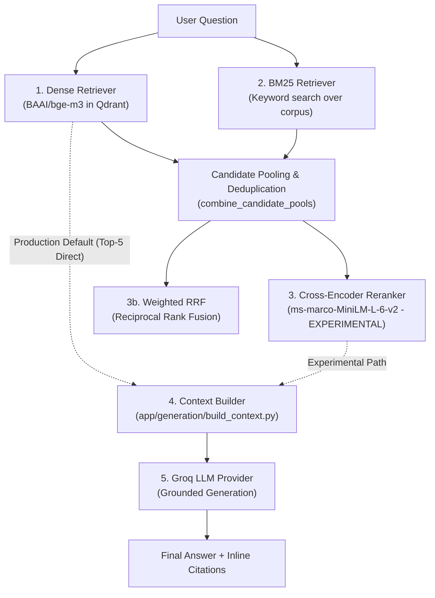

# 🔐 Cybersecurity RAG — Project Handover Document

**File:** `PROJECT_HANDOVER.md`  
**Location:** Repository Root (`C:\Users\Computer\Desktop\cybersecurity-rag\PROJECT_HANDOVER.md`)  
**Repository:** `C:\Users\Computer\Desktop\cybersecurity-rag`  
**Generated Date:** October 19, 2026  
**Primary Current Stage:** **Phase 4A: Forensic Retrieval Error Analysis**  
**Authoritative Production Baseline:** **Dense-Only Retrieval (`BAAI/bge-m3` in Qdrant)**  

---

## Table of Contents
1. [A. Project Overview](#a-project-overview)
2. [B. Corpus and Data](#b-corpus-and-data)
3. [C. Embedding Architecture](#c-embedding-architecture)
4. [D. Qdrant Vector Database](#d-qdrant-vector-database)
5. [E. Evaluation Dataset and Metrics](#e-evaluation-dataset-and-metrics)
6. [F. Chronological Record of Completed Phases](#f-chronological-record-of-completed-phases)
7. [G. Cross-Encoder Experiment and Actual Findings](#g-cross-encoder-experiment-and-actual-findings)
8. [H. Current Stage — Phase 4A: Forensic Retrieval Error Analysis](#h-current-stage--phase-4a-forensic-retrieval-error-analysis)
9. [I. Next Task Instructions for Incoming Conversation](#i-next-task-instructions-for-incoming-conversation)
10. [J. Important Project Safety & Engineering Rules](#j-important-project-safety--engineering-rules)
11. [K. Useful Commands and Environment Verification](#k-useful-commands-and-environment-verification)
12. [L. Repository State and Remaining Work](#l-repository-state-and-remaining-work)

---

## A. Project Overview

### 1. Objective and Intended Functionality
The **Cybersecurity RAG** system is an enterprise-grade, production-oriented Retrieval-Augmented Generation system designed to answer technical, compliance, and architectural cybersecurity questions with strict grounding in official **NIST (National Institute of Standards and Technology) Special Publications**.

The core objective is to eliminate hallucination in technical security domains by:
- Retrieving authoritative passages from authoritative NIST standards (e.g., SP 800-53 Rev 5, SP 800-61 Rev 2, SP 800-207, SP 800-144, SP 800-218).
- Providing exact provenance down to the publication ID, section title, and page number.
- Producing grounded answers synthesized via an LLM (Groq provider) with strict inline citations.

### 2. Architecture and Technologies
- **Operating Environment:** Windows 11, PowerShell terminal (`powershell.exe`).
- **Python Runtime:** Python 3.12 (managed via virtual environment at `.venv\`).
- **Dense Embedding Model:** `BAAI/bge-m3` (1024-dimensional dense vectors, normalized float32, cosine similarity).
- **Vector Database:** Local embedded **Qdrant** (`data/qdrant`), collection `cybersecurity_chunks_bge_m3`.
- **Lexical Search:** In-memory `BM25Okapi` via `rank_bm25` over all 13,084 chunks.
- **Fusion Engine:** Weighted Reciprocal Rank Fusion (`RRFFusion`) with configurable weights and smoothing constant $k$.
- **Reranker (Experimental):** `cross-encoder/ms-marco-MiniLM-L-6-v2` (`sentence-transformers`).
- **Evaluation Harness:** Custom multi-mode evaluator (`evaluation/evaluate_retrieval_metrics.py`) measuring Hit@1, Hit@3, Hit@5, Precision@5, Recall@5, MRR, latency, and candidate pool coverage across 35 benchmark questions.

### 3. Purpose of Major Components in Plain Language


- **Ingestion & Extraction (`app/ingestion/`):** Converts complex NIST PDF documents (multi-column text, callout boxes, tables, figures) into clean Markdown and structured JSON while preserving page dividers and section hierarchies.
- **Chunk Corpus (`data/chunks_corpus/`, `data/chunks_pilot/`):** 13,084 structure-aware chunks (200–800 tokens) tagged with semantic metadata, heading breadcrumbs, and token counts.
- **Embedding Store (`data/embeddings_bge_m3/`):** Unified persistent NumPy matrix (`embeddings.npy`) containing pre-computed vectors for all 13,084 chunks.
- **Vector Database (`data/qdrant/`):** Embedded vector storage enabling millisecond HNSW dense similarity lookups with payload filtering.
- **Retrievers (`app/retrieval/`):**
  - `dense.py`: Query embedding and cosine similarity search against Qdrant.
  - `bm25.py`: Lexical exact-term matching over tokenized chunk texts.
  - `rrf.py`: Combines multiple ranked candidate lists without requiring score normalization.
  - `reranker.py`: Deep transformer cross-encoder that jointly encodes `(query, chunk_text)` pairs to re-score candidates.
- **Evaluation Engine (`evaluation/`):** Computes objective information retrieval metrics against verified ground-truth labels.

---

## B. Corpus and Data

### 1. Verified Corpus Statistics
- **Total Chunks:** Exactly **13,084 chunks**.
- **Unique Source Publications:** Exactly **73 NIST publications**.
- **Content Type Breakdown:**
  - **Text Chunks:** 10,684 chunks (`content_type: "text"`).
  - **Table Chunks:** 1,809 chunks (`content_type: "table"`).
  - **Figure Records:** 591 chunks (`content_type: "figure"`).
- **Corpus Fingerprint:**  
  `91f3d87f4fe3ece9930cc72c9576a01dd313ef94b585b6bb1f94b1a16f61c018`
- **Chunk Naming Convention:** Canonical format `<document_id>_<type>_<index5d>`  
  *Example:* `NIST_SP_800-144_txt_00064`, `NIST_SP_800-53_tab_00120`.

### 2. Authoritative Corpus vs. Legacy Corpus
| Aspect | Authoritative Corpus | Legacy Corpus Assets |
| :--- | :--- | :--- |
| **Location** | `data/chunks_pilot/` (10 docs) & `data/chunks_corpus/` (63 docs) | `data/extraction_baseline/`, `data/extraction_pilot/`, `data/extraction_poc_*/` |
| **Parsing Strategy** | Hybrid PyMuPDF4LLM + Block-fallback with structure-aware cleaning | Naive PyMuPDF text dumping or basic sliding-window token chunking |
| **Metadata** | Full hierarchy: `document_id`, `category`, `page_start`, `page_end`, `token_count`, `section` | Flat text without citation anchors |
| **Status** | **ACTIVE & LOCKED**. Ground truth and Qdrant strictly index this corpus. | **HISTORICAL / ARCHIVAL ONLY**. Never reference in retrieval. |

### 3. Evaluation Data Files & Dependency Protection
- `data/evaluation/evaluation_questions.json`: Master question bank (40 questions, `Q1` to `Q40`).
- `data/evaluation/retrieval_ground_truth_current.json`: Baseline set (20 questions: 15 eligible, 5 ineligible).
- `data/evaluation/retrieval_ground_truth_additional_20.json`: Additional set (20 questions: all 20 eligible).
- `data/evaluation/ground_truth.json`: Legacy 5-question pilot ground truth.
- `data/evaluation/retrieval_ground_truth.json`: Legacy un-suffixed ground-truth file (deleted in working tree; replaced by `retrieval_ground_truth_current.json`).
- `*.bak` files: Safety backups of ground truth prior to audit adjustments.

> [!CAUTION]
> **Do NOT delete legacy evaluation files or `.bak` files without dependency review.** Other evaluation scripts and regression tests may check them for compatibility.

### 4. Extraction Benchmark Artifacts
- `data/extraction_benchmark_pymupdf4llm/` and reports in `reports/batch_*_cleaning_*.md` document the empirical comparison between pure PyMuPDF, OCR fallbacks, and PyMuPDF4LLM. They exist to prove extraction quality and must be preserved as audit records.

---

## C. Embedding Architecture

### 1. Verified Configuration
- **Embedding Model:** `BAAI/bge-m3` (HuggingFace Hub ID: `BAAI/bge-m3`).
- **Model Revision / Commit:** `5617a9f61b028005a4858fdac845db406aefb181`.
- **Parameter Count:** ~567 Million parameters.
- **Embedding Dimension:** **1,024**.
- **Vector Format:** Normalized float32 (`dtype: "float32"`, unit length $\|v\|_2 = 1.0$).
- **Total Vectors:** Exactly **13,084 vectors**.

### 2. Artifact Directory: `data\embeddings_bge_m3\`
- `embeddings.npy`: Binary NumPy matrix of shape `(13084, 1024)`, size **53,592,192 bytes** (51.11 MB).
  - SHA-256 Checksum: `9cf5f8d30d98c7e295f4514a0f29a3bcecb606722be2e2a2a1d1083d9e7c237e`.
- `chunk_metadata.jsonl`: 13,084 lines of JSON metadata matching row-for-row with `embeddings.npy`, size **3,610,307 bytes**.
- `manifest.json`: Verification manifest tracking batch completion (53 batches), chunk count (13,084), and corpus fingerprint.
- `checkpoints/`: 53 interim `.npz` checkpoint files generated during batch encoding.

### 3. How to Validate Existing Artifacts Without Regenerating
To verify the embeddings without re-encoding:
```powershell
python scripts/generate_full_corpus_embeddings.py --validate
```
This inspects `embeddings.npy`, verifies array shape, checks for finite values (no NaNs or Infs), verifies unit normalization, checks corpus fingerprint match, and validates 1:1 ID alignment with `chunk_metadata.jsonl`.

---

## D. Qdrant Vector Database

### 1. Verified Collection Details
- **Collection Name:** `cybersecurity_chunks_bge_m3`
- **Total Points Count:** **13,084**
- **Vector Size:** **1,024**
- **Distance Metric:** **Cosine** (`Distance.COSINE`)
- **Storage Mode:** Embedded local storage at `data\qdrant\`
- **ID Strategy:** Sequential integer indexing (`0` to `13083`), perfectly aligned with `embeddings.npy` rows.
- **Payload Schema:** Every point payload contains:
  ```json
  {
    "chunk_id": "NIST_SP_800-144_txt_00064",
    "document_id": "NIST_SP_800-144",
    "category": "cloud_application_security",
    "content_type": "text",
    "page_start": 42,
    "page_end": 42,
    "token_count": 278,
    "text": "Full text of the chunk...",
    "section": "4.2 Incident Response"
  }
  ```

### 2. Verification and Ingestion Commands
- **Non-destructive collection health check:**
  ```powershell
  python scripts/ingest_embeddings_qdrant.py --verify-only
  ```
- **Preflight dry-run check:**
  ```powershell
  python scripts/ingest_embeddings_qdrant.py --preflight
  ```
- **Interactive query search test:**
  ```powershell
  python scripts/search_qdrant.py
  ```

### 3. Concurrency & File Lock Warning
> [!WARNING]
> **CRITICAL: Only one local Qdrant client/process can access `data/qdrant` at a time.**  
> Embedded Qdrant locks its underlying database files. If two scripts or interactive Python sessions attempt to instantiate `QdrantClient(path="data/qdrant")` simultaneously, the process will crash with a lock acquisition failure or hang. Always ensure clients are closed (`client.close()`) in a `finally:` block.

---

## E. Evaluation Dataset and Metrics

### 1. The Corrected 35-Question Suite
The evaluation suite contains 35 evaluation-eligible questions split into two partitions:
- **Baseline / Development Set (15 Questions):**
  `Q1`, `Q3`, `Q4`, `Q5`, `Q7`, `Q8`, `Q9`, `Q10`, `Q11`, `Q12`, `Q13`, `Q16`, `Q17`, `Q19`, `Q20`.
  *(Note: Q2, Q6, Q14, Q15, Q18 in `retrieval_ground_truth_current.json` have `evaluation_eligible: false` because they were legacy pilot test cases excluded during full corpus expansion).*
- **Additional / Held-Out Test Set (20 Questions):**
  `Q21` through `Q40` (all 20 are active and eligible in `retrieval_ground_truth_additional_20.json`).
- **Combined Benchmark:** All 35 eligible questions (`--eval-set all`).

### 2. Metric Definitions
- **Hit@k ($k \in \{1, 3, 5\}$):** Binary indicator (1 or 0) whether at least one ground-truth relevant chunk is present within the top-$k$ retrieved chunks.
- **Precision@5:** Proportion of the top-5 retrieved chunks that are genuinely relevant ($\frac{|\text{Retrieved} \cap \text{Relevant}|}{5}$).
- **Recall@5:** Proportion of all known relevant chunks for that question retrieved in the top-5 ($\frac{|\text{Retrieved} \cap \text{Relevant}|}{|\text{Relevant}|}$).
- **MRR (Mean Reciprocal Rank):** $\frac{1}{\text{rank of first relevant chunk}}$ if found in top-$k$, else $0$.
- **Candidate Pool Coverage:** Percentage of questions where at least one ground-truth chunk is present in the initial retriever candidate pool (e.g. Top-25 or Top-50) before reranking or fusion.
- **Mean Latency:** Average query round-trip time in milliseconds.

### 3. Ground-Truth Integrity Principle
Ground-truth corrections represent fixing evaluation measurement errors (e.g., correcting an off-by-one section typo or acknowledging an identical duplicate chunk across publication versions). They do **NOT** represent retrieval algorithmic improvements. Ground-truth labels must never be modified without explicit textual evidence and a formal audit report.

---

## F. Chronological Record of Completed Phases

| Phase | Description | Key Scripts & Artifacts | Verified Empirical Evidence | Remaining Limitations |
| :---: | :--- | :--- | :--- | :--- |
| **1. Extraction & Chunking** | Built modular structure-aware extraction engine and chunker for 73 NIST publications. | `scripts/run_corpus_extraction.py`, `data/chunks_corpus/`, `data/chunks_pilot/` | 13,084 total chunks generated; 10,684 text, 1,809 table, 591 figure records. | Scanned PDFs required fallback block parser; complex split tables span chunks. |
| **2. Embedding Generation** | Batch-wise offline embedding with `BAAI/bge-m3`. | `scripts/generate_full_corpus_embeddings.py`, `data/embeddings_bge_m3/` | 13,084 float32 normalized vectors saved in `embeddings.npy` (53.59 MB); SHA-256 verified. | CPU inference requires batch checkpointing (~2-3 chunks/sec). |
| **3. Qdrant Ingestion** | Ingested vectors and rich payloads into embedded local Qdrant. | `scripts/ingest_embeddings_qdrant.py`, `data/qdrant/` | Collection `cybersecurity_chunks_bge_m3` verified with 13,084 points. | Single-process embedded access constraint. |
| **4. Dense Retrieval Baseline** | Evaluated pure dense cosine retrieval Top-5 against initial 35 questions. | `evaluation/evaluate_retrieval_metrics.py --mode dense` | Initial run: Hit@5: 65.71%, MRR: 0.4833 with 12 questions failing Hit@5. | Pure semantic search misses exact keyword codes or diffuse phrasing. |
| **5. Ground-Truth Audit (Phase 1)** | Forensically audited the 12 misses; corrected typos, added missing valid chunks (Q11, Q21, Q28, Q30, Q33, Q40). | `reports/ground_truth_correction_audit_report.md`, `retrieval_ground_truth_current.json` | Corrected Dense Baseline on 35 questions: **Hit@5 82.86%**, **MRR 0.5805** (29 hits, 6 misses). | 6 genuine misses remained: Q10, Q13, Q19, Q25, Q36, Q38. |
| **6. BM25 & Weighted RRF (Phase 2)** | Implemented in-memory BM25Okapi and Reciprocal Rank Fusion. | `app/retrieval/bm25.py`, `app/retrieval/rrf.py`, `hybrid_retrieval_tuning_diagnostic_report.md` | Equal RRF degraded Hit@5 to 71.43%. Weighted RRF ($w_d=0.8, w_b=0.2$) restored Hit@5 to 80.00% and fixed Q13 to Rank 4. | BM25 alone achieves only 48.57% Hit@5; keyword noise diluted dense ranks on held-out set. |
| **7. Cross-Encoder Reranking (Phase 3)** | Implemented `cross-encoder/ms-marco-MiniLM-L-6-v2` reranker with candidate pool deduplication & provenance. | `app/retrieval/reranker.py`, `tests/test_cross_encoder_reranker.py` | Unit tests verified: **136 passing tests in 51.7s**. Deterministic tie-breaking verified. | 7.7x to 11.5x latency increase on CPU. |
| **8. 5-Way Comparative Benchmark** | Ran unified benchmark across all 35 questions comparing Dense, BM25, RRF, Dense+Rerank, Hybrid+Rerank. | `evaluation/evaluate_retrieval_metrics.py --mode compare`, `cross_encoder_reranking_evaluation_report.md` | Quantitative proof that Dense Baseline remains superior (82.86% Hit@5 vs 77.14% Rerank). Rescued Q13 & Q36. | Reranker remains experimental due to held-out degradation (85% $\to$ 75%). |

---

## G. Cross-Encoder Experiment and Actual Findings

### 1. Experimental Setup
- **Model:** `cross-encoder/ms-marco-MiniLM-L-6-v2` (22.7M parameters).
- **Cache Verification:** Weights were already cached locally in the HuggingFace cache directory (~80 MB); zero external network downloads were performed.
- **Candidate Pool Generation:**
  - `Dense + Reranker`: Dense Top-25 candidates $\to$ Cross-Encoder re-score $\to$ Top-5.
  - `Hybrid + Reranker`: Union of Dense Top-25 + BM25 Top-25 (deduplicated by `chunk_id`, preserving provenance) $\to$ Cross-Encoder re-score $\to$ Top-5.

### 2. Five-Way Empirical Benchmark Results (All 35 Questions)
From `cross_encoder_reranking_evaluation_report.md`:

| Strategy | Candidate Coverage | Hit@1 | Hit@3 | Hit@5 | Precision@5 | Recall@5 | MRR | Mean Latency |
| :--- | :---: | :---: | :---: | :---: | :---: | :---: | :---: | :---: |
| **Dense Baseline** (`BGE-M3` Top-5) | 82.86% | 40.00% | **74.29%** | **82.86%** | **20.00%** | **60.24%** | **0.5805** | **610.5 ms** |
| **BM25 Alone** (Top-5) | 48.57% | 22.86% | 34.29% | 48.57% | 10.29% | 36.19% | 0.3076 | 150.5 ms |
| **Weighted RRF** ($w=0.8:0.2, k=20$) | 94.29% | 37.14% | 68.57% | 80.00% | 18.86% | 57.62% | 0.5400 | 761.2 ms |
| **Dense + Reranker** (Dense 25 $\to$ Top-5) | 91.43% | **45.71%** | 68.57% | 77.14% | 17.71% | 56.19% | 0.5771 | 4,703.2 ms |
| **Hybrid + Reranker** (D25+B25 $\to$ Top-5) | 94.29% | 42.86% | 62.86% | 77.14% | 17.14% | 55.48% | 0.5581 | 7,020.6 ms |

### 3. Generalization Performance: Dev vs. Held-Out Test Set
- **Development Set (15 Questions: Q1–Q15):**
  - Dense Baseline: Hit@5 = **80.00%**, MRR = **0.6333**
  - Dense + Reranker: Hit@5 = **80.00%**, MRR = **0.5833**
  - Hybrid + Reranker: Hit@5 = **80.00%**, MRR = **0.5389**
- **Held-Out Test Set (20 Questions: Q21–Q40):**
  - Dense Baseline: Hit@5 = **85.00%**, MRR = **0.5408**
  - Dense + Reranker: Hit@5 = **75.00%** (-10.00%), MRR = **0.5725**
  - Hybrid + Reranker: Hit@5 = **75.00%** (-10.00%), MRR = **0.5725**

### 4. Key Verified Takeaways
1. **Dense-only BGE-M3 remains the authoritative production baseline.** It delivers the highest Hit@5 (82.86%), highest Recall@5 (60.24%), best generalization on held-out data (85.00%), and 7.7x faster response times (610 ms vs 4,703 ms).
2. **The Cross-Encoder Reranker MUST remain experimental.** It failed the formal promotion gate (it regressed by 10 percentage points on the held-out test set).
3. **BM25 does NOT add value before reranking.** `Hybrid + Reranker` had lower Hit@1 (42.86% vs 45.71%) and lower MRR (0.5581 vs 0.5771) than `Dense + Reranker` while adding 2.3 seconds of CPU overhead.
4. **Rescued Questions:** Reranking successfully promoted **Q13** (Dense Rank 7 $\to$ Rerank Rank 2) and **Q36** (Dense Rank 12 $\to$ Rerank Rank 2).
5. **Regressed Questions:** Reranking dropped 4 previously retrieved hits below Rank 5 (**Q8, Q21, Q30, Q33**).
6. **Repository Verification:** Full test suite verified: **136 tests passing in 51.7 seconds**.

---

## H. Current Stage — Phase 4A: Forensic Retrieval Error Analysis

> [!IMPORTANT]
> **THIS IS THE PRIMARY TASK FOR THE INCOMING CONVERSATION.**  
> Do **NOT** implement another retrieval model, fusion method, or architecture until Phase 4A error analysis is complete, written, and reviewed.

Phase 4A requires a deep forensic investigation into **8 specific questions**:

### 1. The Four Unresolved Retrieval Misses (Failed Across Retrievers)
| Question ID | Actual Question Text (from `evaluation_questions.json`) | Target Publication | Expected Ground-Truth Chunks | Observed Ranks |
| :---: | :--- | :--- | :--- | :--- |
| **Q10** | *"What are the security implications of storing organizational data in the public cloud?"* | NIST SP 800-144 | `NIST_SP_800-144_txt_00080`<br>`NIST_SP_800-144_txt_00081`<br>`NIST_SP_800-144_txt_00082` | Dense: **Rank 18**<br>BM25: >25<br>Rerank: **Rank 17** |
| **Q19** | *"What challenges can organizations face when monitoring security in public cloud environments?"* | NIST SP 800-144 / SP 800-146 | `NIST_SP_800-144_txt_00065`<br>`NIST_SP_800-144_txt_00087`<br>`NIST_SP_800-146_txt_00134` | Dense: **Rank 30**<br>BM25: >25<br>Rerank: Outside pool (>25) |
| **Q25** | *"What are the core practice groups that comprise the Secure Software Development Framework (SSDF)?"* | NIST SP 800-218 | `NIST_SP_800-218_txt_00029` | Dense: **Rank 44**<br>BM25: **Rank 24**<br>Rerank: **Rank 28** (Score -4.81) |
| **Q38** | *"What are the five essential characteristics of cloud computing defined by NIST SP 800-145?"* | NIST SP 800-145 | `NIST_SP_800-145_txt_00012` | Dense: **Rank 42**<br>BM25: >25<br>Rerank: Outside pool (>25) |

### 2. The Four Cross-Encoder Regressions (Dense Hits Degraded by Reranker)
| Question ID | Actual Question Text (from `evaluation_questions.json`) | Target Publication | Expected Ground-Truth Chunks | Dense Base Rank | Reranked Rank |
| :---: | :--- | :--- | :--- | :---: | :---: |
| **Q8** | *"How does loss of control affect security in public cloud computing?"* | NIST SP 800-144 / SP 800-146 | `NIST_SP_800-144_txt_00038`<br>`NIST_SP_800-144_txt_00062`<br>`NIST_SP_800-146_txt_00080` | **Rank 4 (HIT)** | **Rank 6 (MISS)**<br>*(Missed by 0.04 score delta)* |
| **Q21** | *"What are the core phases of the incident response life cycle defined in NIST incident handling guidance?"* | NIST SP 800-61 / SP 800-61r3 | `NIST_SP_800-61_txt_00029`<br>`NIST.SP.800-61r3_txt_00029` | **Rank 4 (HIT)** | **Rank 10 (MISS)** |
| **Q30** | *"What are the fundamental attribute types evaluated in an Attribute Based Access Control (ABAC) enterprise system?"* | NIST SP 800-162 | `NIST_SP_800-162_txt_00007`<br>`NIST_SP_800-162_txt_00044` | **Rank 4 (HIT)** | **Rank 14 (MISS)** |
| **Q33** | *"What security controls and client software configurations are required to protect remote access in enterprise telework?"* | NIST SP 800-46 | `NIST_SP_800-46_txt_00030`<br>`NIST_SP_800-46_txt_00076` | **Rank 2 (HIT)** | **Rank 8 (MISS)** |

*(Note: In the prior report `cross_encoder_reranking_evaluation_report.md`, descriptive topic labels in Section 7 contained illustrative placeholders like "Bluetooth security modes" for Q8. The table above reflects the **verified authoritative question texts and ground-truth chunks** from `data/evaluation/evaluation_questions.json`).*

### 3. Forensic Inspection Requirements for Phase 4A
For each of these eight questions, the incoming conversation must inspect:
1. Exact question text and ground-truth relevant chunk IDs.
2. Dense retrieval cosine scores and candidate ranks.
3. BM25 ranks and BM25 scores (if retrieved in candidate window).
4. Cross-Encoder scores and ranks.
5. The actual text content, publication, section, and chunk type of:
   - The top 5 retrieved chunks that outscored the true relevant chunk.
   - The expected relevant chunk(s).
6. Root cause classification:
   - **Candidate Recall / Truncation:** Target chunk was outside the top-25 candidate cutoff (e.g. Q19 rank 30, Q38 rank 42).
   - **Semantic / Scoring Mismatch:** Target chunk was in pool but outscored by generic text (e.g. Q8, Q25).
   - **Query Wording Divergence:** Disconnect between user terminology and formal NIST publication vocabulary (e.g. Q10 *"storing organizational data"* vs Section 5.1 *"Data Storage and Protection"*).
   - **Structural / Boundary Artifacts:** Splitting definition across table/text or introductory headers.
   - **Secondary Citations:** Quoted definitions in other publications outscoring source document (e.g. SP 800-146 quoting SP 800-145).
7. Distinction between **Observed Evidence** (proven by chunk text and rank numbers) vs. **Hypotheses** (inferred explanations).
8. Target Output: Write findings into `reports/phase4_error_analysis_report.md` (or artifact `phase4_error_analysis_report.md`).

---

## I. Next Task Instructions for Incoming Conversation

When starting the next Antigravity session, execute the following step-by-step checklist:

- [ ] **Step 1: Read `PROJECT_HANDOVER.md`** first to load full verified context.
- [ ] **Step 2: Check Git Status** using `git status -s` to confirm repository cleanliness.
- [ ] **Step 3: Inspect Prior Reports:**
  - `cross_encoder_reranking_evaluation_report.md` (in brain artifact dir)
  - `reports/audit_35_question_retrieval_evaluation.md`
  - `reports/ground_truth_correction_audit_report.md`
- [ ] **Step 4: Conduct Chunk-Level Forensic Inspection of the 8 Questions:**
  - Unresolved: `Q10`, `Q19`, `Q25`, `Q38`
  - Regressions: `Q8`, `Q21`, `Q30`, `Q33`
  - Load chunk text from Qdrant payloads or `data/chunks_corpus/` / `data/chunks_pilot/`.
- [ ] **Step 5: Identify Recurring Failure Patterns:** Categorize failures with evidence (candidate truncation, vocabulary mismatch, web-domain cross-encoder inductive bias).
- [ ] **Step 6: Propose $\le$ 3 Targeted Experiments:** Define focused, testable interventions (e.g., candidate pool depth expansion from 25 to 50, metadata-assisted filtering, domain-adapted reranking) with measurable success criteria.
- [ ] **Step 7: Produce `phase4_error_analysis_report.md`:** Write the comprehensive analysis report.
- [ ] **Step 8: Present Executive Summary to User:** Summarize conclusions and recommend the single best next experiment.

> [!TIP]
> **Do not immediately rerun the full 35-question evaluation.** Reuse existing benchmark data and focus on forensic inspection of the 8 target questions.

---

## J. Important Project Safety & Engineering Rules

1. **Do not regenerate embeddings unnecessarily:** The 13,084 BGE-M3 vectors in `data/embeddings_bge_m3/` are finalized, normalized, and verified.
2. **Do not re-ingest Qdrant unnecessarily:** The collection `cybersecurity_chunks_bge_m3` in `data/qdrant` is complete (13,084 points) and verified.
3. **Do not delete existing corpus, artifacts, ground truth, backups, or reports:** Always perform a dependency review before modifying or retiring any asset.
4. **Do not modify ground-truth labels just to improve scores:** Ground-truth edits require strict textual evidence verified through an audit.
5. **Do not change the dense-only production default:** Dense BGE-M3 remains the production retriever unless an experimental technique demonstrably outperforms it on the held-out evaluation set.
6. **Zero Hallucination on Metrics:** Never claim test passes, benchmark scores, or command outputs without verifying them against actual tool execution results.
7. **No Git Commit or Push:** Do not commit or push changes unless explicitly instructed by the user.
8. **No UI or Scope Creep:** Do not build web interfaces, REST APIs, or unrelated features. Focus strictly on RAG retrieval accuracy and error analysis.
9. **Single-Process Qdrant Access:** Avoid concurrent processes accessing `data/qdrant`.
10. **Clear Technical Communication:** Always cite exact file paths using `file:///` markdown links and provide copyable PowerShell commands.

---

## K. Useful Commands and Environment Verification

### 1. Environment Activation
```powershell
# Activate the project virtual environment
(& .venv\Scripts\Activate.ps1)
```

### 2. Git Status Check
```powershell
git status -s
```

### 3. Run Unit Tests
```powershell
# Run the complete test suite (136 tests)
python -m unittest discover tests

# Run only Cross-Encoder and candidate pool tests
python -m unittest tests/test_cross_encoder_reranker.py

# Run only RRF hybrid retrieval tests
python -m unittest tests/test_rrf_hybrid_retrieval.py
```

### 4. Validate Embeddings and Qdrant (Non-Destructive)
```powershell
# Validate embedding matrix and manifest integrity without re-encoding
python scripts/generate_full_corpus_embeddings.py --validate

# Verify Qdrant collection point count and parameters
python scripts/ingest_embeddings_qdrant.py --verify-only
```

### 5. Run Retrieval Evaluation
```powershell
# Run Dense Baseline (Production Default) on all 35 questions
python evaluation/evaluate_retrieval_metrics.py --mode dense --eval-set all

# Run 5-Way Comparative Benchmark on all 35 questions
python evaluation/evaluate_retrieval_metrics.py --mode compare --eval-set all

# Run evaluation on baseline dev set only (15 questions)
python evaluation/evaluate_retrieval_metrics.py --mode dense --eval-set baseline

# Run evaluation on held-out test set only (20 questions)
python evaluation/evaluate_retrieval_metrics.py --mode dense --eval-set additional
```

---

## L. Repository State and Remaining Work

### 1. Git State (Verified)
- **Current Branch:** `main` (up to date with `origin/main`).
- **Latest Commit:** `389bb07 Add structure-aware cleaning and chunking pipelines`
- **Modified Files (Unstaged):**
  - `app/core/models.py`: Added dictionary interface methods to `RetrievedChunk`.
  - `app/retrieval/bm25.py`: In-memory BM25Okapi retriever.
  - `app/retrieval/reranker.py`: `CrossEncoderReranker` and `combine_candidate_pools()`.
  - `app/retrieval/rrf.py`: `RRFFusion` with weighted lists.
  - `data/evaluation/evaluation_questions.json`: 40 question definitions.
  - `evaluation/evaluate_retrieval_metrics.py`: Multi-mode comparative evaluator.
  - `evaluation/evaluate_reranked_retrieval.py`, `evaluation/evaluate_rrf.py`, `evaluation/run_full_evaluation.py`.
  - `scripts/search_qdrant.py`: Interactive search script.
- **Deleted in Working Tree:**
  - `data/evaluation/retrieval_ground_truth.json` (retired in favor of `retrieval_ground_truth_current.json`).
- **Untracked Additions:**
  - `PROJECT_HANDOVER.md` (this handover document).
  - Ground-truth files: `data/evaluation/retrieval_ground_truth_current.json`, `retrieval_ground_truth_additional_20.json` (and backups).
  - Test suites: `tests/test_cross_encoder_reranker.py`, `tests/test_rrf_hybrid_retrieval.py`.
  - Pipeline & Ingestion scripts: `scripts/generate_full_corpus_embeddings.py`, `scripts/ingest_embeddings_qdrant.py`.
  - Audit and Benchmark reports in `reports/`.

### 2. Completed vs. Experimental vs. Pending
- **COMPLETED:**
  - Full corpus extraction, cleaning, and structure-aware chunking (13,084 chunks).
  - Full corpus dense embeddings (`BAAI/bge-m3`, 1024-dim, 13,084 vectors).
  - Qdrant ingestion and point verification (13,084 points).
  - Dense baseline evaluation and ground-truth reconciliation (Phase 1).
  - BM25 and weighted RRF hybrid retrieval evaluation (Phase 2).
  - Cross-Encoder reranker implementation and 5-way benchmark (Phase 3).
- **EXPERIMENTAL:**
  - `CrossEncoderReranker` (`app/retrieval/reranker.py`): Operational and tested, but held as experimental due to held-out test regression.
  - `RRFFusion` (`app/retrieval/rrf.py`): Operational and tested, but held as experimental.
- **PENDING / NEXT UP:**
  - **Phase 4A:** Forensic retrieval error analysis on 8 target questions (`Q10, Q19, Q25, Q38, Q8, Q21, Q30, Q33`) $\to$ Produce `phase4_error_analysis_report.md`.
  - **Phase 4B:** Targeted retrieval experiments based on error analysis findings.
  - **Phase 5:** End-to-end Generation Pipeline evaluation (Groq LLM context injection, faithfulness, and citation verification).

### 3. Exact Next Action for Incoming Conversation
Open `PROJECT_HANDOVER.md`, inspect the 8 target questions listed in Section H, inspect the underlying chunk texts and retrieval scores, and begin drafting the Phase 4A error analysis report `phase4_error_analysis_report.md`.
