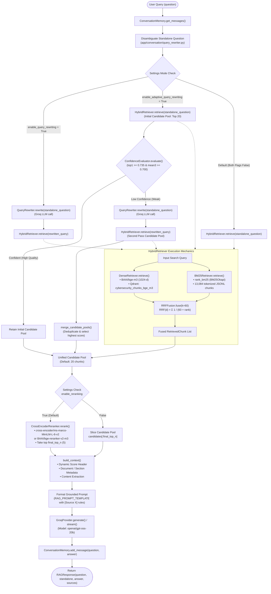

# Current Cybersecurity RAG Architecture

**Repository:** `C:\Users\Computer\Desktop\cybersecurity-rag`  
**Authoritative Documentation Date:** October 2026  
**Document Version:** 1.0 (Production Architecture Audit)

---

## 1. Project Overview

The **Cybersecurity RAG** system is a specialized, production-oriented Retrieval-Augmented Generation (RAG) platform designed to deliver grounded, audit-compliant technical answers from authoritative cybersecurity standards and frameworks.

### The Problem It Solves
1. **High Hallucination Risk in Cybersecurity:** General-purpose Large Language Models (LLMs) frequently hallucinate compliance requirements, misquote security control numbers, invent non-existent sub-controls, or conflate distinct security frameworks (e.g., confusing NIST SP 800-53 with ISO/IEC 27001).
2. **Dense Technical Jargon & Structural Complexity:** Authoritative publications from the National Institute of Standards and Technology (NIST) feature complex layout hierarchies, dense tables, cross-referenced appendices, and formal definitions. Standard naive retrieval pipelines struggle to maintain contextual integrity across split chunks.
3. **Vocabulary Mismatch Between User Queries and Formal Standards:** Security practitioners often query systems using operational vernacular (e.g., *"How do I track what happened in my AWS account?"*), whereas standards define controls using formal terminology (e.g., *"AU-2 Event Logging"*, *"multi-tenant hypervisor visibility barriers"*). Pure dense search or pure keyword search independently fail to capture both semantic intent and precise terminology.

To solve these challenges, the repository implements a modular, hybrid retrieval architecture combining dense vector embeddings, lexical BM25 matching, reciprocal rank fusion (RRF), heuristic retrieval confidence gating, adaptive query optimization, optional cross-encoder reranking, and strictly grounded generation.

---

## 2. Current Technology Stack

| Component | Implemented Technology / Model | Role in System | Justification |
|---|---|---|---|
| **Programming Language & Core Runtime** | Python 3.12, `dataclasses`, `pydantic` | Execution runtime & domain data modeling | Type safety, clean dataclass definitions (`RetrievedChunk`, `ChunkMetadata`, `RAGResponse`). |
| **Document Ingestion & Parsing** | `PyMuPDF` (`fitz`), `PyMuPDF4LLM` | PDF extraction, table detection, structured markdown | Preserves structural tables and headers from complex NIST PDFs without losing tabular context. |
| **Embedding Model** | `BAAI/bge-m3` (1024-dimensional) | Semantic dense vector representation | Multi-lingual, 1024-dim dense representation with strong performance across long technical contexts. |
| **Vector Database** | Embedded `Qdrant` (Local on-disk storage) | Vector indexing & cosine similarity search | Runs embedded directly against the filesystem (`data/qdrant`), avoiding client-server network overhead. |
| **Lexical Search Engine** | `rank_bm25` (`BM25Okapi`) | Exact keyword and alphanumeric identifier matching | Captures exact technical codes (e.g., `AC-6`, `SP 800-145`, `PO.1.1`) that semantic models can overlook. |
| **Rank Fusion Algorithm** | Reciprocal Rank Fusion (`RRFFusion`, $k=60$) | Rank-based combination of dense and keyword candidate lists | Combines disparate score distributions (cosine $[0, 1]$ vs. unbounded BM25) without requiring ad-hoc score scaling. |
| **Confidence Gate** | `ConfidenceEvaluator` (Rule-based heuristics) | Decides whether initial retrieval is sufficiently confident | Avoids unnecessary LLM query rewrite calls by evaluating dense score magnitude ($0.735$) and top-3 peakedness ($0.700$). |
| **Query Rewriter** | `QueryRewriter` via Groq Cloud API (`qwen/qwen3.8-27b`) | Expands operational queries into formal standards terminology | Preserves formal entities while enriching search queries with domain synonyms. |
| **Reranker (Optional)** | `CrossEncoderReranker` (`BAAI/bge-reranker-v2-m3` or `cross-encoder/ms-marco-MiniLM-L-6-v2`) | Full cross-attention query-document scoring | High-precision candidate re-scoring; kept optional due to high CPU latency. |
| **Context Formatter** | `build_context` (`app/generation/build_context.py`) | Compiles retrieved chunks into numbered source blocks | Formats structured text blocks with source metadata and stage-specific relevance scores. |
| **LLM Answer Generator** | `GroqProvider` (`groq` Python SDK, `openai/gpt-oss-20b`) | Grounded answer generation and streaming | Low-latency inference enforcing strict citation rules (`[Source X]`). |
| **Evaluation Framework** | Custom benchmark harness (`evaluation/evaluate_retrieval_metrics.py`) | Measures Hit@K, MRR, Recall@K against 35 ground-truth questions | Standardized, reproducible retrieval metrics against curated NIST ground-truth sets. |

---

## 3. Complete Current Architecture Diagram

The flowchart below represents the actual implemented control flow within [`RAGEngine`](file:///C:/Users/Computer/Desktop/cybersecurity-rag/app/pipeline/engine.py#L63). Conditional branches (Always-On Rewriting, Adaptive Rewriting, and Optional Reranking) reflect the actual execution logic:



---

## 4. Document Ingestion and Indexing

### Supported Formats & Source Documents
The system processes authoritative publications in Portable Document Format (`.pdf`), located under [`documents/`](file:///C:/Users/Computer/Desktop/cybersecurity-rag/documents). The documents represent 68+ NIST Special Publications organized across 10 security disciplines:
1. `ai_security` (e.g., NIST AI 100-1)
2. `cloud_application_security` (e.g., NIST SP 800-144, SP 800-145, SP 800-146)
3. `cryptography_security` (e.g., NIST SP 800-57, SP 800-175B)
4. `identity_access` (e.g., NIST SP 800-63-3)
5. `incident_response` (e.g., NIST SP 800-61r2, SP 800-61r3)
6. `risk_management` (e.g., NIST SP 800-30, SP 800-37, SP 800-39)
7. `supply_chain_security` (e.g., NIST SP 800-161r1)
8. `threats_malware` (e.g., NIST SP 800-83, SP 800-150)
9. `vulnerability_management` (e.g., NIST SP 800-40, SP 800-218 SSDF)
10. `zero_trust_network_security` (e.g., NIST SP 800-207)

### Parsing & Ingestion Pipeline
- **Extraction Engine ([`app/ingestion/extract_text.py`](file:///C:/Users/Computer/Desktop/cybersecurity-rag/app/ingestion/extract_text.py)):** Uses `PyMuPDF4LLM` with an automated fallback to standard block-level `PyMuPDF` (`fitz`). Extracted text preserves Markdown headers (`#`, `##`, `###`) and pipe-separated ASCII tables.
- **Cleaning & Normalization ([`app/ingestion/clean_text.py`](file:///C:/Users/Computer/Desktop/cybersecurity-rag/app/ingestion/clean_text.py)):** Removes repeated running headers/footers, strips page numbers, unifies unicode quotation marks, and normalizes hyphens.
- **Structure-Aware Chunking ([`app/ingestion/chunk_documents.py`](file:///C:/Users/Computer/Desktop/cybersecurity-rag/app/ingestion/chunk_documents.py)):** Tokenizes cleaned Markdown files using sliding window boundaries (nominal size: ~300–500 tokens, 10% overlap), respecting markdown section header boundaries.

### Chunk Domain Model & Metadata
Every chunk is persisted as a JSONL entry conforming to [`RetrievedChunk`](file:///C:/Users/Computer/Desktop/cybersecurity-rag/app/core/models.py#L71) and [`ChunkMetadata`](file:///C:/Users/Computer/Desktop/cybersecurity-rag/app/core/models.py#L12):
```json
{
  "chunk_id": "NIST_SP_800-144_txt_00080",
  "text": "Storage of organizational data in a public cloud environment requires careful evaluation...",
  "metadata": {
    "document_id": "NIST_SP_800-144",
    "category": "cloud_application_security",
    "source_file": "NIST_SP_800-144.pdf",
    "section": "Section 5.1 Data Storage and Protection",
    "token_count": 342,
    "extra": {}
  }
}
```

### Verified Corpus Size & Database Parameters
- **Corpus Chunk Count:** **13,084 total chunks** across `chunks_pilot` and `chunks_corpus`.
- **Vector Database:** Local embedded `Qdrant` instance at `data/qdrant`.
- **Vector Collection Name:** `cybersecurity_chunks_bge_m3`.
- **Vector Dimensionality:** **1,024 dimensions** (`BAAI/bge-m3`).
- **Distance Metric:** Cosine similarity.
- **BM25 Inverted Index:** 13,084 tokenized documents built in-memory via `BM25Okapi` over identical chunk text.

---

## 5. Query-Time Retrieval Pipeline

### Execution Order
When an end-user submits a question to `RAGEngine.query(question)` or `RAGEngine.stream(question)`:

1. **Step 1: History Retrieval & Query Disambiguation**
   - **Input:** Raw user string (`question`), multi-turn memory.
   - **Processing:** Checks `ConversationMemory`. If previous turns exist, invokes [`rewrite_question()`](file:///C:/Users/Computer/Desktop/cybersecurity-rag/app/conversation/query_rewriter.py) to resolve pronouns and implicit references into a self-contained question.
   - **Output:** `standalone_question: str`.

2. **Step 2: Candidate Retrieval & Rewriter Gating**
   - **Input:** `standalone_question`.
   - **Processing:** Checks settings flags:
     - If `enable_query_rewriting=True`: Rewrites upfront using `QueryRewriter`.
     - If `enable_adaptive_query_rewriting=True`: Executes initial retrieval pass, runs `ConfidenceEvaluator.evaluate()`. If low confidence, calls `QueryRewriter.rewrite()` and executes second retrieval pass, merging candidate pools with `merge_candidate_pools()`.
     - Default (`both flags False`): Executes single retrieval pass using `standalone_question`.
   - **Output:** `candidates: List[RetrievedChunk]`, `search_query: str`.

3. **Step 3: Underlying Hybrid Retrieval Mechanics**
   - **Dense Vector Search ([`DenseRetriever.retrieve`](file:///C:/Users/Computer/Desktop/cybersecurity-rag/app/retrieval/dense.py#L71)):** Embeds `search_query` into a 1024-dim normalized vector via `BAAI/bge-m3`, executes `query_points` on Qdrant, returns top 20 chunks with `dense_score` in $[0.0, 1.0]$.
   - **Lexical Search ([`BM25Retriever.retrieve`](file:///C:/Users/Computer/Desktop/cybersecurity-rag/app/retrieval/bm25.py#L188)):** Tokenizes `search_query` via regex `\b[a-zA-Z0-9]+\b`, scores against the 13,084 chunks using `BM25Okapi`, returns top 20 chunks with unbounded `bm25_score`.
   - **Reciprocal Rank Fusion ([`RRFFusion.fuse`](file:///C:/Users/Computer/Desktop/cybersecurity-rag/app/retrieval/rrf.py#L49)):** Combines ranked lists using RRF constant $k=60$:
     $$\text{RRF Score}(d) = \sum_{m} \frac{1.0}{60 + \text{rank}_m(d)}$$
   - **Output:** Fused top-20 `RetrievedChunk` objects sorted descending by `rrf_score`.

### Why Combine Dense Search and BM25 with RRF?
- **Dense Vector Retrieval:** Captures broad conceptual semantics, synonyms, and paraphrased intent, but can lose sensitivity to exact compliance control numbers or alphanumeric tokens (e.g., confusing `SP 800-144` with `SP 800-146`).
- **BM25 Lexical Retrieval:** Excellently matches exact terms, publication identifiers, and specific control titles, but fails when user terminology diverges from publication phrasing.
- **RRF Advantage:** Because cosine similarities and BM25 scores inhabit radically incompatible mathematical scales, naive linear combination requires complex score calibration. RRF bypasses score calibration by fusing rank positions, naturally boosting chunks retrieved near the top of both lists.

---

## 6. Confidence Evaluation and Adaptive Rewriting

### How Retrieval Confidence is Evaluated
Retrieval confidence is evaluated by [`ConfidenceEvaluator`](file:///C:/Users/Computer/Desktop/cybersecurity-rag/app/retrieval/confidence.py#L82) without requiring additional external LLM calls:
1. **Dense Score Extraction:** Inspects candidate chunks and extracts valid dense cosine similarity scores in $[0.0, 1.0]$ using [`extract_dense_score()`](file:///C:/Users/Computer/Desktop/cybersecurity-rag/app/retrieval/confidence.py#L23). RRF scores ($\le 0.035$), BM25 scores ($>1.0$), and reranker logits are explicitly excluded.
2. **Safe Fallback:** If fewer than 3 candidates possess valid dense scores, the system safely triggers an explicit fallback: `is_confident=False`, `top1_score=None`, `reason="missing_or_invalid_scores"`.
3. **Threshold Gating:** If $\ge 3$ valid scores exist:
   - `top1_score`: The highest dense similarity score among candidates.
   - `mean_top3_score`: The arithmetic mean of the top 3 dense scores.
   - **Decision Rule:**
     $$\text{is\_confident} = (\text{top1\_score} \ge 0.735) \land (\text{mean\_top3\_score} \ge 0.700)$$

### Trigger Condition & Second Retrieval Pass
- When `is_confident` is `False`, [`RAGEngine`](file:///C:/Users/Computer/Desktop/cybersecurity-rag/app/pipeline/engine.py#L182) initiates adaptive rewriting:
  1. Calls `QueryRewriter.rewrite(standalone_question)`.
  2. If the rewriter returns an expanded query, executes a second retrieval pass.
  3. Merges initial and rewritten candidate pools using [`merge_candidate_pools()`](file:///C:/Users/Computer/Desktop/cybersecurity-rag/app/retrieval/confidence.py#L190).
- **Default Status:** Adaptive rewriting is **disabled by default** (`enable_adaptive_query_rewriting: False`). Always-on rewriting is also **disabled by default** (`enable_query_rewriting: False`).

---

## 7. Candidate Merging and Reranking

### Candidate Pool Merging (`merge_candidate_pools`)
When combining initial candidates and second-pass rewritten candidates:
1. **Deduplication:** Uses chunk IDs as keys in a hash map.
2. **Metric Tier Comparison:** Compares candidates using metric tiers:
   - Tier 3: `rrf_score` (hybrid results)
   - Tier 2: `dense_score` (cosine similarity)
   - Tier 1: `bm25_score`
   - Tier 0: Generic `score`
   If duplicate chunk IDs exist, the chunk with the higher score within the matching tier is retained.
3. **Pool Sorting:** Sorts hybrid pools by `rrf_score` descending, and pure dense pools by `dense_score` descending.

### Cross-Encoder Reranking Status & Latency Profile
- **Status:** Implemented in [`CrossEncoderReranker`](file:///C:/Users/Computer/Desktop/cybersecurity-rag/app/retrieval/reranker.py#L17). Supported models include `BAAI/bge-reranker-v2-m3` and `cross-encoder/ms-marco-MiniLM-L-6-v2`.
- **Configurability:** Reranking is configurable via `enable_reranking` in [`Settings`](file:///C:/Users/Computer/Desktop/cybersecurity-rag/app/core/config.py#L82) and [`RAGEngine`](file:///C:/Users/Computer/Desktop/cybersecurity-rag/app/pipeline/engine.py#L115).
- **Default Setting:** `enable_reranking = True` (matches initial production default).
- **Hardware/Latency Observation:** On standard CPU runtimes, cross-encoder inference across 20 candidate chunks takes **84 to 145 seconds per query** for `BAAI/bge-reranker-v2-m3` (compared to ~5ms for RRF). Setting `enable_reranking=False` completely bypasses this step and slices the top candidates directly in ~0.01ms.

---

## 8. Context Building and Answer Generation

### Context Builder ([`app/generation/build_context.py`](file:///C:/Users/Computer/Desktop/cybersecurity-rag/app/generation/build_context.py))
Retrieved candidate chunks are formatted into numbered blocks for prompt inclusion. The score header dynamically adapts to the active pipeline stage:
```text
SOURCE 1

Document: NIST_SP_800-144
Source File: NIST_SP_800-144.pdf
Section: Section 5.1 Data Storage and Protection
RRF Score: 0.032522

Content:
Storage of organizational data in a public cloud environment requires careful evaluation...
```
- If reranked: displays `Reranker Score: {score:.4f}`
- If hybrid: displays `RRF Score: {score:.6f}`
- If dense-only: displays `Dense Score: {score:.4f}`
- If BM25-only: displays `BM25 Score: {score:.4f}`

### Answer Generation ([`app/generation/providers/groq_provider.py`](file:///C:/Users/Computer/Desktop/cybersecurity-rag/app/generation/providers/groq_provider.py))
- **Prompt Template:** Formatted using `RAG_PROMPT_TEMPLATE` in [`app/pipeline/engine.py`](file:///C:/Users/Computer/Desktop/cybersecurity-rag/app/pipeline/engine.py#L22).
- **Grounded Citation Enforcement:** Enforces 13 strict behavioral rules:
  1. Use ONLY information directly supported by retrieved context.
  2. Never invent facts or extrapolate beyond available context.
  3. If context is insufficient, explicitly state that context is insufficient.
  4. Every factual claim must include an inline citation: `[Source X]`.
- **Inference Client:** Invokes the Groq Cloud API using `temperature=0.0` and `max_tokens=8192` with streaming or non-streaming execution.

---

## 9. Current Evaluation Results

### Historical Dense Retrieval Baseline (35 Questions)
The following metrics represent the verified historical baseline of pure dense retrieval (`BAAI/bge-m3` on Qdrant) across the 35 ground-truth evaluation questions:

| Metric | Score | Notes |
|---|---|---|
| **Hit@1** | **40.00%** | Expected chunk ranked #1 in 14 of 35 questions |
| **Hit@3** | **74.29%** | Expected chunk retrieved in top 3 in 26 of 35 questions |
| **Hit@5** | **82.86%** | Expected chunk retrieved in top 5 in 29 of 35 questions |
| **Hit@10** | **85.71%** | Expected chunk retrieved in top 10 in 30 of 35 questions |
| **Hit@20** | **91.43%** | Expected chunk retrieved in top 20 in 32 of 35 questions |
| **MRR** | **0.5885** | Mean Reciprocal Rank across all 35 queries |
| **Recall@5** | **60.24%** | Proportion of all relevant chunks retrieved in top 5 |

*(Note: These figures represent dense retrieval evaluation against ground-truth labels and do not constitute an assertion of end-to-end LLM answer generation accuracy).*

### Focused Diagnostic Results: Q10, Q13, Q19
Tested across the newly integrated pipeline stages (`reports/evaluation_q10_q13_q19_summary.json`):

| Question ID | Configuration | Hit@5 | Hit@20 | Retrieved in Top 5 / Total Expected | Observed Latency |
|---|---|:---:|:---:|:---:|---:|
| **Q10** | Dense (`BGE-M3`) | ❌ False | ✅ True | 0 / 3 (2 found in top 20) | 39,069.9 ms* |
| **Q10** | BM25 (`Okapi`) | ❌ False | ❌ False | 0 / 3 | 13,587.0 ms* |
| **Q10** | Hybrid (`RRF`) | ❌ False | ❌ False | 0 / 3 (Displaced to ranks 26 & 29) | 52,657.2 ms |
| **Q13** | Dense (`BGE-M3`) | ❌ False | ✅ True | 0 / 3 (Found at rank 12) | 4,648.6 ms |
| **Q13** | BM25 (`Okapi`) | ❌ False | ✅ True | 0 / 3 (Found at rank 8) | 739.2 ms |
| **Q13** | **Hybrid (`RRF`)** | **✅ True** | **✅ True** | **1 / 3 (`txt_00064` promoted to #3)** | **5,390.5 ms** |
| **Q13** | **Hybrid + BGE Reranker** | **✅ True** | **✅ True** | **1 / 3 (`txt_00064` promoted to #3)** | **84,491.1 ms** |
| **Q19** | Dense (`BGE-M3`) | ❌ False | ❌ False | 0 / 3 (Best at rank 30) | 4,266.4 ms |
| **Q19** | BM25 (`Okapi`) | ❌ False | ❌ False | 0 / 3 (Best at rank 44) | 570.8 ms |
| **Q19** | Hybrid (`RRF`) | ❌ False | ❌ False | 0 / 3 | 4,838.4 ms |
| **Q19** | Hybrid + Rewriting (Enabled Diagnostic) | **✅ True** | **✅ True** | **2 / 3 (`txt_00087` #3, `txt_00134` #5)** | **5,850.0 ms** |

*\*Note: Q10 included cold-start model loading.*

---

## 10. Known Issues

### Issue 1: Q10 — Hybrid Fusion Pool Truncation
- **Observed Behavior:** Dense retrieval successfully found two expected chunks for Q10: `NIST_SP_800-144_txt_00081` at rank 18 and `NIST_SP_800-144_txt_00080` at rank 19. However, after RRF hybrid fusion, these chunks were displaced to ranks 26 and 29, falling outside the final Top 20 candidate pool.
- **Root Cause:** Both the dense input limit and the BM25 input limit were set to `top_k = 20`, and the final fused limit was also sliced at `top_k = 20`. There were 9 dual-hit chunks that took ranks 1–9, followed by 16 single-hit chunks from dense and BM25 that ranked $\le 17$. These 25 chunks pushed dense ranks 18 and 19 down to ranks 26 and 29.
- **Proposed Fix (Unimplemented Proposal):** In `HybridRetriever`, increase input candidate retrieval depth to `dense_top_k = 50` and `bm25_top_k = 50` while returning a final sliced pool of `top_k = 20`.

### Issue 2: Q19 — Query Rewriter Inactive Under Adaptive Mode
- **Observed Behavior:** When Q19 was evaluated under adaptive query rewriting, the confidence evaluator correctly detected weak retrieval (`top1=0.7106 < 0.7350`) and triggered query rewriting. However, the rewriter returned the exact original question unchanged.
- **Root Cause:** In [`QueryRewriter.rewrite()`](file:///C:/Users/Computer/Desktop/cybersecurity-rag/app/retrieval/query_rewriter.py#L164), line 164 checked `if not self.enabled: return original_query`. `self.enabled` was initialized from `settings.enable_query_rewriting` (the flag for *always-on* rewriting, which is `False` by default). Consequently, programmatic calls from the adaptive branch were blocked from calling the Groq API.
- **Diagnostic Verification:** When tested with `enabled=True`, the rewriter expanded the query to `"public cloud security monitoring challenges event logs forensics limitations incident response"`, which successfully retrieved 2 of the 3 expected chunks into Top 5 (Hit@5: **66.7%**).
- **Proposed Fix (Unimplemented Proposal):** In `app/retrieval/query_rewriter.py`, update `QueryRewriter.__init__` to check `settings.enable_query_rewriting or settings.enable_adaptive_query_rewriting`, or add `force=True` to bypass the flag during adaptive execution.

---

## 11. Repository File Map

```
cybersecurity-rag/
├── app/
│   ├── core/
│   │   ├── config.py              # Central Settings dataclass (models, paths, flags, thresholds)
│   │   ├── interfaces.py          # Abstract protocols (BaseRetriever, BaseReranker, BaseLLMProvider)
│   │   └── models.py              # Core domain models (RetrievedChunk, ChunkMetadata, RAGResponse)
│   ├── conversation/
│   │   ├── conversation_memory.py # Turn-based in-memory history storage
│   │   └── query_rewriter.py      # Multi-turn conversational history disambiguation
│   ├── generation/
│   │   ├── build_context.py       # Context assembly with dynamic stage score headers
│   │   └── providers/
│   │       └── groq_provider.py   # Groq Cloud API LLM provider (streaming/non-streaming)
│   ├── ingestion/
│   │   ├── chunk_documents.py     # Sliding window token chunking with section preservation
│   │   ├── clean_text.py          # PDF artifact cleaning and header/footer stripping
│   │   ├── extract_text.py        # PyMuPDF and PyMuPDF4LLM extraction runner
│   │   └── embed_documents_safe.py# Batch embedding generator with checkpoints
│   ├── pipeline/
│   │   └── engine.py              # RAGEngine: end-to-end orchestrator (query, stream, run)
│   └── retrieval/
│       ├── bm25.py                # Lexical keyword retriever using rank_bm25
│       ├── confidence.py          # ConfidenceEvaluator and candidate pool merger
│       ├── dense.py               # Dense vector retriever using BGE-M3 and Qdrant
│       ├── hybrid.py              # HybridRetriever combining Dense + BM25 via RRF
│       ├── query_rewriter.py      # LLM query optimizer for technical standards
│       ├── reranker.py            # CrossEncoderReranker and provenance tracking
│       ├── retriever.py           # Backward-compatible functional retrieval interface
│       └── rrf.py                 # Pure Reciprocal Rank Fusion computational component
├── data/
│   ├── chunks_corpus/             # Authoritative tokenized chunks (JSONL)
│   ├── evaluation/                # 35-question evaluation benchmark and ground truth
│   └── qdrant/                    # Local embedded Qdrant vector database storage
├── docs/                          # Architectural documentation and design guides
├── reports/                       # Generated evaluation summaries and failure analysis reports
├── scripts/
│   ├── evaluate_q10_q13_q19.py    # Dedicated 3-question diagnostic evaluation harness
│   └── search_qdrant.py           # CLI vector search utility
└── tests/
    ├── test_adaptive_query_rewriter.py # Unit tests for confidence evaluation and merging
    ├── test_modular_rag.py             # Integration tests for modular pipeline components
    ├── test_pipeline_integration.py    # Tests for rerank toggle, streaming, and score extraction
    ├── test_query_rewriter.py          # Tests for query rewriting prompts and fallback handling
    └── test_rrf_hybrid_retrieval.py    # Tests for RRF score calculations and tie-breaking
```

---

## 12. Current Architecture Summary

### Compact End-to-End Flow
$$\text{User Query} \longrightarrow \text{Disambiguation} \longrightarrow \begin{cases} \text{Dense Search (BGE-M3)} \\ \text{BM25 (Okapi)} \end{cases} \longrightarrow \text{RRF Fusion} \longrightarrow \text{Optional Rerank} \longrightarrow \text{Context} \longrightarrow \text{Groq LLM} \longrightarrow \text{Grounded Answer}$$

### Implementation Status Matrix

| Component / Feature | Current Status | Default Configuration |
|---|---|---|
| **Dense Vector Retrieval (BGE-M3 + Qdrant)** | Implemented & Verified | Active (`cybersecurity_chunks_bge_m3`, 1024-d) |
| **BM25 Keyword Retrieval (rank_bm25)** | Implemented & Verified | Active (13,084 chunks) |
| **RRF Hybrid Fusion (`RRFFusion`)** | Implemented & Verified | Active ($k=60$) |
| **Multi-turn Memory (`ConversationMemory`)** | Implemented & Verified | Active (6 turns limit) |
| **Grounded LLM Generation (`GroqProvider`)** | Implemented & Verified | Active (`openai/gpt-oss-20b`, streaming enabled) |
| **Dynamic Context Score Labeling** | Implemented & Verified | Active (stage-aware score headers) |
| **Cross-Encoder Reranking (`CrossEncoderReranker`)**| Implemented & Optional | Active by default (`enable_reranking: True`), high CPU latency |
| **Retrieval Confidence Gating** | Implemented & Verified | Functional when adaptive mode is invoked |
| **Always-On Query Rewriting** | Implemented & Disabled | Inactive (`enable_query_rewriting: False`) |
| **Adaptive Query Rewriting** | Implemented & Disabled | Inactive (`enable_adaptive_query_rewriting: False`) |
| **Document Graph / Knowledge Graph** | Not implemented | N/A |
| **Full 35-Question Reranked Benchmark** | Needs verification | Not run due to CPU latency constraint |

### Next Diagnostic & Improvement Priorities
1. **Activate Adaptive Query Rewriter Programmatic Call:** Decouple `QueryRewriter.rewrite()` execution from the always-on feature flag so adaptive rewriting executes properly when low confidence is detected.
2. **Expand RRF Input Candidate Pool Depth:** Increase `dense_top_k` and `bm25_top_k` to 40 or 50 in `HybridRetriever` to resolve candidate depth starvation for questions like Q10.
3. **Calibrate Confidence Thresholds for Hybrid Signals:** Expand `ConfidenceEvaluator` to optionally consider BM25 score peakedness alongside dense cosine similarity.
