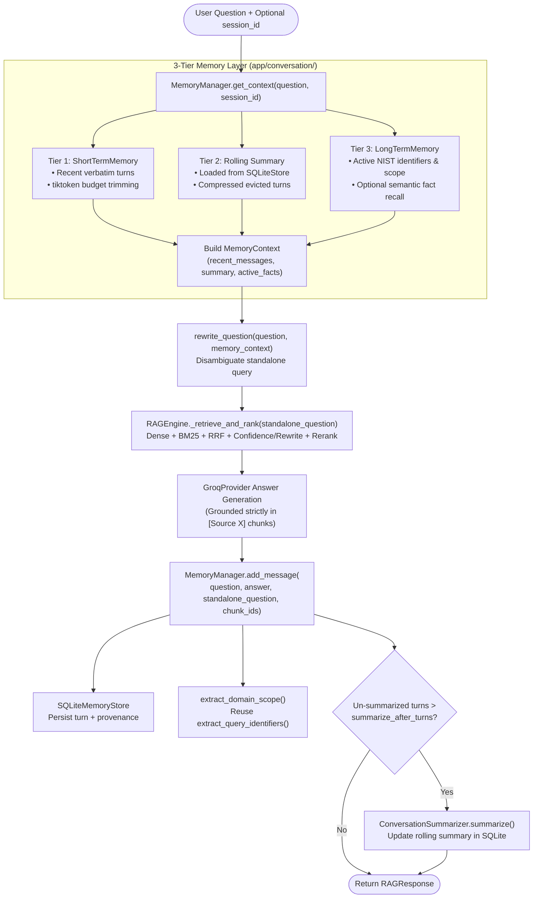

# Cybersecurity RAG — Memory Layer Implementation Plan

**Document Path:** `docs/MEMORY_LAYER_IMPLEMENTATION_PLAN.md`  
**Repository:** `C:\Users\Computer\Desktop\cybersecurity-rag`  
**Date:** 2026-11-25  
**Target Status:** Implementation Blueprint (Pending Execution)  
**Zero New External Dependencies:** Uses Python 3.12 stdlib (`sqlite3`, `json`, `uuid`, `threading`, `datetime`) and existing `pyproject.toml` libraries (`tiktoken>=0.14.0`, `sentence-transformers>=6.0.0`, `numpy`, `groq>=1.6.0`).

---

## 1. Executive Summary & Problem Statement

### 1.1 Current State Audit
In the current codebase, conversational memory is minimal and volatile:
* **Interface ([`app/core/interfaces.py`](file:///C:/Users/Computer/Desktop/cybersecurity-rag/app/core/interfaces.py#L67-L82)):** `BaseConversationMemory` exposes only `add_message(user_message: str, assistant_message: str)` and `get_messages()`.
* **Implementation ([`app/conversation/conversation_memory.py`](file:///C:/Users/Computer/Desktop/cybersecurity-rag/app/conversation/conversation_memory.py#L10-L65)):** `ConversationMemory` stores an in-memory `List[Message]` bounded solely by `MAX_RECENT_MESSAGES = 6` (`settings.conversation_history_limit`).
* **Limitations:**
  1. **Zero Persistence:** All conversational context is lost immediately when [`main.py`](file:///C:/Users/Computer/Desktop/cybersecurity-rag/main.py) exits or `RAGEngine` is re-instantiated.
  2. **No Multi-Session Isolation:** There is no `session_id` concept to separate independent cybersecurity investigations or user threads.
  3. **No Token Budgeting:** [`rewrite_question()`](file:///C:/Users/Computer/Desktop/cybersecurity-rag/app/conversation/query_rewriter.py#L17-L76) concatenates all 6 turns verbatim without checking token limits.
  4. **Hard Context Cliff:** Once a conversation passes 6 turns, earlier standards, architectural assumptions (e.g., *"we are deploying a multi-tenant SaaS on AWS"*), and NIST publication numbers are permanently dropped.
  5. **No Provenance or Scope Tracking:** Neither `standalone_question` nor cited `chunk_id`s are recorded alongside turns.

### 1.2 Target Architecture Goals
Build a modular, production-grade **3-Tier Memory Layer** that:
1. Preserves 100% backward compatibility with `BaseConversationMemory`, `ConversationMemory`, [`RAGEngine`](file:///C:/Users/Computer/Desktop/cybersecurity-rag/app/pipeline/engine.py#L63-L344), and all existing unit/integration tests ([`tests/test_modular_rag.py`](file:///C:/Users/Computer/Desktop/cybersecurity-rag/tests/test_modular_rag.py), [`tests/test_pipeline_integration.py`](file:///C:/Users/Computer/Desktop/cybersecurity-rag/tests/test_pipeline_integration.py)).
2. Keeps `cybersecurity_chunks_bge_m3` in `data/qdrant` completely untouched and avoids Qdrant SQLite lock contention by persisting memory in a dedicated SQLite store (`data/memory/memory.sqlite`).
3. Enforces **Cybersecurity RAG Grounding Integrity**: memory strictly assists *query disambiguation, active scope tracking, and conversational continuity* — the generation LLM must still ground every factual claim exclusively in retrieved NIST chunks (`[Source X]`) per [`RAG_PROMPT_TEMPLATE`](file:///C:/Users/Computer/Desktop/cybersecurity-rag/app/pipeline/engine.py#L22-L60).
4. Operates behind opt-in configuration flags in [`Settings`](file:///C:/Users/Computer/Desktop/cybersecurity-rag/app/core/config.py#L15-L175) so current defaults remain safe and reversible.

---

## 2. End-to-End Memory Architecture & Data Flow



---

## 3. Target Directory & Module Layout

```text
app/
├── core/
│   ├── config.py                    # [UPDATE] Memory paths, token limits, feature flags
│   ├── interfaces.py                # [UPDATE] Add BaseMemoryManager protocol (keep BaseConversationMemory)
│   └── models.py                    # [UPDATE] Extend Message; add SessionMetadata, MemoryFact, MemoryContext
├── conversation/
│   ├── __init__.py                  # [UPDATE] Export MemoryManager, ConversationMemory, rewrite_question
│   ├── conversation_memory.py       # [KEEP/ENHANCE] Backward-compatible in-memory buffer
│   ├── short_term_memory.py         # [NEW] TokenCounter (tiktoken + fallback) & token-budgeted window
│   ├── storage.py                   # [NEW] SQLiteMemoryStore (sessions, turns, facts, episodic vectors)
│   ├── summarizer.py                # [NEW] ConversationSummarizer (incremental LLM summary + safe fallback)
│   ├── long_term_memory.py          # [NEW] Cybersecurity scope/identifier extraction + semantic recall
│   ├── memory_manager.py            # [NEW] Unified MemoryManager implementing BaseConversationMemory & BaseMemoryManager
│   └── query_rewriter.py            # [UPDATE] Accept MemoryContext alongside legacy List[Message | dict]
├── pipeline/
│   └── engine.py                    # [UPDATE] Optional session_id, MemoryContext rewriting, provenance save, close()
main.py                              # [UPDATE] CLI session commands (/new, /sessions, /load, /memory, /clear)
tests/
├── test_short_term_memory.py        # [NEW] Unit tests for token counting & window eviction
├── test_memory_storage.py           # [NEW] Unit tests for SQLite schema, isolation, restarts, deletes
├── test_memory_summarizer.py        # [NEW] Unit tests for incremental summaries & LLM failure fallback
├── test_long_term_memory.py         # [NEW] Unit tests for identifier scope extraction & semantic recall
├── test_memory_manager.py           # [NEW] Unit tests for 3-tier orchestration & protocol compliance
└── test_memory_integration.py       # [NEW] End-to-end RAGEngine.query()/stream() + rewriter integration tests
```

---

## 4. Detailed Module-by-Module Specification

### Module 0: Core Models, Protocols, and Configuration

#### 0.1 Domain Models ([`app/core/models.py`](file:///C:/Users/Computer/Desktop/cybersecurity-rag/app/core/models.py))
Preserve existing `Message(user, assistant)` positional/keyword compatibility and dictionary-like methods (`__getitem__`, `get`, `to_dict`, `from_dict`):

1. **Extend `Message`**:
   ```python
   @dataclass
   class Message:
       user: str
       assistant: str
       timestamp: Optional[str] = None
       standalone_question: Optional[str] = None
       source_chunk_ids: List[str] = field(default_factory=list)
       turn_index: Optional[int] = None
   ```
   * Ensure `to_dict()` preserves `"user"` and `"assistant"` keys and includes new fields when present; `from_dict()` safely defaults missing keys.

2. **Add `SessionMetadata`**:
   ```python
   @dataclass
   class SessionMetadata:
       session_id: str
       title: str = "New Session"
       summary: str = ""
       turn_count: int = 0
       created_at: str = ""
       updated_at: str = ""
   ```

3. **Add `MemoryFact`**:
   ```python
   @dataclass
   class MemoryFact:
       fact_id: str
       session_id: str
       category: str          # "standard" | "control" | "environment" | "preference" | "episodic_summary"
       key: str               # normalized identifier/key, e.g. "NIST_SP_800-53", "deployment_model"
       value: str             # human-readable fact value
       source_turn: Optional[int] = None
       confidence: float = 1.0
       updated_at: str = ""
   ```

4. **Add `MemoryContext`**:
   ```python
   @dataclass
   class MemoryContext:
       session_id: Optional[str] = None
       recent_messages: List[Message] = field(default_factory=list)
       summary: str = ""
       active_facts: List[MemoryFact] = field(default_factory=list)
       total_tokens: int = 0

       @property
       def has_context(self) -> bool:
           return bool(self.recent_messages or self.summary.strip() or self.active_facts)
   ```

#### 0.2 Protocols ([`app/core/interfaces.py`](file:///C:/Users/Computer/Desktop/cybersecurity-rag/app/core/interfaces.py))
* **Keep `BaseConversationMemory` unchanged** so existing mocks and `issubclass(ConversationMemory, BaseConversationMemory)` checks continue passing.
* **Add `BaseMemoryManager(Protocol)`**:
  ```python
  @runtime_checkable
  class BaseMemoryManager(BaseConversationMemory, Protocol):
      def get_context(
          self,
          query: str = "",
          session_id: Optional[str] = None,
      ) -> MemoryContext:
          ...

      def clear(self, session_id: Optional[str] = None) -> None:
          ...

      def close(self) -> None:
          ...
  ```

#### 0.3 Configuration ([`app/core/config.py`](file:///C:/Users/Computer/Desktop/cybersecurity-rag/app/core/config.py))
Add the following properties and settings to `Settings`:

| Setting / Property | Env Var | Default | Purpose |
| :--- | :--- | :--- | :--- |
| `memory_dir` (property) | — | `self.data_dir / "memory"` | Base directory for persisted memory files |
| `memory_db_path` (property) | `MEMORY_DB_PATH` | `self.memory_dir / "memory.sqlite"` | SQLite database file path |
| `enable_persistent_memory` | `ENABLE_PERSISTENT_MEMORY` | `False` | Enables `MemoryManager` + SQLite persistence in `RAGEngine` |
| `enable_memory_summarization` | `ENABLE_MEMORY_SUMMARIZATION` | `False` | Enables rolling summarization of evicted turns |
| `enable_long_term_memory` | `ENABLE_LONG_TERM_MEMORY` | `False` | Enables entity/scope tracking & episodic semantic recall |
| `memory_max_history_tokens` | `MEMORY_MAX_HISTORY_TOKENS` | `1500` | Maximum tokens allocated to recent verbatim turns |
| `memory_max_summary_tokens` | `MEMORY_MAX_SUMMARY_TOKENS` | `300` | Maximum tokens permitted for rolling summary |
| `memory_summarize_after_turns` | `MEMORY_SUMMARIZE_AFTER_TURNS` | `6` | Window threshold triggering incremental summarization |
| `memory_long_term_top_k` | `MEMORY_LONG_TERM_TOP_K` | `3` | Maximum recalled `MemoryFact`s injected into context |

---

### Module 1: Token-Budgeted Short-Term Memory (`app/conversation/short_term_memory.py`)

**Responsibilities:**
- Maintain an in-memory working buffer of recent turns.
- Enforce both a hard turn limit (`max_recent_messages`, default `6`) and a token budget (`max_tokens`, default `1500`).
- Report turns evicted past the short-term window so they can be summarized cleanly.

**Design Details:**
1. **`TokenCounter`**:
   - Lazily loads `tiktoken.get_encoding("cl100k_base")`.
   - Falls back safely to `max(1, len(text) // 4)` if `tiktoken` fails (e.g., offline environment missing cached encoding files).
   - `count_message(msg: Message) -> int`: counts `user` + `assistant` + role formatting overhead (~8 tokens).
2. **`ShortTermMemory`**:
   - `__init__(max_recent_messages=6, max_tokens=1500, token_counter=None)`
   - `add(message: Message) -> List[Message]`: appends `message`; if `len > max_recent_messages`, pops oldest items and returns them as `evicted_turns`.
   - `get_messages(max_tokens: Optional[int] = None) -> List[Message]`: iterates backward from most recent turn, accumulating turns while `total_tokens <= budget`. Always includes the single most recent turn even if it exceeds budget slightly (unless `budget <= 0`), then reverses back to chronological order.
   - `hydrate(messages: Sequence[Message]) -> None`: loads initial turns from SQLite on session resume.
   - `clear() -> None`: clears the internal list.

*Note on [`app/conversation/conversation_memory.py`](file:///C:/Users/Computer/Desktop/cybersecurity-rag/app/conversation/conversation_memory.py):* Keep `ConversationMemory` intact (or back it optionally with `ShortTermMemory` while preserving `self.messages` and `MAX_RECENT_MESSAGES = 6`) so all existing callers and unit tests work identically.

---

### Module 2: SQLite Persistent Session & Turn Store (`app/conversation/storage.py`)

**Responsibilities:**
- Persist sessions, conversation turns, citations, rolling summaries, extracted domain facts, and optional episodic embeddings cleanly on disk without interfering with `data/qdrant`.

**SQLite Schema (`data/memory/memory.sqlite`):**
```sql
PRAGMA journal_mode = WAL;
PRAGMA foreign_keys = ON;

CREATE TABLE IF NOT EXISTS sessions (
    session_id TEXT PRIMARY KEY,
    title TEXT NOT NULL DEFAULT 'New Session',
    summary TEXT NOT NULL DEFAULT '',
    last_summarized_turn_index INTEGER NOT NULL DEFAULT 0,
    created_at TEXT NOT NULL,
    updated_at TEXT NOT NULL
);

CREATE TABLE IF NOT EXISTS turns (
    id INTEGER PRIMARY KEY AUTOINCREMENT,
    session_id TEXT NOT NULL,
    turn_index INTEGER NOT NULL,
    user_message TEXT NOT NULL,
    standalone_question TEXT,
    assistant_message TEXT NOT NULL,
    source_chunk_ids_json TEXT NOT NULL DEFAULT '[]',
    created_at TEXT NOT NULL,
    FOREIGN KEY (session_id) REFERENCES sessions(session_id) ON DELETE CASCADE
);

CREATE INDEX IF NOT EXISTS idx_turns_session_idx
    ON turns(session_id, turn_index);

CREATE TABLE IF NOT EXISTS memory_facts (
    fact_id TEXT PRIMARY KEY,
    session_id TEXT NOT NULL,
    category TEXT NOT NULL,
    fact_key TEXT NOT NULL,
    fact_value TEXT NOT NULL,
    source_turn INTEGER,
    confidence REAL NOT NULL DEFAULT 1.0,
    updated_at TEXT NOT NULL,
    FOREIGN KEY (session_id) REFERENCES sessions(session_id) ON DELETE CASCADE
);

CREATE UNIQUE INDEX IF NOT EXISTS idx_facts_unique
    ON memory_facts(session_id, category, fact_key);

CREATE TABLE IF NOT EXISTS episodic_embeddings (
    fact_id TEXT PRIMARY KEY,
    session_id TEXT NOT NULL,
    embedding_blob BLOB NOT NULL,
    dim INTEGER NOT NULL,
    FOREIGN KEY (fact_id) REFERENCES memory_facts(fact_id) ON DELETE CASCADE
);
```

**Class `SQLiteMemoryStore`:**
- Accepts `db_path: Union[str, Path]` (creates parent directory automatically; supports `":memory:"` for unit tests).
- Guards write/read transactions with `threading.RLock()` and uses parameterized SQL (`?` placeholders) exclusively.
- Key methods:
  - `create_session(session_id=None, title=None) -> SessionMetadata`
  - `get_session(session_id) -> Optional[SessionMetadata]`
  - `list_sessions(limit=20) -> List[SessionMetadata]`
  - `append_turn(session_id, message: Message) -> int` (auto-creates session row if missing, assigns sequential `turn_index`, sets title from first truncated question if `"New Session"`).
  - `get_recent_turns(session_id, limit=6) -> List[Message]`
  - `get_unsummarized_turns(session_id, up_to_turn_index: int) -> List[Message]`
  - `update_summary(session_id, summary: str, last_summarized_turn_index: int) -> None`
  - `upsert_fact(fact: MemoryFact, embedding: Optional[Sequence[float]] = None) -> None`
  - `get_facts(session_id: Optional[str] = None, category: Optional[str] = None) -> List[MemoryFact]`
  - `get_fact_embeddings(session_id: Optional[str] = None) -> List[Tuple[MemoryFact, bytes, int]]`
  - `delete_session(session_id) -> None`
  - `close() -> None` (context manager compatible: `__enter__` / `__exit__`).

---

### Module 3: Rolling Conversation Summarizer (`app/conversation/summarizer.py`)

**Responsibilities:**
- Incrementally fold turns that age out of the short-term window into a concise session summary without exceeding `max_summary_tokens`.

**Prompt Contract (`SUMMARY_PROMPT_TEMPLATE`):**
- Instructs the LLM to merge `CURRENT SUMMARY` and `NEWLY EVICTED TURNS` into one concise factual paragraph/bullet list while strictly preserving:
  - Explicit NIST publications and standards (`NIST SP 800-53`, `SP 800-144`, `SP 800-207`, `SSDF`, etc.)
  - Security control IDs (`AU-3`, `AC-2`, `SA-9`, `SI-2`)
  - Target cloud models / system scope (`SaaS`, `IaaS`, `Zero Trust`, `multi-tenant`)
  - Open sub-questions or constraints stated by the user
- Explicitly instructs: *"Do NOT invent new standards or technical claims not present in the turns."*

**Class `ConversationSummarizer`:**
- `__init__(llm_provider: Optional[BaseLLMProvider] = None, max_summary_tokens: int = 300, token_counter: Optional[TokenCounter] = None)`
- `summarize(existing_summary: str, new_turns: Sequence[Message]) -> str`:
  - Returns `existing_summary` if `new_turns` is empty.
  - Calls `llm_provider.generate(prompt, temperature=0.0, max_tokens=self.max_summary_tokens)`.
  - **Resilience Fallback:** If `llm_provider` raises an exception (rate limit, timeout, missing API key in tests) or returns empty text, falls back to a deterministic condensation appending truncated `turn.user` topics onto `existing_summary` and trimming to `max_summary_tokens`.

---

### Module 4: Long-Term Cybersecurity Scope & Episodic Memory (`app/conversation/long_term_memory.py`)

**Responsibilities:**
- Track structured cybersecurity entities/constraints active in a session so follow-ups like *"What controls apply to that?"* retain the exact standard/model scope even 15 turns later.
- Optionally support semantic similarity lookup over prior facts/episodic summaries using normalized BGE-M3 embeddings stored as `float32` BLOBs in SQLite.

**Design Details:**
1. **Deterministic Identifier Extraction (Zero Logic Duplication):**
   - Import and reuse [`extract_query_identifiers()`](file:///C:/Users/Computer/Desktop/cybersecurity-rag/app/retrieval/confidence.py#L67-L76) from [`app/retrieval/confidence.py`](file:///C:/Users/Computer/Desktop/cybersecurity-rag/app/retrieval/confidence.py).
   - Map detected identifiers into `MemoryFact` records (`category="standard"` or `"control"`, `key=normalized_id`, `value=f"Active referenced identifier: {ident}"`).
   - Also record lightweight deployment-model/architecture cues (`SaaS`, `PaaS`, `IaaS`, `public cloud`, `Zero Trust`, `microservices`, `Kubernetes`, `BYOD`) when matched in user statements.
2. **Optional Episodic Semantic Recall (`EpisodicMemoryRetriever`)**:
   - Accepts an optional `embed_fn: Optional[Callable[[str], Sequence[float]]]` (which in production can wrap `DenseRetriever.embedding_model.encode(..., normalize_embeddings=True)` without loading a second copy of `BAAI/bge-m3` into RAM!).
   - `recall(query: str, session_id: str, top_k: int = 3, include_cross_session: bool = False) -> List[MemoryFact]`:
     - Always prioritizes active session facts (latest identifiers/scope).
     - When `embed_fn` is configured and `episodic_embeddings` exist, computes exact cosine similarity (`np.dot`) against normalized BLOB vectors, filters by minimum relevance threshold (e.g. `>= 0.55`), and returns top-$k$ deduplicated `MemoryFact`s.

---

### Module 5: Unified `MemoryManager` (`app/conversation/memory_manager.py`)

**Responsibilities:**
- Serve as the single drop-in implementation of both `BaseConversationMemory` and `BaseMemoryManager` for `RAGEngine`.

**Lifecycle Methods:**
1. **`__init__(...)`**:
   - Parameters: `session_id: Optional[str] = None`, `store: Optional[SQLiteMemoryStore] = None`, `short_term: Optional[ShortTermMemory] = None`, `summarizer: Optional[ConversationSummarizer] = None`, `long_term: Optional[LongTermMemory] = None`, `enable_persistence: Optional[bool] = None`, `enable_summarization: Optional[bool] = None`, `enable_long_term: Optional[bool] = None`, `summarize_after_turns: Optional[int] = None`.
   - If `enable_persistence` is `True` and `session_id` already exists in `store`, hydrates `ShortTermMemory` from `store.get_recent_turns(session_id)` and loads `session.summary`.
2. **`add_message(user_message, assistant_message="", *, standalone_question=None, source_chunk_ids=None)`**:
   - Constructs `Message` with UTC ISO-8601 timestamp and optional metadata.
   - Persists turn to `SQLiteMemoryStore` (if enabled), obtaining `turn_index`.
   - Appends to `ShortTermMemory`.
   - Extracts & upserts `MemoryFact`s via `LongTermMemory` (if enabled).
   - Checks if un-summarized turns exceed `summarize_after_turns` (`turn_index - last_summarized_turn_index > window`): if `enable_summarization` is `True`, compresses the overflow turns via `ConversationSummarizer` and updates the session summary in SQLite.
3. **`get_messages() -> List[Message]`**:
   - Returns token-budgeted recent `Message` list from `ShortTermMemory`.
4. **`get_context(query: str = "", session_id: Optional[str] = None) -> MemoryContext`**:
   - Combines `recent_messages` (token-trimmed), `summary` (from session), and `active_facts` (from `LongTermMemory.recall(...)`).
5. **Session Management Helpers**:
   - `switch_session(session_id: str) -> SessionMetadata`
   - `new_session(title: Optional[str] = None) -> SessionMetadata`
   - `list_sessions(limit: int = 20) -> List[SessionMetadata]`
   - `clear(session_id: Optional[str] = None) -> None`
   - `close() -> None`

---

### Module 6: Rewriter, Orchestrator & CLI Integration

#### 6.1 Conversational Query Rewriter ([`app/conversation/query_rewriter.py`](file:///C:/Users/Computer/Desktop/cybersecurity-rag/app/conversation/query_rewriter.py))
Update [`rewrite_question()`](file:///C:/Users/Computer/Desktop/cybersecurity-rag/app/conversation/query_rewriter.py#L17-L76) while keeping its signature 100% backward compatible:
```python
def rewrite_question(
    question: str,
    conversation_history: Union[MemoryContext, List[Union[Message, dict]]],
    llm_provider: Optional[BaseLLMProvider] = None,
) -> str:
```
* When `conversation_history` is a `MemoryContext`, format three labeled prompt sections (omitting any empty section):
  1. `Session Summary:` (`context.summary`)
  2. `Active Technical Context / Standards:` (`- [fact.category] fact.key: fact.value`)
  3. `Recent Conversation Turns:` (`User: ... / Assistant: ...`)
* Add a strict rule to the rewrite prompt: *"Use the session summary and active standards only to resolve pronouns or missing scope in the latest question; if the latest question introduces a new standalone topic, preserve it unchanged."*
* Fallback safely to `question.strip()` if the LLM call fails or returns empty text.

#### 6.2 Orchestrator ([`app/pipeline/engine.py`](file:///C:/Users/Computer/Desktop/cybersecurity-rag/app/pipeline/engine.py))
1. **`RAGEngine.__init__`**:
   - Add `session_id: Optional[str] = None`.
   - Memory default initialization:
     ```python
     if memory is not None:
         self.memory = memory
     elif getattr(settings, "enable_persistent_memory", False):
         from app.conversation.memory_manager import MemoryManager
         self.memory = MemoryManager(session_id=session_id, llm_provider=self.llm_provider)
     else:
         self.memory = ConversationMemory()
     ```
2. **`RAGEngine._rewrite_query()`**:
   - If `isinstance(self.memory, BaseMemoryManager)`, pull `ctx = self.memory.get_context(question)`: if `not ctx.has_context`, return `question`; otherwise pass `ctx` to `self.query_rewriter(...)`.
   - Else use existing `self.memory.get_messages()` path untouched.
3. **Provenance-Safe Persistence in `query()` and `stream()`**:
   - Preserve exact two-argument compatibility (`self.memory.add_message(question, answer)`) when `self.memory` is a simple `BaseConversationMemory` or `MagicMock` (so [`test_pipeline_integration.py`](file:///C:/Users/Computer/Desktop/cybersecurity-rag/tests/test_pipeline_integration.py#L104) stays green without mock assertion changes):
     ```python
     if isinstance(self.memory, BaseMemoryManager):
         self.memory.add_message(
             question,
             answer,
             standalone_question=standalone_question,
             source_chunk_ids=[c.chunk_id for c in final_chunks],
         )
     else:
         self.memory.add_message(question, answer)
     ```
4. **`RAGEngine.close()`**:
   - Close `self.memory.close()` if `hasattr(self.memory, "close")`.

#### 6.3 Interactive CLI ([`main.py`](file:///C:/Users/Computer/Desktop/cybersecurity-rag/main.py))
Add lightweight command handling before calling `engine.query()` (preserving `'exit'` and empty-input validation):
* `/new` — creates and switches to a fresh persistent session.
* `/sessions` — lists recent sessions (`session_id`, `title`, `turn_count`, `updated_at`).
* `/load <session_id>` — switches active `MemoryManager` session and displays summary.
* `/memory` — inspects active session ID, summary, active standards/facts, and turn count.
* `/clear` — clears active session history.

---

## 5. Comprehensive Module-Wise Test Plan (`tests/`)

All tests follow the repository's `unittest` framework using `tempfile.TemporaryDirectory`, `":memory:"` SQLite DBs, and mock `BaseLLMProvider` implementations — **no live Groq API calls and no reads/writes to `data/qdrant`**.

### 5.1 `tests/test_short_term_memory.py`
* **`test_turn_limit_eviction`**: Adding 8 turns with `max_recent_messages=6` keeps the newest 6 and returns the 2 oldest as evicted.
* **`test_token_budget_trims_oldest_turns`**: With `max_tokens=100`, adding turns totaling 250 tokens returns only the most recent subset fitting under 100 tokens.
* **`test_always_keeps_latest_turn`**: Even if the newest single turn exceeds `max_tokens`, at least 1 turn is retained when `max_tokens > 0`.
* **`test_tiktoken_offline_fallback`**: Mocking `tiktoken.get_encoding` to raise `OSError` verifies seamless fallback to heuristic character estimation.
* **`test_clear_resets_window`**: Verifies `clear()` empties buffer cleanly.

### 5.2 `tests/test_memory_storage.py`
* **`test_schema_initialization`**: Verifies `sessions`, `turns`, `memory_facts`, and `episodic_embeddings` are created automatically in a temp SQLite file.
* **`test_session_isolation`**: Turns and facts written to `sess_1` never appear in `get_recent_turns("sess_2")` or `get_facts("sess_2")`.
* **`test_restart_persistence_roundtrip`**: Writes 4 turns (including `standalone_question` and `source_chunk_ids`), closes `SQLiteMemoryStore`, opens a fresh instance on the same file, and asserts identical restoration.
* **`test_summary_and_fact_upsert`**: Verifies `upsert_fact` deduplicates by `(session_id, category, fact_key)` and `update_summary` updates `last_summarized_turn_index`.
* **`test_delete_session_cascades`**: Deleting a session removes all associated `turns`, `memory_facts`, and `episodic_embeddings`.
* **`test_sql_injection_resistance`**: Passing quotes, semicolons, and SQL keywords in `question`/`session_id` succeeds safely via parameterized queries.

### 5.3 `tests/test_memory_summarizer.py`
* **`test_incremental_summarization_prompt`**: Uses `MockLLMProvider` to verify prompt contains both `existing_summary` and newly evicted turns, and returns updated summary.
* **`test_empty_turns_skips_llm`**: `summarize("existing", [])` returns `"existing"` with 0 LLM calls.
* **`test_llm_exception_uses_deterministic_fallback`**: When `llm_provider.generate()` raises `TimeoutError` or returns `""`, returns a safe non-empty fallback summary without raising.
* **`test_summary_respects_token_cap`**: Oversized mock LLM output is safely bounded by `max_summary_tokens`.

### 5.4 `tests/test_long_term_memory.py`
* **`test_identifier_extraction_reuses_confidence_patterns`**: Inputting `"Compare NIST SP 800-53 AC-2 with CVE-2024-1234 under SaaS"` extracts `NIST SP 800-53`, `AC-2`, `CVE-2024-1234`, and `SaaS` as `MemoryFact`s.
* **`test_fact_deduplication_across_turns`**: Mentioning `NIST SP 800-144` in Turn 1 and Turn 4 maintains a single updated `MemoryFact` row rather than duplicates.
* **`test_semantic_fact_recall_ranking`**: Uses mocked unit-norm vectors (`[1, 0, ...]` vs `[0, 1, ...]`) to verify cosine similarity ranking returns the most relevant `MemoryFact`s top-$k$ and safely ignores zero/mismatched vectors.

### 5.5 `tests/test_memory_manager.py`
* **`test_protocol_compliance`**: Verifies `issubclass(MemoryManager, BaseConversationMemory)` and `issubclass(MemoryManager, BaseMemoryManager)`.
* **`test_automatic_eviction_and_summarization`**: Adding 8 turns with `max_recent_messages=4` and `enable_summarization=True` compacts turns 1–4 into `summary` while keeping turns 5–8 verbatim.
* **`test_get_context_combines_three_tiers`**: Asserts `MemoryContext` includes `summary`, `active_facts`, and token-trimmed `recent_messages`.
* **`test_in_memory_mode_without_sqlite`**: With `enable_persistence=False`, operates purely in-memory without creating SQLite files on disk.

### 5.6 `tests/test_memory_integration.py`
* **`test_rewriter_resolves_summary_and_active_standard`**: Passes a `MemoryContext` (summary mentioning `NIST SP 800-144`, active fact `SaaS`, and 2 recent turns) into `rewrite_question()` and verifies the LLM prompt carries all 3 tiers while keeping original question safe on fallback.
* **`test_rag_engine_query_and_stream_with_memory_manager`**: Runs `RAGEngine.query()` and `RAGEngine.stream()` with mock retriever/reranker/LLM and real `MemoryManager` (temp SQLite DB); verifies `standalone_question` and retrieved `chunk_id`s are persisted after both calls.
* **`test_backward_compatibility_with_simple_memory_mock`**: Verifies `RAGEngine` with `MagicMock(spec=BaseConversationMemory)` still invokes `add_message(question, answer)` with exact 2 positional args.
* **`test_grounding_rule_preserved`**: Verifies answers cite only retrieved `[Source X]` chunks and never fabricate `[Source X]` from memory facts.

---

## 6. Phased Rollout & Verification Checklist

| Phase | Deliverables | Verification Gate |
| :--- | :--- | :--- |
| **Phase 1: Core Contracts** | Update `models.py`, `interfaces.py`, `config.py` | Existing 167 tests remain 100% green |
| **Phase 2: Working & Storage** | Implement `short_term_memory.py` + `storage.py` | `test_short_term_memory.py` + `test_memory_storage.py` pass |
| **Phase 3: Cognitive Tiers** | Implement `summarizer.py` + `long_term_memory.py` | `test_memory_summarizer.py` + `test_long_term_memory.py` pass |
| **Phase 4: Orchestration** | Implement `memory_manager.py` | `test_memory_manager.py` passes |
| **Phase 5: Pipeline & CLI** | Wire `query_rewriter.py`, `engine.py`, `main.py` | `test_memory_integration.py` + full `unittest discover` pass |

### Full Verification Command
```powershell
python -m unittest discover -s tests -p "test_*.py"
```

### Operational Safety Rules During Implementation
1. Never read or write `data/qdrant/` or `data/embeddings_bge_m3/` during memory testing.
2. Never add memory entries into the `cybersecurity_chunks_bge_m3` Qdrant collection.
3. Keep `ENABLE_PERSISTENT_MEMORY`, `ENABLE_MEMORY_SUMMARIZATION`, and `ENABLE_LONG_TERM_MEMORY` `false` by default until integration validation is complete, then enable via `.env`.
