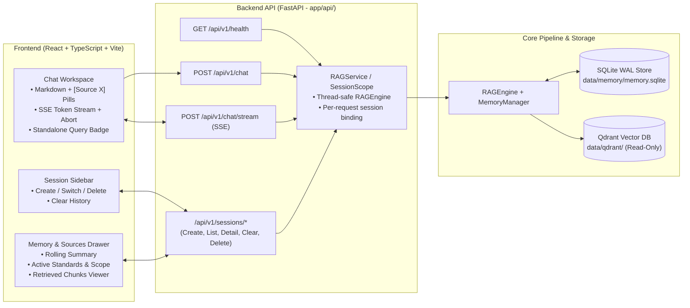

# Cybersecurity RAG — Backend API, Database Integration & Frontend Implementation Plan

**Document Path:** `docs/API_AND_FRONTEND_IMPLEMENTATION_PLAN.md`  
**Repository:** `C:\Users\Computer\Desktop\cybersecurity-rag`  
**Date:** 2026-11-25  
**Target Status:** Implementation Blueprint (Pending Execution)  
**Prerequisites Completed:** 3-Tier Memory Layer (`MemoryManager`, `SQLiteMemoryStore`, `ShortTermMemory`, `ConversationSummarizer`, `LongTermMemory`, `RAGEngine` `session_id` & provenance support).

---

## 1. Executive Summary & Architectural Goals

### 1.1 Objective
Expose the existing `RAGEngine` and 3-tier `MemoryManager` through a clean, production-structured **FastAPI backend** and a **React + TypeScript frontend** (`frontend/`) while preserving:
1. **Strict Separation of Concerns:** `RAGEngine` remains completely HTTP-agnostic (`main.py` CLI continues working unchanged).
2. **Database Isolation & Safety:**
   - `data/memory/memory.sqlite` remains the single source of truth for sessions, turns, provenance (`standalone_question`, `source_chunk_ids`), rolling summaries, and extracted domain facts.
   - `data/qdrant/` (`cybersecurity_chunks_bge_m3`) remains strictly read-only for document retrieval.
3. **Cybersecurity Grounding Integrity:** Answers remain grounded exclusively in retrieved `[Source X]` chunks; the UI visually links `[Source X]` citations to retrieved chunk metadata and exposes `standalone_question`, rolling summary, and active scope facts for full transparency.

### 1.2 End-to-End Architecture



---

## 2. Target Directory & File Layout

```text
cybersecurity-rag/
├── app/
│   ├── api/
│   │   ├── __init__.py              # [NEW] Package exports
│   │   ├── app.py                   # [NEW] FastAPI app factory, CORS, lifespan cleanup, exception handlers
│   │   ├── dependencies.py          # [NEW] Shared RAGEngine lifecycle & thread-safe session locking
│   │   ├── schemas.py               # [NEW] Pydantic v2 request/response & SSE event models
│   │   └── routes/
│   │       ├── __init__.py          # [NEW] Router aggregation (/api/v1)
│   │       ├── health.py            # [NEW] Health & active feature-flag status endpoint
│   │       ├── chat.py              # [NEW] Synchronous chat & SSE streaming chat endpoints
│   │       └── sessions.py          # [NEW] Session CRUD, turn history, summary & memory inspection
│   ├── conversation/
│   │   └── storage.py               # [UPDATE] Add get_session_turns(session_id, limit) helper if needed
│   └── core/
│       └── config.py                # [UPDATE] Add API host/port/CORS settings (backward compatible)
├── api_server.py                    # [NEW] Uvicorn entrypoint (python api_server.py)
├── frontend/                        # [NEW] Vite + React + TypeScript + Tailwind UI
│   ├── package.json
│   ├── vite.config.ts               # Proxy /api -> http://localhost:8000 in dev
│   ├── index.html
│   └── src/
│       ├── main.tsx
│       ├── App.tsx
│       ├── api/
│       │   └── client.ts            # Typed REST + SSE fetch stream client with AbortSignal
│       ├── types/
│       │   └── api.ts               # TypeScript interfaces matching app/api/schemas.py
│       └── components/
│           ├── SessionSidebar.tsx   # Session list, new/load/clear/delete controls
│           ├── ChatPanel.tsx        # Message list, streaming bubble, [Source X] badges, input box
│           ├── MemoryDrawer.tsx     # Rolling summary + active NIST standards/scope facts
│           └── SourcesModal.tsx     # Inspected chunk text, doc_id, section, page, score
└── tests/
    └── test_api_endpoints.py        # [NEW] FastAPI TestClient tests (mock engine + temp SQLite)
```

---

## 3. Database Integration & Concurrency Design

### 3.1 SQLite (`data/memory/memory.sqlite`) Integration
* **Existing Tables Reused:** `sessions`, `turns`, `memory_facts`, and `episodic_embeddings` in `SQLiteMemoryStore`.
* **New Read Helper (`SQLiteMemoryStore.get_session_turns`):**
  * Add `get_session_turns(self, session_id: str, limit: int = 100) -> List[Message]` returning chronological turns (including `turn_index`, `user`, `assistant`, `standalone_question`, `source_chunk_ids`, and `timestamp`) so the frontend can restore complete conversation threads on page reload or session switch.
* **Connection Lifecycle:**
  * Initialize `RAGEngine` once during FastAPI `lifespan` startup (so heavy BGE-M3 embedding and CrossEncoder reranker weights load only once in RAM) and call `engine.close()` on shutdown.

### 3.2 Concurrency & Multi-Tab Session Safety
* Because `RAGEngine` shares a single heavy retrieval/reranker stack in memory while `MemoryManager` tracks an active `session_id`:
  * Wrap session switching + query execution inside an `asyncio.Lock` (or per-session lock with explicit `switch_session(request.session_id)` before `query()` / `stream()`).
  * Run blocking `RAGEngine.query()` calls via `await asyncio.to_thread(...)` and iterate synchronous `RAGEngine.stream()` safely so FastAPI's event loop remains responsive.
  * When `session_id` is omitted in `POST /api/v1/chat` or `POST /api/v1/chat/stream`, automatically create a new session and return its `session_id` in the response/SSE metadata so the frontend immediately binds to it.

---

## 4. Backend API Specification (`app/api/`)

### 4.1 Pydantic v2 Schemas (`app/api/schemas.py`)

| Schema | Fields | Purpose |
| :--- | :--- | :--- |
| `HealthResponse` | `status`, `persistent_memory_enabled`, `summarization_enabled`, `long_term_memory_enabled`, `active_session_id` | Service & feature flag status |
| `SourceChunkDTO` | `source_index` (`1..N`), `chunk_id`, `doc_id`, `title`, `section`, `page`, `score`, `text_preview` | Maps `[Source X]` to retrieved document metadata |
| `ChatRequest` | `question: str` (`min_length=1`), `session_id: Optional[str] = None` | Incoming user query |
| `ChatResponse` | `session_id`, `question`, `standalone_question`, `answer`, `sources: List[SourceChunkDTO]`, `memory_context: MemoryContextDTO` | Synchronous chat response |
| `TurnDTO` | `turn_index`, `user`, `assistant`, `standalone_question`, `source_chunk_ids`, `timestamp` | Persisted turn for UI hydration |
| `MemoryFactDTO` | `fact_id`, `category`, `key`, `value`, `source_turn`, `confidence` | Tracked standard, control, or deployment scope |
| `MemoryContextDTO` | `session_id`, `summary`, `active_facts: List[MemoryFactDTO]`, `recent_turn_count` | Snapshot of active 3-tier memory |
| `SessionSummaryDTO` | `session_id`, `title`, `summary`, `turn_count`, `created_at`, `updated_at` | Sidebar session item |
| `SessionDetailDTO` | `session: SessionSummaryDTO`, `turns: List[TurnDTO]`, `active_facts: List[MemoryFactDTO]` | Full session state on load/refresh |

### 4.2 Endpoints (`/api/v1`)

1. **`GET /api/v1/health`**
   - Returns `200 OK` with `HealthResponse`.
2. **`POST /api/v1/chat`**
   - Switches to or creates `session_id`, runs `engine.query(question)`, extracts `standalone_question`, `sources`, and current `MemoryContext`, and returns `ChatResponse`.
3. **`POST /api/v1/chat/stream`** (`media_type="text/event-stream"`)
   - Emits structured SSE events:
     - `event: session` -> `{"session_id": "..."}`
     - `event: metadata` -> `{"standalone_question": "...", "sources": [...]}`
     - `event: token` -> `{"token": "..."}`
     - `event: memory` -> `{"summary": "...", "active_facts": [...]}`
     - `event: done` -> `{"ok": true}`
     - `event: error` -> `{"detail": "..."}`
4. **`POST /api/v1/sessions`**
   - Creates a new session (`{"title": Optional[str]}`) and returns `SessionSummaryDTO`.
5. **`GET /api/v1/sessions`**
   - Lists recent sessions (`?limit=20`) ordered by `updated_at DESC`.
6. **`GET /api/v1/sessions/{session_id}`**
   - Returns `404` if session does not exist; otherwise returns `SessionDetailDTO` (metadata + chronological turns + active facts).
7. **`POST /api/v1/sessions/{session_id}/clear`**
   - Clears turns/history for `session_id` and returns updated `SessionSummaryDTO`.
8. **`DELETE /api/v1/sessions/{session_id}`**
   - Deletes session and cascades turns/facts/embeddings in SQLite; returns `{"deleted": true, "session_id": "..."}`.

---

## 5. Frontend Specification (`frontend/`)

### 5.1 Tech Stack
* **Framework:** React 18 + TypeScript + Vite
* **Styling & Rendering:** Tailwind CSS, `react-markdown` + `remark-gfm` (for structured NIST tables/lists), and `lucide-react` icons.
* **Dev Proxy:** `vite.config.ts` proxies `/api` requests to `http://127.0.0.1:8000` to avoid CORS friction during local development.

### 5.2 Core UI Components
1. **`SessionSidebar.tsx`**:
   - **New Investigation** button (`POST /api/v1/sessions`).
   - Scrollable session list showing title, turn count, and relative timestamp (`GET /api/v1/sessions`).
   - Active session highlight, **Clear Turns**, and **Delete Session** actions with confirmation.
2. **`ChatPanel.tsx`**:
   - Renders chronological `TurnDTO` messages plus an active streaming assistant bubble.
   - Parses `[Source X]` tokens in assistant answers into clickable citation chips linked to `SourceChunkDTO`.
   - Displays a subtle **Rewritten Query** pill (`standalone_question`) when query rewriting expanded pronouns/scope.
   - Input textarea (`Enter` to send, `Shift+Enter` for newline) with a **Stop** button wired to `AbortController` during SSE streaming.
3. **`MemoryDrawer.tsx` & `SourcesModal.tsx`**:
   - **Rolling Summary Card:** Displays the condensed session summary from Tier 2 memory.
   - **Active Scope & Standards Pills:** Displays Tier 3 `MemoryFact`s grouped by category (`standard`, `control`, `environment`).
   - **Retrieved Evidence Drawer:** Lists `[Source 1..N]` chunks for the selected turn (`doc_id`, `section`, `page`, relevance score, and chunk excerpt).

---

## 6. Phased Rollout & Verification Checklist

| Phase | Deliverables | Verification Gate |
| :--- | :--- | :--- |
| **Phase 1: Backend API & DB Helper** | `storage.py` (`get_session_turns`), `config.py` API settings, `app/api/*`, `api_server.py` | `tests/test_api_endpoints.py` passes with `TestClient` + temp SQLite |
| **Phase 2: Frontend Scaffold & Client** | `frontend/` Vite + React + TS project, `types/api.ts`, `api/client.ts` (REST + SSE parser) | `npm run build` / `tsc --noEmit` succeeds cleanly |
| **Phase 3: UI Workspace & Inspector** | `SessionSidebar`, `ChatPanel`, `MemoryDrawer`, `SourcesModal` | Interactive UI renders markdown, `[Source X]` citations, and memory tiers |
| **Phase 4: Full-Stack Integration** | End-to-end run (`python api_server.py` + `npm run dev`) with memory flags enabled | Multi-turn NIST query persists across page refresh without touching `data/qdrant/` |

### Operational Safety Rules
1. Never modify or write to `data/qdrant/` or `data/embeddings_bge_m3/` during API/frontend development or automated testing.
2. Keep `main.py` CLI working independently of `api_server.py`.
3. Update `pyproject.toml` only with required web server dependencies (`fastapi`, `uvicorn[standard]`, `httpx` for `TestClient`) if not already installed.