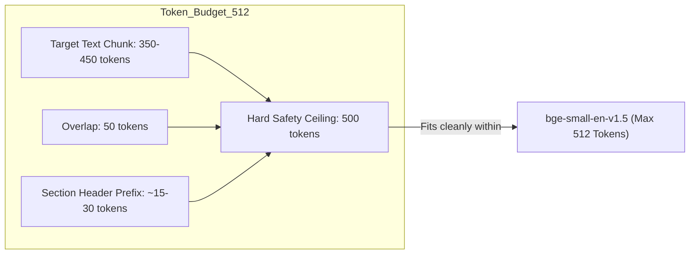

# Stage 0 Discovery Report: Structure-Aware Chunking Pipeline

> **Date**: 2026-10-14
> **Project**: `cybersecurity-rag`
> **Pipeline Stage**: Stage 4 Chunking — Stage 0 Discovery & Preflight
> **Reference Plan**: [CHUNKING_IMPLEMENTATION_PLAN.md](file:///C:/Users/Computer/Desktop/cybersecurity-rag/CHUNKING_IMPLEMENTATION_PLAN.md)
> **Audited Cohort**: 10 Pilot Publications (`data/cleaned_pilot/`, 1,057 physical pages, 353 tables, 147 figure assets)
> **Full Corpus Reference**: 73 Publications (`documents/`, 4,649 physical pages, 591 figure assets, 19 ambiguous-character warnings)
> **Status**: **`STAGE 0 DISCOVERY COMPLETE — READY FOR USER REVIEW`**

---

## 1. Executive Summary

In accordance with [CHUNKING_IMPLEMENTATION_PLAN.md](file:///C:/Users/Computer/Desktop/cybersecurity-rag/CHUNKING_IMPLEMENTATION_PLAN.md), this document establishes the empirical, schema-level baseline for **Stage 4: Structure-Aware Chunking** in the Cybersecurity RAG project.

All discovery activities were conducted under strict **read-only** constraints:
- Zero modifications were made to source PDFs (`documents/`), extraction outputs (`data/extraction_pilot_v3/`, `data/extraction_corpus_68/`), or cleaned corpus deliverables (`data/cleaned_pilot/`, `data/cleaned_corpus/`).
- No chunking code has been implemented or executed.
- No packages were installed, and no remote models were downloaded.
- Existing tests were verified: all **97 out of 97 unit and integration tests** pass cleanly.
- Hugging Face local hub caches and tokenizers were inspected offline.

### Key Discoveries & Architectural Findings

1. **Cleaned Pilot Cohort Baseline**:
   - Exactly **10 documents** across 5 subcategories reside in `data/cleaned_pilot/`.
   - Total physical pages: **1,057 pages**.
   - Total structured tables in JSON: **353 tables**.
   - Total figure assets in JSON: **147 figures**, with exactly **147 PNG files** verified existing on disk under each document's `figures/` directory.
   - Ambiguous character warnings in pilot: **3 warnings** (`NIST_SP_800-152` p. 30, `NIST_SP_800-186` p. 15, `NIST_SP_800-186` p. 59), preserved verbatim as `\ufffd`.

2. **Critical Tokenizer & Context Limit Discovery**:
   - The primary configured embedding pipeline ([embed_documents_safe.py](file:///C:/Users/Computer/Desktop/cybersecurity-rag/app/ingestion/embed_documents_safe.py)) uses `BAAI/bge-small-en-v1.5`.
   - Both `BAAI/bge-small-en-v1.5` and `BAAI/bge-m3` are cached locally in `C:\Users\Computer\.cache\huggingface\hub` and load offline via `AutoTokenizer.from_pretrained(..., local_files_only=True)`.
   - **`bge-small-en-v1.5` utilizes `BertTokenizer` with a strict `model_max_length` of 512 tokens**.
   - **Warning / Risk Flag**: The implementation plan proposed a 400–600 token target. If `bge-small` is used, chunks between 513 and 600 tokens would **silently truncate** during embedding generation. For `bge-small`, the chunk target must be bounded to **350–450 tokens** with a hard ceiling of **500 tokens**. If `bge-m3` (8,192 tokens) is selected instead, 400–600 tokens is completely safe.
   - Legacy script [chunk_documents.py](file:///C:/Users/Computer/Desktop/cybersecurity-rag/app/ingestion/chunk_documents.py) used `tiktoken` (`cl100k_base`), which diverges significantly from BERT WordPiece token counts on technical cybersecurity tokens (`AC-2(1)`, `0x7FFF`, `NIST_SP_800-53r5`). Using the model's native `BertTokenizer` directly ensures token counts match embedding limits.

3. **Content Representation Invariants**:
   - **Structured JSON (`*_structured.json`) is the authoritative source of truth**. It contains typed arrays for `blocks` (with bounding boxes, reading order, and heading levels), `tables` (with structured cell coordinates, headers, rows, and pre-rendered pipe Markdown), `figures` (with image paths and bounding boxes), and `cleaning_metadata` (with character counts and warnings).
   - **Markdown (`*.md`) and Plain Text (`*.txt`)** are derived flat exports. They contain embedded pipe Markdown tables and page headings (`## Page N` / `--- PAGE N ---`), but do **not** contain Markdown image tags (``). Figures exist exclusively in `*_structured.json` and in `figures/` directories on disk.

4. **Storage & Headroom**:
   - Current free disk space: **1,834 MB (1.79 GB)**.
   - Mandatory reserve: **500 MB**.
   - Usable headroom: **1,334 MB**.
   - Estimated pilot chunk output size: **~5–10 MB** (well within available reserve).

---

## 2. Environment & Dependency Audit

The local Python virtual environment was inspected and tested:

| Component | Path / Version | Status / Notes |
| :--- | :--- | :--- |
| **Python Runtime** | `C:\Users\Computer\Desktop\cybersecurity-rag\.venv\Scripts\python.exe` (v3.12.13) | Verified active |
| **PyTorch** | `2.13.0+cpu` | Verified operational on CPU |
| **PyMuPDF (`fitz`)** | `1.28.2` | Deprecation warning note: use `import pymupdf` |
| **pypdf** | `6.16.2` | Installed |
| **transformers** | `5.15.1` | Installed and operational |
| **tokenizers** | `0.22.2` | Installed and operational |
| **sentence_transformers** | `6.0.0` | Installed and operational |
| **tiktoken** | `0.14.0` | Installed (`cl100k_base`) |
| **pydantic** | `2.13.4` | Installed |
| **qdrant_client** | Installed | Available for future stages |
| **Existing Test Suite** | `python -m unittest discover -s tests -p "test_*.py"` | **97/97 tests passed** (55.2s execution time) |

### Local Hugging Face Cache Audit

Inspection of `C:\Users\Computer\.cache\huggingface\hub` revealed the following cached model repositories:
- `models--BAAI--bge-small-en-v1.5`
- `models--BAAI--bge-m3`
- `models--cross-encoder--ms-marco-MiniLM-L-6-v2`
- `models--sentence-transformers--all-MiniLM-L6-v2`
- `models--PaddlePaddle--PP-OCRv6_medium_det` & `rec`

Both BAAI tokenizers were instantiated offline (`local_files_only=True`):
```text
BAAI/bge-small-en-v1.5:
  Class: BertTokenizer
  model_max_length: 512
  vocab_size: 30522

BAAI/bge-m3:
  Class: XLMRobertaTokenizer
  model_max_length: 8192
  vocab_size: 250002
```

---

## 3. Verified 10-Document Pilot Inventory

The 10 pilot documents in `data/cleaned_pilot/` provide a balanced cross-section of publication formats, including text-dense catalogs, table-heavy requirements, equation-heavy cryptography, and figure-heavy vulnerability guides:

| Category | Document ID | Pages | Tables (JSON) | Figures (JSON) | Figure PNGs on Disk | Ambiguous Warnings | Directory Size | Primary Structural Feature |
| :--- | :--- | :---: | :---: | :---: | :---: | :---: | :---: | :--- |
| `cryptography_security` | [NIST_SP_800-152](file:///C:/Users/Computer/Desktop/cybersecurity-rag/data/cleaned_pilot/cryptography_security/NIST_SP_800-152/) | 147 | 147 | 2 | 2 | 1 (p. 30) | Table-dense CKMS requirement matrices; 1 ligature warning |
| `cryptography_security` | [NIST_SP_800-186](file:///C:/Users/Computer/Desktop/cybersecurity-rag/data/cleaned_pilot/cryptography_security/NIST_SP_800-186/) | 75 | 6 | 3 | 3 | 2 (p. 15, 59) | Elliptic curve formulas, prime field params, 2 equation warnings |
| `identity_access` | [NIST_SP_800-116](file:///C:/Users/Computer/Desktop/cybersecurity-rag/data/cleaned_pilot/identity_access/NIST_SP_800-116/) | 71 | 27 | 4 | 4 | 0 | PIV authentication mechanisms, dense tabular mappings |
| `risk_management` | [NIST_SP_800-39](file:///C:/Users/Computer/Desktop/cybersecurity-rag/data/cleaned_pilot/risk_management/NIST_SP_800-39/) | 88 | 13 | 5 | 5 | 0 | Multi-tier Risk Management Framework (RMF), mixed diagrams |
| `risk_management` | [NIST_SP_800-53](file:///C:/Users/Computer/Desktop/cybersecurity-rag/data/cleaned_pilot/risk_management/NIST_SP_800-53/) | 492 | 94 | 1 | 1 | 0 | Flagship Security & Privacy Controls catalog; 492 pages |
| `root` | [NIST.SP.800-61r3](file:///C:/Users/Computer/Desktop/cybersecurity-rag/data/cleaned_pilot/root/NIST.SP.800-61r3/) | 48 | 27 | 5 | 5 | 0 | Incident response; exact duplicate of `risk_management/NIST_SP_800-61` |
| `root` | [NIST_SP_800-234](file:///C:/Users/Computer/Desktop/cybersecurity-rag/data/cleaned_pilot/root/NIST_SP_800-234/) | 31 | 7 | 4 | 4 | 0 | Medium publication; mixed text, tables, and figures |
| `root` | [NIST_SP_800-236](file:///C:/Users/Computer/Desktop/cybersecurity-rag/data/cleaned_pilot/root/NIST_SP_800-236/) | 29 | 0 | 66 | 66 | 0 | Figure-heavy slide publication; 66 figures on 29 pages |
| `root` | [NIST_SP_800-238](file:///C:/Users/Computer/Desktop/cybersecurity-rag/data/cleaned_pilot/root/NIST_SP_800-238/) | 19 | 0 | 54 | 54 | 0 | Figure-heavy slide publication; 54 figures on 19 pages |
| `vulnerability_management` | [NIST_SP_800-218](file:///C:/Users/Computer/Desktop/cybersecurity-rag/data/cleaned_pilot/vulnerability_management/NIST_SP_800-218/) | 57 | 32 | 3 | 3 | 0 | Secure Software Development Framework (SSDF); task tables |
| **TOTALS** | **10 Documents** | **1,057** | **353** | **147** | **147** | **3** | **~44.7 MB** | Disjoint from 63-document production cohort |

Every document directory in `data/cleaned_pilot/` contains:
1. `<doc_id>_structured.json` (authoritative, typed JSON containing all page, block, table, figure, and cleaning records).
2. `<doc_id>.md` (cleaned human-readable Markdown with `## Page N` demarcations).
3. `<doc_id>.txt` (cleaned plaintext with `--- PAGE N ---` demarcations).
4. `manifest.json` (cleaning summary, character count deltas, and transformation metrics).
5. `figures/` (extracted PNG/JPEG assets named `figure_p{page}_{idx}.png`).

---

## 4. Actual Data Schemas and Field Representations

### A. Document-Level Schema (`<doc_id>_structured.json`)

```json
{
  "document_id": "NIST_SP_800-152",
  "file_path": "documents/cryptography_security/NIST_SP_800-152.pdf",
  "absolute_path": "C:\\Users\\Computer\\Desktop\\cybersecurity-rag\\documents\\cryptography_security\\NIST_SP_800-152.pdf",
  "category": "cryptography_security",
  "file_size_bytes": 1083984,
  "sha256_hash": "648a731efcba4386a6358dbbda2e31535091a0cba48375c34e6e0da324d5ba73",
  "page_count": 147,
  "primary_parser": "hybrid_pymupdf4llm_table_preservation",
  "supporting_parser": "pymupdf_table_snapper",
  "extracted_at": "2026-10-12T19:35:10.123456",
  "title": "NIST SP 800-152, A Profile for U.S. Federal Cryptographic Key Management Systems",
  "author": "Barker, Elaine, et al.",
  "pages": [...],
  "cleaning_summary": {
    "total_headers_removed": 145,
    "total_footers_removed": 147,
    "total_hyphens_repaired": 34,
    "total_encoding_transforms": 12,
    "total_encoding_warnings": 1,
    "original_char_count": 310542,
    "cleaned_char_count": 302198,
    "delta_chars": -8344,
    "pct_change": -2.69
  }
}
```

### B. Page-Level Schema (`pages[i]`)

Each page object maintains 1-indexed physical PDF page numbering:
- `page_number` (`int`): 1-indexed physical PDF page number (e.g. 1 to 147).
- `citation_label` (`str`): Canonical citation token (e.g. `[NIST_SP_800-152 Page 30]`).
- `dimensions` (`Dict[str, float]`): `{"width": 612.0, "height": 792.0}` (points).
- `rotation` (`int`): Page orientation (0, 90, 180, 270).
- `raw_text` (`str`): Immutable, unaltered text stream extracted from PyMuPDF.
- `cleaned_text` (`str`): Cleaned page text with headers/footers removed, hyphens repaired, and Markdown pipe tables embedded.
- `section_headings` (`List[str]`): Active section headings on the page (e.g. `["3.1 Core Requirements", "Table 3-1"]`).
- `blocks` (`List[Dict]`): Structural layout blocks with:
  - `block_id` (`str`): Unique block ID (`b_p30_1`).
  - `block_type` (`str`): `"text"`, `"table"`, or `"figure"`.
  - `text` (`str`): Block text content.
  - `reading_order` (`int`): Linear sequence index.
  - `bbox` (`Dict`): `{"left": float, "top": float, "right": float, "bottom": float, "width": float, "height": float}`.
  - `heading_level` (`Optional[int]`): 1 for `#`, 2 for `##`, 3 for `###`, or `None`.
- `tables` (`List[Dict]`): Structured table records (see below).
- `figures` (`List[Dict]`): Structured figure assets (see below).
- `cleaning_metadata` (`Dict`): Per-page cleaning audit records (`headers_removed`, `footers_removed`, `encoding_warnings`).

### C. Table Representation Schema (`page["tables"]`)

Tables possess a dual representation:
1. **Structured Container (`page["tables"]`)**:
   - `table_id` (`str`): e.g. `table_p30_1`.
   - `page_number` (`int`): Source physical page number.
   - `headers` (`List[str]`): Column header names.
   - `rows` (`List[List[str]]`): 2D array of raw cell strings.
   - `markdown` (`str`): Pre-rendered pipe-delimited Markdown table.
   - `rows_count` (`int`), `cols_count` (`int`).
   - `bbox` (`Dict[str, float]`): Exact bounding box on page.
   - `caption` (`Optional[str]`): Table title/caption if identified.
   - `cells` (`List[Dict]`): Detailed cell array with `row_idx`, `col_idx`, `text`, `row_span`, `col_span`, `is_header`, `bbox`.
2. **Embedded Text Representation**:
   - The pipe-delimited Markdown table is also spliced directly into `cleaned_text`, preserving reading order relative to surrounding paragraphs.

**Multi-Page Table Continuations**:
When a table spans multiple pages (e.g., `NIST_SP_800-161` Table 3 on pages 39–40, or `NIST_SP_800-56` Table 1 across 8 continuous pages), the extraction engine generated **distinct `TableData` objects on each page**, repeating the identical column headers on consecutive pages. The chunker must detect consecutive pages sharing identical column headers and link continuation chunks to the parent table.

### D. Figure Representation Schema (`page["figures"]`)

Figures are represented in `page["figures"]` with:
- `figure_id` (`str`): e.g. `fig_p36_1`.
- `page_number` (`int`): Source physical page number.
- `image_path` (`str`): Relative path from document root (`figures/figure_p36_1.png`).
- `bbox` (`Dict[str, float]`): Exact bounding box coordinates.
- `width` / `height` (`int`): Pixel dimensions of the saved PNG image.
- `caption` (`str`): Extraction caption field (often fallback `Embedded image (xref 228...)`).
- `status` (`str`): Lifecycle state (`EXTRACTED_VLM_PENDING`).
- `diagram_analysis` (`str`): Placeholder for future multimodal description.

**Crucial Finding on Figures**:
- The image assets exist on disk in `figures/figure_pX_Y.png` and are valid PNG images.
- In `cleaned_text` and `*.md`, captions (e.g., `**Fig. 7. Relationship between C-SCRM documents**`) appear directly in the narrative text flow, but there are **no Markdown image links** (``).
- Figure records for RAG must link the `FigureAsset` metadata, the nearby textual caption from narrative text, and a context window of adjacent explanatory paragraphs.

### E. Ambiguous Characters (`\ufffd`) and Encoding Warnings

Across the complete 73-document corpus, exactly **19 ambiguous replacement characters** (`\ufffd`) were detected and preserved. Exactly **3 of these occur in the pilot cohort**:

| Document ID | Physical Page | Context in Document | Handling |
| :--- | :---: | :--- | :--- |
| `NIST_SP_800-152` | Page 30 | Capability matrix diagram box ligature (`CKMS\ufffdSecurity...`) | Preserved verbatim as `\ufffd`, logged in `encoding_warnings` |
| `NIST_SP_800-186` | Page 15 | Elliptic curve cardinality mathematical formula (`\| _E_ \| \ufffd ...`) | Preserved verbatim as `\ufffd`, logged in `encoding_warnings` |
| `NIST_SP_800-186` | Page 59 | Modulo root mathematical formula exponent (`x\ufffd (mod p)`) | Preserved verbatim as `\ufffd`, logged in `encoding_warnings` |

**Invariant for Chunking**:
- The chunking pipeline must preserve `\ufffd` verbatim without guessing.
- Any chunk containing an ambiguous character must carry an explicit warning flag (`has_encoding_warning: true`, `warning_details: [...]`) in its chunk metadata so downstream LLM generation can handle the uncertainty transparently.

### F. Exact Duplicate Document Reconciliation

The corpus contains an exact duplicate PDF pair:
1. `documents/risk_management/NIST_SP_800-61.pdf` (SHA256: `e5593d6bb85daecec7e8d9549400c7b3473bcc3f06e469c82218073afa7fba2d`)
2. `documents/NIST.SP.800-61r3.pdf` (SHA256: `e5593d6bb85daecec7e8d9549400c7b3473bcc3f06e469c82218073afa7fba2d`)

**Status**:
- `NIST.SP.800-61r3` is in the **pilot cohort** (`data/cleaned_pilot/root/NIST.SP.800-61r3/`).
- `NIST_SP_800-61` is in the **production cohort** (`data/cleaned_corpus/risk_management/NIST_SP_800-61/`).
- The pilot will process only `NIST.SP.800-61r3`. Deterministic chunk IDs must include the document ID (`NIST.SP.800-61r3_c00001`) rather than text hash alone, preventing ID collisions when production is chunked later.

---

## 5. Tokenizer & Embedding Model Analysis

### The 512-Token Hard Ceiling for `bge-small-en-v1.5`

The project repository contains two embedding scripts:
1. `app/ingestion/embed_documents.py`: Configured for `BAAI/bge-m3` (8,192 token limit).
2. `app/ingestion/embed_documents_safe.py`: Configured for `BAAI/bge-small-en-v1.5` (512 token limit).

Because `embed_documents_safe.py` is the designated resume-safe pipeline for low-resource CPU execution, the chunker **must accommodate the 512-token ceiling of `bge-small`**:



### Recommendation on Tokenizer Implementation
1. **Primary Tokenizer**: Load `AutoTokenizer.from_pretrained("BAAI/bge-small-en-v1.5", local_files_only=True)`.
2. **Chunk Size Parameters**:
   - `TARGET_CHUNK_TOKENS`: **400** tokens (range 350–450).
   - `MAX_CHUNK_TOKENS`: **500** tokens (strict hard limit to prevent BERT 512 truncation).
   - `CHUNK_OVERLAP_TOKENS`: **50** tokens.
   - `MIN_CHUNK_TOKENS`: **80** tokens (avoid micro-chunks, except standalone tables/figures).
3. **Fallback**: If `transformers` is unavailable in any test environment, character-based proxy estimation ($1 \text{ token} \approx 4.0 \text{ characters}$) can be reported with explicit labeling.

---

## 6. Architecture & Modular Design Proposal (Stage 1 Preview)

The chunking pipeline will be implemented as an isolated package under `app/ingestion/chunking/`, leaving all existing modules intact:

```
app/ingestion/chunking/
├── __init__.py               # Package exports
├── config.py                 # ChunkingConfig dataclass (sizes, overlaps, models)
├── models.py                 # ChunkRecord, TableChunkMetadata, FigureChunkMetadata
├── tokenizer.py              # Local BertTokenizer wrapper with offline caching
├── text_chunker.py           # Structure-aware heading/paragraph splitter
├── table_chunker.py          # Atomic & row-split table processor with header repeating
├── figure_chunker.py         # Figure record builder with caption & context linker
├── pipeline.py               # DocumentChunkingPipeline orchestrator
└── runner.py                 # CLI runner supporting --dry-run, --doc, --pilot
```

### Common Chunk Record Schema (`ChunkRecord`)

```json
{
  "chunk_id": "NIST_SP_800-53_c00042",
  "document_id": "NIST_SP_800-53",
  "category": "risk_management",
  "source_file": "documents/risk_management/NIST_SP_800-53.pdf",
  "content_type": "text",
  "page_start": 36,
  "page_end": 36,
  "citation_label": "[NIST_SP_800-53 Page 36]",
  "section_path": ["3. CONTROL BASES", "3.2 Control Structure"],
  "text": "### AC-2 ACCOUNT MANAGEMENT\nControl: The organization manages information system accounts...",
  "token_count": 384,
  "char_count": 1820,
  "table_metadata": null,
  "figure_metadata": null,
  "has_encoding_warning": false,
  "encoding_warnings": [],
  "bbox_coordinates": [{"left": 72.0, "top": 140.0, "right": 540.0, "bottom": 680.0}],
  "content_hash": "a1b2c3d4..."
}
```

For **Table Chunks** (`content_type: "table"`):
- `table_metadata`:
  - `parent_table_id`: `"table_p39_1"`
  - `part_index`: 1
  - `total_parts`: 2
  - `headers`: `["Levels", "LevelName", "GenericStakeholder", "Activities"]`
  - `row_start`: 0
  - `row_end`: 5
  - `is_continuation`: false

For **Figure Records** (`content_type: "figure"`):
- `figure_metadata`:
  - `figure_id`: `"fig_p40_1"`
  - `asset_path`: `"figures/figure_p40_1.png"`
  - `caption`: `"**Fig. 7. Relationship between C-SCRM documents**"`
  - `status`: `"EXTRACTED_VLM_PENDING"`
  - `dimensions`: `{"width": 1383, "height": 896}`
  - `surrounding_context`: `"The relationship between C-SCRM documents across the organization..."`

---

## 7. Storage, Disk Headroom & Isolation Guard

- **Current Free Space**: **1,834.64 MB**.
- **Mandatory Reserve**: **500.00 MB**.
- **Net Usable Margin**: **1,334.64 MB**.
- **Isolated Target Output**: `data/chunks_pilot/`
  - Verified: `data/chunks_pilot/` does **not** exist yet.
  - Estimated pilot size: **~5–10 MB** (10 documents, ~2,500 total chunks).
  - The pilot will consume < 1% of the available headroom.
  - Strict disk guard will abort if free space falls within 500 MB.

---

## 8. Proposed Test Matrix (Unit & Integration)

To maintain the project's high test coverage, the following tests will be implemented in `tests/test_chunking_pipeline.py`:

1. **Tokenizer Tests**:
   - Offline initialization of `BertTokenizer` (`bge-small-en-v1.5`).
   - Token counting accuracy on cybersecurity identifiers (`NIST SP 800-53r5`, `AC-2(1)`, `0x7FFF`).
2. **Text Chunker Tests**:
   - Heading boundary respect (`#`, `##`, `###`).
   - Sizing bounds (no text chunk > 500 tokens).
   - Paragraph integrity (no mid-sentence splits when paragraph fits).
   - Overlap continuity without duplicative headings.
3. **Table Chunker Tests**:
   - Small table atomic preservation (< 500 tokens).
   - Large table row-splitting with repeated column headers and table title.
   - Column/cell count conservation before and after chunking.
   - Multi-page continuation detection across consecutive pages.
4. **Figure Chunker Tests**:
   - Figure record generation with verified disk asset paths.
   - Textual caption linkage from adjacent markdown text.
   - Context window extraction without narrative bloating.
5. **Security & Warning Tests**:
   - Verbatim preservation of `\ufffd` and `encoding_warnings` propagation.
   - Verbatim preservation of NIST control IDs, CVEs, and cryptographic terms.
6. **Provenance & ID Determinism**:
   - Deterministic chunk IDs across repeated runs.
   - Page range and citation label verification.

---

## 9. Assumptions, Open Decisions, and Gate A Checklist

### Assumptions Verified
- [x] Input paths and schemas inspected directly from JSON/Markdown/TXT files.
- [x] 10 pilot publications verified (1,057 pages, 353 tables, 147 figure PNGs).
- [x] 19 ambiguous-character warnings identified (3 in pilot: `800-152` p.30, `800-186` p.15, p.59).
- [x] Duplicate pair identified (`NIST_SP_800-61` vs `NIST.SP.800-61r3`), disjoint between pilot and production cohorts.
- [x] Tokenizer verified offline: `BAAI/bge-small-en-v1.5` has a 512-token limit.
- [x] Free disk headroom verified (>1.33 GB above reserve).
- [x] 97/97 existing tests confirmed passing.

### Decisions Requiring User Confirmation for Gate B
1. **Target Chunk Size**: Confirm calibration of chunk size to **350–450 tokens with a 500-token hard ceiling** to prevent truncation by `bge-small-en-v1.5` (512 max tokens).
2. **Output Format**: Confirm output format as **JSONL** (`<doc_id>_chunks.jsonl`) plus a structured manifest (`chunks_manifest.json`) under `data/chunks_pilot/`.
3. **Execution Plan**: Confirm sequential processing of the 10-document pilot in `data/chunks_pilot/` with zero modifications to existing files.

---

## 10. Conclusion & Preflight Verdict

Stage 0 Discovery is complete with all required evidence gathered from actual files and the runtime environment. Zero code was altered, no files were overwritten, and all invariants remain intact.

**Final Preflight Verdict**: **`PASS — Stage 0 Discovery Complete. Ready for User Review and Stage 1 Design Approval`**.
