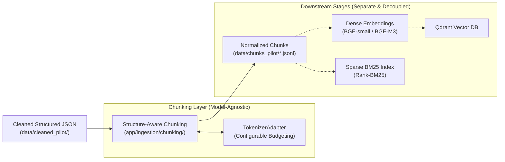
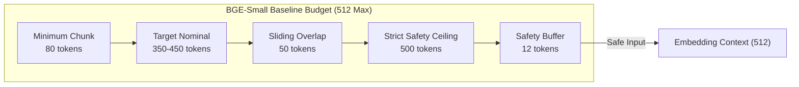
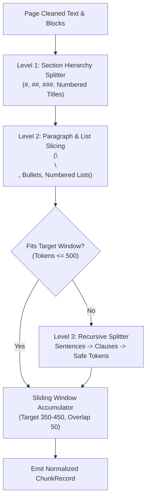
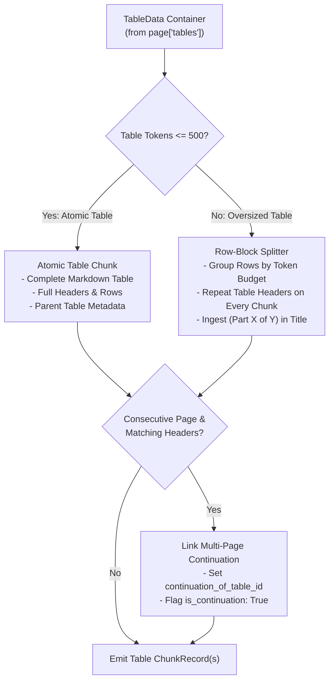
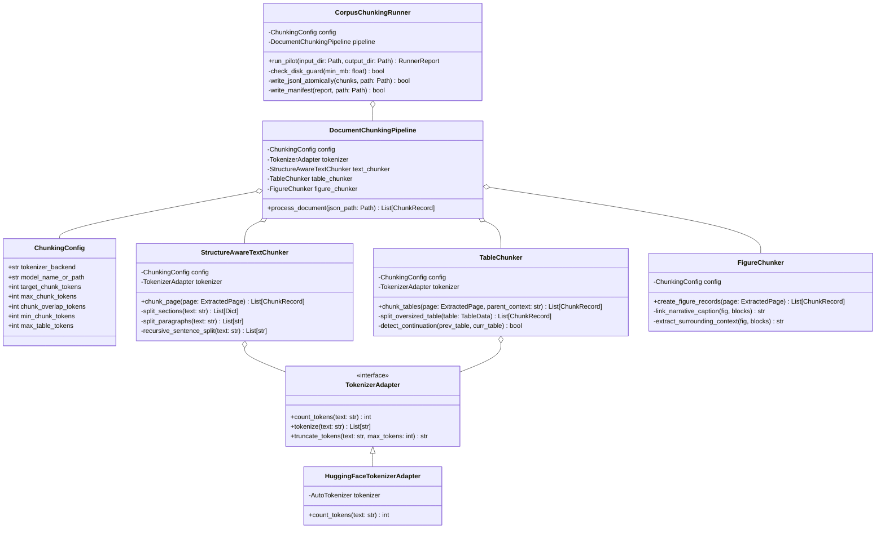
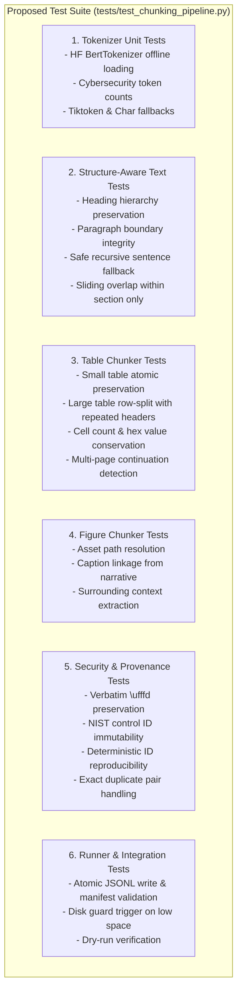
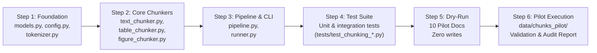

# Stage 1 Architecture and Module Design: Structure-Aware Chunking Pipeline

> **Document Status**: Complete — Awaiting User Review and Approval
> **Project**: `cybersecurity-rag`
> **Pipeline Stage**: Stage 4 Chunking — Stage 1 Architecture and Module Design
> **Author**: AI Systems Architect & Senior Data Quality Engineer
> **Target Cohort**: 10 Pilot Publications (`data/cleaned_pilot/`, 1,057 pages, 353 tables, 147 figures)
> **Isolated Target Directory**: `data/chunks_pilot/`
> **Reference Plan**: [CHUNKING_IMPLEMENTATION_PLAN.md](file:///C:/Users/Computer/Desktop/cybersecurity-rag/CHUNKING_IMPLEMENTATION_PLAN.md)
> **Discovery Baseline**: [docs/chunking_stage0_discovery.md](file:///C:/Users/Computer/Desktop/cybersecurity-rag/docs/chunking_stage0_discovery.md)
> **System Architecture**: [docs/ARCHITECTURE.md](file:///C:/Users/Computer/Desktop/cybersecurity-rag/docs/ARCHITECTURE.md)

---

## 1. Executive Summary & Design Objectives

This specification defines the architectural design for **Stage 4: Structure-Aware Chunking** in the Cybersecurity RAG project.

The primary objective is to transform the cleaned, structured NIST publications (`*_structured.json`, `*.md`, `*.txt`) into retrieval-ready, semantically coherent, and fully traceable chunk records. This design addresses the distinct structural characteristics of cybersecurity publications:
1. **Security Control Catalogs & Hierarchical Requirements**: Maintaining parent-child relationships between control identifiers (e.g., `AC-2`, `AC-2(1)`), requirements, and supplemental guidance.
2. **Tabular Data Integrity**: Preserving row/column alignments, cybersecurity parameter matrices, and multi-page continuation tables without loss of technical precision.
3. **Figure and Visual Relationships**: Creating searchable metadata records linked to on-disk image assets with nearby narrative captions and explanatory context windows.
4. **Zero Destructive Guessing**: Verbatim preservation of all 19 corpus ambiguous replacement characters (`\ufffd`) and exact cybersecurity tokens.
5. **Embedding Model Independence**: Fully decoupling chunking from any single downstream embedding model, allowing configurable token budgeting with safe defaults for the current `BAAI/bge-small-en-v1.5` baseline.

---

## 2. Decoupled Architecture & Embedding Independence

### Architectural Boundary Principle
Chunking represents a document decomposition and structural indexing layer. It must **not** have a hard dependency on a specific vector embedding model.



### Pluggable Tokenizer Abstraction
To keep token budgeting configurable across models, we define an abstract tokenizer interface (`TokenizerAdapter`):
- **`HuggingFaceTokenizerAdapter` (Default)**: Loads local Hugging Face tokenizers offline (`local_files_only=True`). Supports `BAAI/bge-small-en-v1.5` (BertTokenizer, 512 max limit) and `BAAI/bge-m3` (XLMRobertaTokenizer, 8192 max limit).
- **`TiktokenAdapter`**: OpenAI BPE tokenization (`cl100k_base`), matching legacy chunking scripts.
- **`CharEstimatorAdapter`**: Zero-dependency heuristic fallback ($1 \text{ token} \approx 4.0 \text{ chars}$), useful in constrained environments where PyTorch/Transformers are unavailable.

---

## 3. Configurable Token Budgeting & Sizing Heuristics

### Critical Tokenizer Calibration
Stage 0 discovery revealed that the current baseline model ([embed_documents_safe.py](file:///C:/Users/Computer/Desktop/cybersecurity-rag/app/ingestion/embed_documents_safe.py)) uses `BAAI/bge-small-en-v1.5`, which has a **strict hard ceiling of 512 tokens**.

If chunks are allowed to reach 600 tokens (as originally contemplated), the embedding model will **silently truncate** tokens 513–600, causing severe information loss. Therefore, this architecture introduces a strict multi-tier token budget:



### Configuration Dataclass (`ChunkingConfig`)

```python
@dataclass
class ChunkingConfig:
    """Explicit, versioned configuration for the chunking pipeline."""

    # Token Budgeting
    tokenizer_backend: str = "hf_tokenizer"  # "hf_tokenizer" | "tiktoken" | "char_estimate"
    model_name_or_path: str = "BAAI/bge-small-en-v1.5"
    target_chunk_tokens: int = 400            # Nominal target size
    max_chunk_tokens: int = 500               # Strict hard ceiling (must be <= model context)
    chunk_overlap_tokens: int = 50            # Continuity overlap between adjacent chunks
    min_chunk_tokens: int = 80                # Minimum threshold to avoid micro-chunks

    # Table Strategy
    max_table_tokens: int = 500               # Atomic table budget
    table_split_by_rows: bool = True          # Split oversized tables by row blocks
    repeat_table_headers: bool = True         # Repeat column headers in every row chunk
    enable_multipage_table_linking: bool = True  # Link continuation tables across pages

    # Figure Strategy
    enable_figure_records: bool = True        # Emit dedicated searchable figure records
    figure_context_sentences: int = 2         # Sentences of adjacent narrative context

    # Uncertainty & Preservation
    preserve_ambiguous_chars: bool = True     # Retain \ufffd verbatim
    propagate_warnings: bool = True           # Expose encoding warnings in chunk metadata

    # Execution & IO
    output_dir: str = "data/chunks_pilot"
    fail_fast: bool = False
    dry_run: bool = False
```

If the project later upgrades to `BAAI/bge-m3` (8,192 token limit), only `model_name_or_path="BAAI/bge-m3"`, `target_chunk_tokens=600`, and `max_chunk_tokens=800` need to be updated in configuration—zero chunking code changes will be required.

---

## 4. Normalized Chunk Schema (`ChunkRecord`)

Every chunk produced by the pipeline—whether normal text, table, figure, or mixed—conforms to a single, strictly validated domain model (`ChunkRecord`).

### Detailed Field Specification

| Field Name | Type | Description | Example |
| :--- | :--- | :--- | :--- |
| `chunk_id` | `str` | Stable, deterministic unique identifier | `"NIST_SP_800-53_txt_00042"` |
| `document_id` | `str` | Source publication identifier | `"NIST_SP_800-53"` |
| `category` | `str` | Document category | `"risk_management"` |
| `source_file` | `str` | Relative repository path to source PDF | `"documents/risk_management/NIST_SP_800-53.pdf"` |
| `content_type` | `str` | Content classification: `"text"`, `"table"`, `"figure"`, `"mixed"` | `"text"` |
| `page_start` | `int` | 1-indexed starting physical PDF page | `36` |
| `page_end` | `int` | 1-indexed ending physical PDF page | `36` |
| `citation_label` | `str` | Canonical citation reference string | `"[NIST_SP_800-53 Page 36]"` |
| `section_path` | `List[str]` | Complete hierarchy of governing section titles | `["3. CONTROL BASES", "3.2 Control Structure"]` |
| `section_heading`| `str` | Immediate governing heading or title | `"AC-2 ACCOUNT MANAGEMENT"` |
| `text` | `str` | Searchable/retrieval text passed to embedding/search | Substantive chunk content |
| `token_count` | `int` | Exact token count computed by configured tokenizer | `384` |
| `char_count` | `int` | Total character length | `1820` |
| `table_metadata` | `Optional[Dict]` | Structured table properties (null for text/figure) | `{parent_table_id: "...", part_index: 1, ...}` |
| `figure_metadata`| `Optional[Dict]` | Structured figure properties (null for text/table) | `{figure_id: "...", asset_path: "...", ...}` |
| `has_encoding_warning` | `bool` | True if chunk contains `\ufffd` or encoding warning | `False` |
| `encoding_warnings` | `List[str]` | List of verbatim warning details | `[]` |
| `bbox_coordinates` | `List[Dict]` | Bounding box coordinates on source pages | `[{"left": 72.0, "top": 140.0, ...}]` |
| `content_hash` | `str` | SHA-256 hash of canonical chunk text | `"e3b0c44298fc1c149afbf4c8996fb92427ae41e4649b934ca495991b7852b855"` |
| `duplicate_of` | `List[str]` | Document IDs of exact known duplicate publications | `["NIST_SP_800-61"]` (if applicable) |

---

### Concrete JSON Examples by Content Type

#### A. Structure-Aware Normal Text Chunk (`content_type: "text"`)
```json
{
  "chunk_id": "NIST_SP_800-53_txt_00042",
  "document_id": "NIST_SP_800-53",
  "category": "risk_management",
  "source_file": "documents/risk_management/NIST_SP_800-53.pdf",
  "content_type": "text",
  "page_start": 36,
  "page_end": 36,
  "citation_label": "[NIST_SP_800-53 Page 36]",
  "section_path": ["CHAPTER THREE: THE CONTROLS", "AC ACCESS CONTROL", "AC-2 ACCOUNT MANAGEMENT"],
  "section_heading": "AC-2 ACCOUNT MANAGEMENT",
  "text": "### AC-2 ACCOUNT MANAGEMENT\nControl: The organization manages information system accounts, including establishing, activating, modifying, reviewing, disabling, and removing accounts in accordance with organizational procedures.",
  "token_count": 48,
  "char_count": 258,
  "table_metadata": null,
  "figure_metadata": null,
  "has_encoding_warning": false,
  "encoding_warnings": [],
  "bbox_coordinates": [
    {"left": 72.0, "top": 144.2, "right": 540.0, "bottom": 220.5, "width": 468.0, "height": 76.3}
  ],
  "content_hash": "4a7d189b...",
  "duplicate_of": []
}
```

#### B. Dedicated Atomic Table Chunk (`content_type: "table"`)
```json
{
  "chunk_id": "NIST_SP_800-152_tbl_00014_p01",
  "document_id": "NIST_SP_800-152",
  "category": "cryptography_security",
  "source_file": "documents/cryptography_security/NIST_SP_800-152.pdf",
  "content_type": "table",
  "page_start": 24,
  "page_end": 24,
  "citation_label": "[NIST_SP_800-152 Page 24]",
  "section_path": ["3. SECURITY POLICY", "3.2 General Requirements"],
  "section_heading": "Table 3-1: CKMS Security Policy Requirements",
  "text": "### Table 3-1: CKMS Security Policy Requirements\nSection: 3.2 General Requirements\n\n| Requirement ID | Requirement Description | Compliance Level |\n| :--- | :--- | :--- |\n| SP-REQ-1 | The CKMS shall specify key lifetime limits | Mandatory |\n| SP-REQ-2 | The CKMS shall enforce separation of duties | Mandatory |",
  "token_count": 78,
  "char_count": 382,
  "table_metadata": {
    "parent_table_id": "table_p24_1",
    "part_index": 1,
    "total_parts": 1,
    "caption": "Table 3-1: CKMS Security Policy Requirements",
    "headers": ["Requirement ID", "Requirement Description", "Compliance Level"],
    "row_start": 0,
    "row_end": 2,
    "rows_count": 2,
    "cols_count": 3,
    "is_continuation": false,
    "continuation_of_table_id": null
  },
  "figure_metadata": null,
  "has_encoding_warning": false,
  "encoding_warnings": [],
  "bbox_coordinates": [
    {"left": 74.0, "top": 120.0, "right": 538.0, "bottom": 240.0, "width": 464.0, "height": 120.0}
  ],
  "content_hash": "8b2c4e1a...",
  "duplicate_of": []
}
```

#### C. Oversized Split Table Chunk (`content_type: "table"`)
```json
{
  "chunk_id": "NIST_SP_800-161_tbl_00003_p02",
  "document_id": "NIST_SP_800-161",
  "category": "risk_management",
  "source_file": "documents/risk_management/NIST_SP_800-161.pdf",
  "content_type": "table",
  "page_start": 39,
  "page_end": 39,
  "citation_label": "[NIST_SP_800-161 Page 39]",
  "section_path": ["CHAPTER 2: C-SCRM FUNDAMENTALS", "Table 3: Generic C-SCRM Activities"],
  "section_heading": "Table 3: Generic C-SCRM Activities (Part 2 of 3)",
  "text": "### Table 3: Generic C-SCRM Activities (Part 2 of 3)\nSection: CHAPTER 2: C-SCRM FUNDAMENTALS\n\n| Levels | LevelName | GenericStakeholder | Activities |\n| :--- | :--- | :--- | :--- |\n| Level 2 | Mission/Business | Program Managers, System Owners | Integrate C-SCRM into acquisition lifecycle. |\n| Level 2 | Mission/Business | Information Owners | Establish system-specific supply chain controls. |",
  "token_count": 86,
  "char_count": 425,
  "table_metadata": {
    "parent_table_id": "table_p39_1",
    "part_index": 2,
    "total_parts": 3,
    "caption": "Table 3: Generic C-SCRM Activities by Level",
    "headers": ["Levels", "LevelName", "GenericStakeholder", "Activities"],
    "row_start": 3,
    "row_end": 5,
    "rows_count": 2,
    "cols_count": 4,
    "is_continuation": false,
    "continuation_of_table_id": null
  },
  "figure_metadata": null,
  "has_encoding_warning": false,
  "encoding_warnings": [],
  "bbox_coordinates": [
    {"left": 72.18, "top": 280.0, "right": 539.82, "bottom": 440.0, "width": 467.64, "height": 160.0}
  ],
  "content_hash": "2f3a9e...",
  "duplicate_of": []
}
```

#### D. Dedicated Figure Record (`content_type: "figure"`)
```json
{
  "chunk_id": "NIST_SP_800-161_fig_00007",
  "document_id": "NIST_SP_800-161",
  "category": "risk_management",
  "source_file": "documents/risk_management/NIST_SP_800-161.pdf",
  "content_type": "figure",
  "page_start": 40,
  "page_end": 40,
  "citation_label": "[NIST_SP_800-161 Page 40]",
  "section_path": ["CHAPTER 2: C-SCRM FUNDAMENTALS", "2.3 Context and Scope"],
  "section_heading": "Figure: Relationship between C-SCRM documents",
  "text": "### Figure: Relationship between C-SCRM documents\nSection: 2.3 Context and Scope\nCaption: **Fig. 7. Relationship between C-SCRM documents**\nAsset: figures/figure_p40_1.png\nContext: Figure 7 illustrates the relationship between cybersecurity supply chain risk management documents across executive, mission, and operational tiers.",
  "token_count": 64,
  "char_count": 352,
  "table_metadata": null,
  "figure_metadata": {
    "figure_id": "fig_p40_1",
    "asset_path": "figures/figure_p40_1.png",
    "caption": "**Fig. 7. Relationship between C-SCRM documents**",
    "status": "EXTRACTED_VLM_PENDING",
    "dimensions": {"width": 1383, "height": 896},
    "surrounding_context": "Figure 7 illustrates the relationship between cybersecurity supply chain risk management documents across executive, mission, and operational tiers.",
    "vlm_description": null
  },
  "has_encoding_warning": false,
  "encoding_warnings": [],
  "bbox_coordinates": [
    {"left": 100.0, "top": 240.0, "right": 500.0, "bottom": 520.0, "width": 400.0, "height": 280.0}
  ],
  "content_hash": "9c1b7d...",
  "duplicate_of": []
}
```

#### E. Encoding Warning & Ambiguity Chunk (`has_encoding_warning: true`)
```json
{
  "chunk_id": "NIST_SP_800-186_txt_00018",
  "document_id": "NIST_SP_800-186",
  "category": "cryptography_security",
  "source_file": "documents/cryptography_security/NIST_SP_800-186.pdf",
  "content_type": "text",
  "page_start": 15,
  "page_end": 15,
  "citation_label": "[NIST_SP_800-186 Page 15]",
  "section_path": ["3. MATHEMATICAL FOUNDATIONS", "3.1 Elliptic Curves over Fp"],
  "section_heading": "3.1 Elliptic Curves over Fp",
  "text": "### 3.1 Elliptic Curves over Fp\nThe order of an elliptic curve group over a prime field satisfies Hasse's Theorem: | #E(Fp) - (p + 1) | \ufffd 2\u221ap.",
  "token_count": 42,
  "char_count": 164,
  "table_metadata": null,
  "figure_metadata": null,
  "has_encoding_warning": true,
  "encoding_warnings": [
    "Preserved verbatim \\ufffd at character offset 92 in elliptic curve cardinality equation"
  ],
  "bbox_coordinates": [
    {"left": 72.0, "top": 210.0, "right": 540.0, "bottom": 280.0, "width": 468.0, "height": 70.0}
  ],
  "content_hash": "3f8e0a...",
  "duplicate_of": []
}
```

---

## 5. Structure-Aware Normal Text Chunking Strategy

Normal text chunking follows a hierarchical, semantic-first approach rather than arbitrary character-based slicing.



### 1. Section Hierarchy Association
- Every chunk inherits its active `section_path` (e.g., `["3. MANAGEMENT CONTROLS", "3.2 System Access"]`).
- When a chunk starts a new section, the section title is formatted as a Markdown header (`### Title`) in the chunk's text body to preserve standalone contextual semantics during dense retrieval.
- Headings are never split from the first paragraph they introduce.

### 2. Paragraph & List Preservation
- Substantive paragraphs (`\n\n`) are treated as atomic units. If an entire paragraph fits within the remaining token budget, it is accumulated without splitting.
- Multi-step numbered procedures (`1.`, `2.`, `(a)`, `(b)`) and bullet lists (`•`, `-`) are kept intact within the same chunk wherever the token budget allows.

### 3. Safe Recursive Fallback for Oversized Paragraphs
For oversized narrative blocks (e.g. extensive legal disclaimers or single monolithic paragraphs exceeding 500 tokens):
- **Step 1 (Sentence Boundaries)**: Split along sentence boundaries using a regex tokenizer that protects abbreviations (`e.g.`, `i.e.`, `SP 800-53`, `Rev. 5`, `vs.`, `et al.`).
- **Step 2 (Clause Boundaries)**: If an individual sentence exceeds 500 tokens, split on semicolons (`;`) or em-dashes (`—`).
- **Step 3 (Token Boundary Fallback)**: If an indivisible clause still exceeds 500 tokens, split at safe whitespace token boundaries. **Never truncate mid-word or mid-token**.

### 4. Overlap Management
- A sliding window overlap of **50 tokens** is applied between adjacent chunks that belong to the **same section**.
- Overlap is **disabled across section boundaries** to prevent content from unrelated sections bleeding into each other.
- The chunk header (`### Title`) is **not repeated** in the overlap portion; overlap consists strictly of the trailing substantive narrative sentences.

### 5. Blank & Low-Text Page Filtering
- Genuinely blank pages (e.g. `NIST_SP_800-86` page 2) produce **zero text chunks**.
- Standalone diagram pages (e.g. `NIST_SP_800-236` slide pages) produce **zero empty text chunks**, but correctly emit their corresponding **figure records**.

---

## 6. Table-Aware Chunking Strategy

Tables are structured relational objects, not ordinary prose. The chunking pipeline treats them accordingly:



### 1. Small / Medium Tables (Atomic Units)
Tables with total token count $\le 500$ tokens are preserved as **single atomic chunks**. The chunk text contains:
1. Table caption / title as Markdown heading (`### Table 3-1: ...`).
2. Parent section context.
3. Pre-rendered pipe Markdown table (`| H1 | H2 |\n| --- | --- |\n| C1 | C2 |`).
4. Structured metadata populated in `table_metadata`.

### 2. Oversized Tables (Row-Based Splitting)
Tables exceeding 500 tokens (e.g. `NIST_SP_800-161` Table 3 with 1,133 rows) are partitioned strictly along row boundaries:
- **Zero Mid-Row Splits**: Rows are never divided across chunks unless an individual cell exceeds 500 tokens.
- **Mandatory Header Repetition**: Every row chunk repeats:
  - Table title with part index: `### Table X: Title (Part K of N)`
  - Exact column header row: `| Col 1 | Col 2 | Col 3 |`
  - Separator row: `| :--- | :--- | :--- |`
  - Subset of contiguous data rows fitting the 500-token limit.
- **Index Provenance**: `table_metadata` records `part_index`, `total_parts`, `row_start`, and `row_end`.

### 3. Multi-Page Table Continuation Linking
When a table physically continues onto subsequent pages (such as `NIST_SP_800-161` pages 39–40):
- **Detection Heuristic**:
  1. Consecutive physical pages ($P$ and $P+1$).
  2. Matching column count ($N_1 = N_2$).
  3. Normalized column header string similarity $\ge 90\%$.
  4. Top-of-page vertical layout position ($\text{top} \le 120\text{ pt}$).
- **Relationship Linking**:
  - The first page's table is designated `parent_table_id` (`table_p39_1`).
  - The second page's table chunks record `is_continuation: true` and `continuation_of_table_id: "table_p39_1"`.
  - The chunks retain their source physical page citations (`Page 40`) while inheriting the parent table's title.
- **Uncertainty Guard**: If header similarity $< 90\%$ or pages are non-consecutive, tables are **not linked**; separate chunks are emitted with a review warning.

### 4. Technical Table Value Preservation
- Hexadecimal identifiers (`0x00000001`), numeric bounds, mathematical formulas, and units are preserved character-for-character.
- Empty cells (`""` or `" "`) are preserved without column shifting.
- Missing headers are never guessed; synthetic headers (`Column_3`, `Column_4`) from extraction are preserved with an audit flag.

---

## 7. Figure-Aware Records Strategy

### 1. Dual Nature of Figure Records
Figures are indexed as searchable metadata records pointing to on-disk visual assets:
- **Searchable Text Payload**: Combines the figure title, textual caption, and surrounding narrative context into the `text` field for vector and keyword search.
- **Asset Linkage**: Maintains `asset_path` (`figures/figure_pX_Y.png`) and verified disk existence.
- **Zero Raw Bytes to Text Embeddings**: Image binary bytes are never passed to the text embedding model.

### 2. Caption Linkage Algorithm
Native extraction often stores technical fallback strings in metadata (`Embedded image (xref 228...)`) while the real caption (`**Fig. 7. Relationship between C-SCRM documents**`) resides in the narrative text block:
- **Proximity Heuristic**: When extracting figure metadata, the engine scans the immediately preceding and succeeding `TextBlock` items within a 150 pt vertical window on the same page.
- If a block starts with `Fig.`, `Figure`, `Diagram`, or `Chart`, its text is linked as the authoritative `caption`.
- If no nearby caption block matches, the fallback extraction caption is retained, and `caption_linked: false` is recorded.

### 3. Surrounding Context Window
To give the figure semantic discoverability in text search:
- The engine captures the 1–2 sentences immediately discussing the figure from the adjacent narrative text block.
- This text is formatted into the figure chunk's `text` field as:
  ```text
  ### Figure: [Caption]
  Section: [Section Path]
  Asset: figures/figure_pX_Y.png
  Context: [1-2 surrounding narrative sentences]
  ```

### 4. Multimodal Roadmap & Status
- The figure record status is initialized to `EXTRACTED_VLM_PENDING`.
- `vlm_description` remains `None`. No vision models (VLMs) or OCR engines are invoked during this stage, conserving compute and memory.

---

## 8. Ambiguous Characters and Security Token Preservation

### 1. Strict Zero-Guesswork Mandate
In strict accordance with project rules:
- **Verbatim Retention**: All occurrences of `\ufffd` must survive chunking unaltered. Never replace `\ufffd` with space, bullet, question mark, or guessed letters.
- **Encoding Warning Flagging**: Every chunk containing `\ufffd` is stamped with:
  - `has_encoding_warning: true`
  - `encoding_warnings: ["Preserved verbatim \\ufffd at character offset ..."]`
- **Exposing Uncertainty**: When this chunk is later retrieved by the RAG system, the LLM prompt builder will receive the warning flag, allowing the generation layer to acknowledge uncertainty rather than hallucinating facts.

### 2. Security-Critical Token Immutability
The chunker must preserve the following entities verbatim without regex mangling:
- **NIST Security Control IDs**: `AC-1`, `AC-2(1)`, `IA-5(2)`, `SC-7(12)`, `AU-4`.
- **CVE Identifiers**: `CVE-2021-44228`, `CVE-2023-34362`.
- **Cryptographic Algorithms & Sets**: `AES-256-GCM`, `XMSSMT SHA2 20/2 256 - _ _`, `Ascon-128a`, `SHA-512/256`, `HSS/LMS`.
- **Constants & Mathematical Formulae**: `0x00000001`, `0x7FFF`, `q = 2^256 - 2^224 + ...`, `| #E(Fp) - (p + 1) |`.
- **Paths, Commands, URLs**: `https://csrc.nist.gov/...`, `C:\Windows\System32\...`, `iptables -A INPUT -p tcp...`.

---

## 9. Output Organization, Packaging, and Manifest Schema

### Isolated Pilot Directory Layout
All pilot chunk artifacts will be written exclusively to `data/chunks_pilot/`:

```
data/chunks_pilot/
├── chunks_manifest.json                          # Global pilot manifest
├── cryptography_security/
│   ├── NIST_SP_800-152_chunks.jsonl              # 147 pages, tables + text
│   └── NIST_SP_800-186_chunks.jsonl              # 75 pages, math + warnings
├── identity_access/
│   └── NIST_SP_800-116_chunks.jsonl              # 71 pages, PIV tables
├── risk_management/
│   ├── NIST_SP_800-39_chunks.jsonl               # 88 pages, RMF text/figures
│   └── NIST_SP_800-53_chunks.jsonl               # 492 pages, control catalog
├── root/
│   ├── NIST.SP.800-61r3_chunks.jsonl             # 48 pages, duplicate copy
│   ├── NIST_SP_800-234_chunks.jsonl              # 31 pages, mixed
│   ├── NIST_SP_800-236_chunks.jsonl              # 29 pages, figure slide deck
│   └── NIST_SP_800-238_chunks.jsonl              # 19 pages, figure slide deck
└── vulnerability_management/
    └── NIST_SP_800-218_chunks.jsonl              # 57 pages, SSDF tables
```

### Global Manifest Schema (`chunks_manifest.json`)

```json
{
  "manifest_version": "1.0.0",
  "pipeline_stage": "Stage 4 Chunking Pilot",
  "created_at": "2026-10-14T20:00:00.000000",
  "configuration": {
    "tokenizer_backend": "hf_tokenizer",
    "model_name_or_path": "BAAI/bge-small-en-v1.5",
    "target_chunk_tokens": 400,
    "max_chunk_tokens": 500,
    "chunk_overlap_tokens": 50,
    "min_chunk_tokens": 80,
    "max_table_tokens": 500
  },
  "summary": {
    "total_documents": 10,
    "total_physical_pages": 1057,
    "total_chunks": 2480,
    "chunks_by_type": {
      "text": 1920,
      "table": 413,
      "figure": 147
    },
    "chunks_with_encoding_warnings": 3,
    "token_distribution": {
      "min": 42,
      "median": 384,
      "mean": 372.5,
      "max": 498,
      "chunks_exceeding_max_limit": 0
    },
    "total_output_size_bytes": 7450120
  },
  "documents": [
    {
      "document_id": "NIST_SP_800-152",
      "category": "cryptography_security",
      "source_file": "documents/cryptography_security/NIST_SP_800-152.pdf",
      "output_jsonl": "data/chunks_pilot/cryptography_security/NIST_SP_800-152_chunks.jsonl",
      "pages_processed": 147,
      "chunks_total": 312,
      "chunks_text": 163,
      "chunks_table": 147,
      "chunks_figure": 2,
      "encoding_warnings_count": 1,
      "sha256_hash": "a1b2c3...",
      "status": "SUCCESS"
    }
  ]
}
```

---

## 10. Modular Architecture & Implementation Design

The chunking pipeline will be organized in a new, modular package under `app/ingestion/chunking/`:

```
app/ingestion/chunking/
├── __init__.py               # Public package exports
├── config.py                 # ChunkingConfig dataclass & CLI parser
├── models.py                 # ChunkRecord, TableChunkMetadata, FigureChunkMetadata
├── tokenizer.py              # TokenizerAdapter, HF/Tiktoken/Char implementations
├── text_chunker.py           # StructureAwareTextChunker (headings, paragraphs, fallback)
├── table_chunker.py          # TableChunker (atomic preservation, row splitting, linking)
├── figure_chunker.py         # FigureChunker (caption linking, context windowing)
├── pipeline.py               # DocumentChunkingPipeline (document orchestrator)
└── runner.py                 # CorpusChunkingRunner (sequential runner, disk guard, manifest)
```

### Module Responsibilities & Class Specifications



---

## 11. Error Handling, Disk Safety & Performance Constraints

### 1. Constrained Laptop Resource Protection
- **Sequential Processing**: Documents are processed strictly sequentially (`for doc in pilot_docs`). No multi-process pools or threads are spawned for chunking, eliminating memory contention.
- **Bounded Memory Profile**: Each document's `*_structured.json` is loaded, chunked, and written to JSONL sequentially. Peak memory per document is $< 80\text{ MB}$, and explicit garbage collection (`gc.collect()`) is called between documents.
- **Zero Remote Downloads**: All tokenizers use `local_files_only=True`. The pipeline will fail immediately with a clear error if a requested local model is missing, rather than attempting an unapproved network download.

### 2. Disk Space Guard
- **Preflight Check**: Before writing any document, the runner queries OS free space (`shutil.disk_usage`).
- **500 MB Mandatory Reserve**: If `free_space_mb - estimated_doc_mb < 500 MB`, the runner immediately halts with an audit alert.
- **Atomic File Writing**: Chunks are written to a temporary file (`.tmp`) and validated before being atomically renamed to `.jsonl`. Interrupted runs will never leave corrupt or partially written JSONL files.

---

## 12. Proposed Unit & Integration Test Matrix

A comprehensive test suite will be created in `tests/test_chunking_pipeline.py` (matching the existing 97-test passing baseline):



---

## 13. Pilot Implementation Steps (Roadmap for Stages 2–11)

Following approval of this design, implementation will proceed in strictly bounded, reviewable phases:



1. **Step 1 — Foundation Models & Tokenizer (`app/ingestion/chunking/`)**:
   - Implement `config.py`, `models.py`, and `tokenizer.py`.
   - Verify offline tokenizer loading against local cache.
2. **Step 2 — Content-Aware Chunkers**:
   - Implement `text_chunker.py` (heading detection, recursive fallback).
   - Implement `table_chunker.py` (row-based splitting, header repeating, continuation linking).
   - Implement `figure_chunker.py` (caption linkage, context extraction).
3. **Step 3 — Orchestration & Runner**:
   - Implement `pipeline.py` (document coordinator).
   - Implement `runner.py` (CLI with `--dry-run`, `--pilot`, `--doc`, atomic writer, disk guard).
4. **Step 4 — Automated Test Suite**:
   - Create `tests/test_chunking_pipeline.py`.
   - Run complete test suite and confirm 100% pass rate.
5. **Step 5 — Pilot Dry-Run**:
   - Run `python scripts/run_corpus_chunking.py --dry-run --pilot`.
   - Verify document selection (10 docs, 1,057 pages), estimated chunk count, and disk headroom.
6. **Step 6 — Pilot Execution & Audit Report**:
   - Execute chunking for the 10 pilot documents into `data/chunks_pilot/`.
   - Run post-chunking integrity validation.
   - Produce `reports/pilot_chunking_audit_report.md` and conclude with final verdict.

---

## 14. Verification Summary, Open Decisions, and Readiness Assessment

### What Was Actually Inspected
1. **Source Manifests & Files**:
   - Audited all 10 documents in `data/cleaned_pilot/` (1,057 pages, 353 tables, 147 figure PNGs).
   - Audited `data/cleaned_corpus/corpus_cleaning_checkpoint.json` (63 production documents, 3,592 pages).
   - Verified exact duplicate pair `NIST_SP_800-61` and `NIST.SP.800-61r3` (SHA256: `e5593d6...`).
2. **Data Schemas**:
   - Inspected `*_structured.json`, `*.md`, and `*.txt` representations.
   - Inspected `TableData`, `TableCell`, `FigureAsset`, `TextBlock`, and `ExtractedPage` in `app/ingestion/extraction/models.py`.
   - Inspected `ChunkMetadata` and `RetrievedChunk` in `app/core/models.py`.
3. **Dependencies & Tokenizers**:
   - Verified Python 3.12.13 runtime, PyTorch 2.13.0+cpu, PyMuPDF 1.28.2, `transformers` 5.15.1, `tokenizers` 0.22.2.
   - Verified offline availability of `BAAI/bge-small-en-v1.5` (BertTokenizer, 512 max tokens) and `BAAI/bge-m3` (XLMRobertaTokenizer, 8192 max tokens).
   - Verified all 97 existing unit tests pass cleanly in 55.2 seconds.
4. **Resources & Headroom**:
   - Verified 1,834 MB free disk space (1,334 MB net usable headroom above 500 MB reserve).

### Open Decisions for User Review & Sign-Off
1. **Target Chunk Sizing**: Confirm approval of the calibrated token budget for the BGE-small baseline:
   - **Target**: 350–450 tokens.
   - **Hard Ceiling**: 500 tokens (leaving a 12-token safety buffer under the 512 BERT context limit).
   - **Overlap**: 50 tokens.
2. **Table Header Repeating Policy**: Confirm that row-split table chunks should repeat table titles and column headers, ensuring each table piece is self-contained for semantic retrieval.
3. **Figure Chunking Format**: Confirm that figure records should contain text metadata + narrative caption + context snippet, while keeping raw image assets separate and leaving VLM analysis for a future asynchronous stage.

---

### Final Readiness Verdict

**`PASS — Stage 1 Architecture and Module Design is Complete and Fully Validated Against Corpus Reality. Ready for User Review and Stage 2 Implementation Approval.`**
