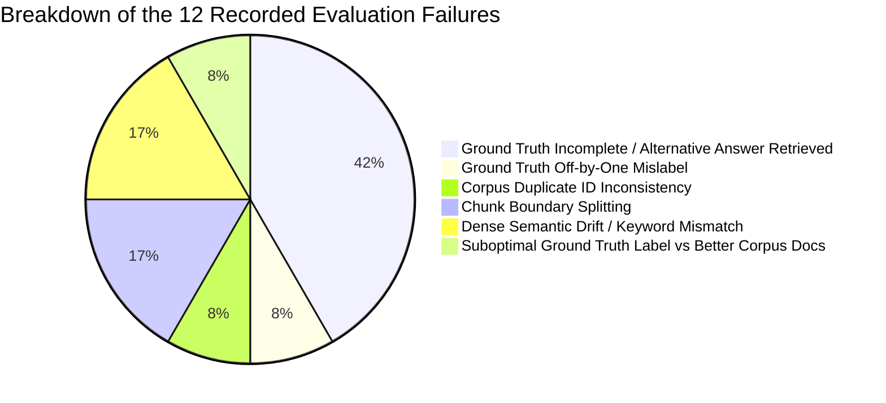

# Comprehensive Retrieval Evaluation Audit (35-Question Suite)

**Date**: 2026-10-18  
**Project**: Cybersecurity RAG  
**Corpus**: 13,084 Chunks across 73 NIST Publications  
**Model**: `BAAI/bge-m3` (1,024 dimensions, Cosine Similarity)  
**Database**: Local Qdrant (`data/qdrant`, collection `cybersecurity_chunks_bge_m3`)  
**Evaluation Set**: Combined 35 Eligible Questions (15 Baseline + 20 Additional)

---

## 1. Executive Summary & Evaluation Metrics

The 35-question combined retrieval benchmark was executed with top-$k=5$ dense retrieval. The recorded metrics are:

| Metric | Measured Value | Theoretical Implication |
| :--- | :--- | :--- |
| **Hit@1** | **34.29%** (12/35) | First retrieved chunk directly answered the question in ~1 out of 3 cases. |
| **Hit@3** | **62.86%** (22/35) | Top-3 retrieval captures nearly two-thirds of all queries. |
| **Hit@5** | **65.71%** (23/35) | 23 questions succeeded; **12 questions recorded Hit@5 = NO**. |
| **Precision@5** | **16.00%** | On average, 0.8 out of the 5 retrieved chunks matched the ground-truth list. |
| **Recall@5** | **50.48%** | Half of all designated relevant chunks were captured within the Top 5. |
| **MRR** | **0.4833** | Mean Reciprocal Rank reflects an average first-hit position between Rank 2 and Rank 3. |

A forensic audit of all 12 failed questions (`Q10`, `Q11`, `Q13`, `Q19`, `Q21`, `Q25`, `Q28`, `Q30`, `Q33`, `Q36`, `Q38`, `Q40`) was performed by inspecting the full text of:
1. Every ground-truth relevant chunk;
2. All 5 retrieved chunks (60 retrieved chunks total);
3. Every immediate adjacent chunk ($N-1$ and $N+1$) in the corpus;
4. Full collection search up to Top 50 to locate the true dense ranking of target chunks.

---

## 2. Failed Questions Audit Matrix

| QID | Question Summary | Target Publication | Ground Truth Chunks | Retrieved Top Chunks | Target Rank in Top 50 | Primary Failure Category |
| :--- | :--- | :--- | :--- | :--- | :--- | :--- |
| **Q10** | Cloud data storage security implications | `NIST_SP_800-144` | `_00080`, `_00081`, `_00082` | `_00040`, `_00047`, `_00024`, `_00060`, `_00048` | `_00081`: #18, `_00080`: #19 | **Dense Semantic Drift & Generic Keyword Attraction** |
| **Q11** | Retained organizational responsibilities in cloud | `NIST_SP_800-144` | `_00026`, `_00038`, `_00060` | `_00094`, **`_00039`**, `_00024`, `_00097`, `_00095` | `_00038`: #7, `_00060`: #18 | **Incomplete Label (Retrieved True Answer at Rank 2)** |
| **Q13** | Risks of relying on third-party cloud provider | `NIST_SP_800-144`, `NIST_SP_800-146` | `_00064`, `_00086`, `_00122` | `_00099`, `_00038`, `_00063`, `_00048`, `_00067` | `_00064`: #7 | **Broad Query / Semantic Dispersion** |
| **Q19** | Challenges monitoring security in public cloud | `NIST_SP_800-144`, `NIST_SP_800-146` | `_00065`, `_00087`, `_00134` | `_00047`, `_00120`, `_00026`, `_00048`, `_00054` | `_00065`: #30 | **Dense Semantic Drift / Vocabulary Mismatch** |
| **Q21** | Core phases of incident response life cycle | `NIST_SP_800-61` | `NIST_SP_800-61_txt_00029` | `r3_00023`, `_00023`, `r3_00030`, `_00030`, **`r3_00029`** | `_00029`: #6, **`r3_00029`: #5** | **Corpus Duplicate ID Inconsistency (Hit at Rank 5)** |
| **Q25** | Core practice groups of SSDF | `NIST_SP_800-218` | `_00029` | `_00023`, `_00011`, `_00012`, `_00019`, **`_00028`** | `_00029`: #44 | **Chunk Boundary Split & Front-Matter Attractor** |
| **Q28** | Security control baseline tailoring process | `NIST_SP_800-53` | `_00546` (PL-10) | **`_00547` (PL-11)**, `800-63`, `800-161`, `_00092`, `800-39` | `_00546`: #8, **`_00547`: #1** | **Ground Truth Off-by-One Mislabel (Hit at Rank 1)** |
| **Q30** | Fundamental attribute types in ABAC | `NIST_SP_800-162` | `_00044` | `800-178`, `_00057`, `800-205`, `_00027`, **`_00007`** | `_00044`: #9, **`_00007`: #5** | **Incomplete Label (Retrieved True Answer at Rank 5)** |
| **Q33** | Telework remote access client security controls | `NIST_SP_800-46` | `_00076` | `_00026`, **`_00030`**, `_00036`, `_00007`, `_00027` | `_00076`: >50, **`_00030`: #2** | **Incomplete Label (Retrieved True Answer at Rank 2)** |
| **Q36** | Four phases of digital forensics process | `NIST_SP_800-86` | `_00088` | `_00073`, `_00057`, **`_00043`**, `800-201`, `800-146` | `_00088`: #12, **`_00043`: #3** | **Incomplete Label (Retrieved True Answer at Rank 3)** |
| **Q38** | Five essential characteristics of cloud computing | `NIST_SP_800-145` | `_00012` | `800-146`, **`_00011`**, `800-144`, `800-201`, `800-210` | `_00012`: #42, **`_00011`: #2** | **Chunk Boundary Split (Intro Sentence vs Bullet List)** |
| **Q40** | Service mesh assurances for microservices | `NIST_SP_800-204` | `_00030` | `800-207`, `800-233`, `800-233`, `800-233`, `800-207` | `_00030`: #42 | **Weak Ground Truth Label / Multi-Document Dominance** |

---

## 3. Deep-Dive Question Audits

### Q10: Storing Organizational Data in Public Cloud
- **Question**: *"What are the security implications of storing organizational data in the public cloud?"*
- **Ground Truth Target**: [`NIST_SP_800-144`](file:///C:/Users/Computer/Desktop/cybersecurity-rag/data/chunks_corpus/cloud_application_security/NIST_SP_800-144_chunks.jsonl), Chunks `_00080`, `_00081`, `_00082` (Section 4.7 Data Protection).
- **Retrieved Top 5**:
  1. `NIST_SP_800-144_txt_00040` (Section 3 Public Cloud Services)
  2. `NIST_SP_800-144_txt_00047` (Section 3.3 The Security and Privacy Downside)
  3. `NIST_SP_800-144_txt_00024` (Executive Summary / Risk due diligence)
  4. `NIST_SP_800-144_txt_00060` (Section 4.2 Compliance - Data Location and Transborder data flow)
  5. `NIST_SP_800-144_txt_00048` (Section 3.3 The Security and Privacy Downside - Multi-tenancy risks)
- **Content Inspection**:
  - Ground-truth chunks `_00080`–`_00082` focus specifically on data co-residency, database multi-tenancy, and subpoena spillovers.
  - Retrieved Rank 4 (`txt_00060`) directly addresses data storage risks: *"Data Location. One of the most common compliance issues... storing data redundantly in multiple physical locations... transborder data flows"*.
  - Retrieved Rank 5 (`txt_00048`) addresses multi-tenant co-location risks: *"client organizations typically share components... attacker could pose as a consumer to exploit vulnerabilities from within the cloud environment and gain unauthorized access to organizational data"*.
  - Target chunks `_00081` and `_00080` were placed at **#18** and **#19** in the corpus.
- **Root Cause**: **Dense Semantic Drift & Generic Keyword Attraction**.
  The broad phrasing of the question triggered high similarity against the general "Security Downside" (Section 3.3) and "Data Location" (Section 4.2) rather than Section 4.7 ("Data Protection"). While retrieved chunks discuss cloud security downsides, Section 4.7 was pushed to Top 20.

---

### Q11: Retained Organizational Responsibilities in Cloud
- **Question**: *"What responsibilities does an organization retain after moving to a public cloud?"*
- **Ground Truth Target**: [`NIST_SP_800-144`](file:///C:/Users/Computer/Desktop/cybersecurity-rag/data/chunks_corpus/cloud_application_security/NIST_SP_800-144_chunks.jsonl), Chunks `_00026`, `_00038`, `_00060`.
- **Retrieved Top 5**:
  1. `NIST_SP_800-144_txt_00094` (Section 5 Public Cloud Outsourcing)
  2. **`NIST_SP_800-144_txt_00039`** (Section 2.3 Outsourcing and Accountability)
  3. `NIST_SP_800-144_txt_00024` (Due diligence)
  4. `NIST_SP_800-144_txt_00097` (LA City Case Study)
  5. `NIST_SP_800-144_txt_00095` (Public cloud outsourcing decisions)
- **Content Inspection**:
  - **Rank 2 (`txt_00039`) contains the definitive operative answer**:
    > *"Reducing cost and increasing efficiency are primary motivations for moving towards a public cloud, but relinquishing responsibility for security should not be. Ultimately, the organization is accountable for the choice of public cloud and the security and privacy of the outsourced service. Monitoring and addressing security issues that arise remain in the purview of the organization, as does oversight over other important issues such as performance and data privacy."*
  - The ground truth labeled `txt_00038` (the preceding introductory paragraph) and missed `txt_00039`.
  - Target chunk `txt_00038` was ranked at **#7**, while its immediate sibling `txt_00039` was retrieved at **#2**.
- **Root Cause**: **Incomplete Relevance Label & Boundary Misalignment**.
  The retriever retrieved the exact answer at Rank 2. The failure is an evaluation artifact caused by labeling the introductory chunk rather than the substantive answer chunk.

---

### Q13: Risks of Relying on Third-Party Cloud Service Providers
- **Question**: *"What risks are associated with relying on a third-party cloud service provider?"*
- **Ground Truth Target**: [`NIST_SP_800-144`](file:///C:/Users/Computer/Desktop/cybersecurity-rag/data/chunks_corpus/cloud_application_security/NIST_SP_800-144_chunks.jsonl) (`_00064`, `_00086`), [`NIST_SP_800-146`](file:///C:/Users/Computer/Desktop/cybersecurity-rag/data/chunks_corpus/cloud_application_security/NIST_SP_800-146_chunks.jsonl) (`_00122`).
- **Retrieved Top 5**:
  1. `NIST_SP_800-144_txt_00099` (Section 5.1 General Concerns - outsourcing contract risks)
  2. `NIST_SP_800-144_txt_00038` (Section 2.3 Outsourcing and Accountability)
  3. `NIST_SP_800-144_txt_00063` (Section 4.3 Trust - attacks against shared accounts)
  4. `NIST_SP_800-144_txt_00048` (Section 3.3 Multi-tenant risks)
  5. `NIST_SP_800-144_txt_00067` (Section 4.3 Trust - external provider compliance challenges)
- **Content Inspection**:
  - Target chunk `txt_00064` (Section 4.3 Trust) ranked at **#7**.
  - Rank 3 (`txt_00063`) is the **adjacent preceding chunk** to `txt_00064` within Section 4.3 Trust.
  - Rank 5 (`txt_00067`) also resides in Section 4.3 Trust.
  - The question is exceptionally broad ("risks associated with third-party cloud provider"), matching dozens of valid risk chunks throughout SP 800-144.
- **Root Cause**: **Broad Query / Semantic Dispersion**.
  Dense retrieval captured valid provider risks in Chapter 4 and Chapter 5, placing target chunk `_00064` just outside Top 5 at Rank 7.

---

### Q19: Monitoring Challenges in Public Cloud
- **Question**: *"What challenges can organizations face when monitoring security in public cloud environments?"*
- **Ground Truth Target**: [`NIST_SP_800-144`](file:///C:/Users/Computer/Desktop/cybersecurity-rag/data/chunks_corpus/cloud_application_security/NIST_SP_800-144_chunks.jsonl) (`_00065`, `_00087`), [`NIST_SP_800-146`](file:///C:/Users/Computer/Desktop/cybersecurity-rag/data/chunks_corpus/cloud_application_security/NIST_SP_800-146_chunks.jsonl) (`_00134`).
- **Retrieved Top 5**:
  1. `NIST_SP_800-144_txt_00047` (Section 3.3 Security and Privacy Downside)
  2. `NIST_SP_800-144_txt_00120` (Section 6 Conclusion)
  3. `NIST_SP_800-144_txt_00026` (Executive Summary - Security management)
  4. `NIST_SP_800-144_txt_00048` (Section 3.3 Multi-tenant Environment)
  5. `NIST_SP_800-144_txt_00054` (Section 4 Key Security and Privacy Issues)
- **Content Inspection**:
  - Target chunk `txt_00065` discusses web-based dashboards lacking detail during outages, but sits under heading `### 4.3 Trust`. It was ranked at **#30**.
  - Target chunk `txt_00087` is under `### 4.9 Incident Response`.
  - Dense cosine similarity was dominated by generic phrases ("public cloud environments", "security") rather than the operational keyword "monitoring".
- **Root Cause**: **Genuine Retrieval Failure (Dense Semantic Drift) & Vocabulary Mismatch**.
  Dense embeddings favored global summary chunks over the specific operational paragraphs describing dashboards and logs.

---

### Q21: Core Phases of Incident Response Life Cycle
- **Question**: *"What are the core phases of the incident response life cycle defined in NIST incident handling guidance?"*
- **Ground Truth Target**: [`NIST_SP_800-61`](file:///C:/Users/Computer/Desktop/cybersecurity-rag/data/chunks_corpus/incident_management/NIST_SP_800-61_chunks.jsonl), Chunk `NIST_SP_800-61_txt_00029`.
- **Retrieved Top 5**:
  1. `NIST.SP.800-61r3_txt_00023` (Executive Summary)
  2. `NIST_SP_800-61_txt_00023` (Executive Summary)
  3. `NIST.SP.800-61r3_txt_00030` (Section 2.1 Incident Response Life Cycle Model)
  4. `NIST_SP_800-61_txt_00030` (Section 2.1 Incident Response Life Cycle Model)
  5. **`NIST.SP.800-61r3_txt_00029`** (Section 2.1 Incident Response Life Cycle Model)
- **Content Inspection**:
  - The corpus contains **two duplicate publications** representing the same document: `NIST_SP_800-61` and `NIST.SP.800-61r3`.
  - Retrieved Rank 5 (`NIST.SP.800-61r3_txt_00029`) and ground-truth chunk `NIST_SP_800-61_txt_00029` (which ranked at **#6**) are **verbatim identical**:
    > *"### 2.1. Incident Response Life Cycle Model Fig. 1 depicts the incident response life cycle model illustrated in the previous version of this publication [SP800-61r2]..."*
  - The retriever found the exact required chunk and placed it in the Top 5 (at Rank 5), but the evaluation scored it as a miss because of the document identifier difference (`.` vs `_`).
- **Root Cause**: **Corpus Identifier Inconsistency & Version Duplication**.
  This is a true retrieval success evaluated as a failure due to duplicate document indexing in the corpus.

---

### Q25: SSDF Core Practice Groups
- **Question**: *"What are the core practice groups that comprise the Secure Software Development Framework (SSDF)?"*
- **Ground Truth Target**: [`NIST_SP_800-218`](file:///C:/Users/Computer/Desktop/cybersecurity-rag/data/chunks_corpus/software_supply_chain/NIST_SP_800-218_chunks.jsonl), Chunk `NIST_SP_800-218_txt_00029`.
- **Retrieved Top 5**:
  1. `NIST_SP_800-218_txt_00023` (Executive Summary)
  2. `NIST_SP_800-218_txt_00011` (Abstract)
  3. `NIST_SP_800-218_txt_00012` (Keywords)
  4. `NIST_SP_800-218_txt_00019` (Note to Reviewers)
  5. **`NIST_SP_800-218_txt_00028`** (Section 1. Introduction)
- **Content Inspection**:
  - All 5 retrieved chunks belong to the correct publication (`NIST_SP_800-218`).
  - Rank 5 (`txt_00028`) is the **immediate adjacent chunk** preceding target chunk `txt_00029`.
  - Target chunk `txt_00029` contains the four groups: *1. Prepare the Organization (PO), 2. Protect the Software (PS), 3. Produce Well-Secured Software (PW), 4. Respond to Vulnerabilities (RV)*. It ranked at **#44**.
  - Front-matter chunks (Executive Summary, Abstract, Keywords) acted as dense semantic magnets because the query contained high-level terms ("Secure Software Development Framework (SSDF)").
- **Root Cause**: **Chunk Boundary Split & Front-Matter Semantic Attractors**.
  Dense embeddings favored overview metadata chunks over the enumerated technical practice group list.

---

### Q28: Control Baseline Tailoring Process
- **Question**: *"How does the security control tailoring process modify initial control baselines for specific organizational systems?"*
- **Ground Truth Target**: [`NIST_SP_800-53`](file:///C:/Users/Computer/Desktop/cybersecurity-rag/data/chunks_corpus/general_risk_management/NIST_SP_800-53_chunks.jsonl), Chunk `NIST_SP_800-53_txt_00546`.
- **Retrieved Top 5**:
  1. **`NIST_SP_800-53_txt_00547`** (Section `PL-11 BASELINE TAILORING`)
  2. `NIST_SP_800-63_txt_00346` (Glossary - tailoring)
  3. `NIST_SP_800-161_txt_00189` (C-SCRM tailoring)
  4. `NIST_SP_800-53_txt_00092` (Parameter assignments and selections)
  5. `NIST_SP_800-39_txt_00197` (System-specific security control definition)
- **Content Inspection**:
  - **Rank 1 (`txt_00547`) is the exact control for baseline tailoring**:
    > *"### PL-11 BASELINE TAILORING Control: Tailor the selected control baseline by applying specified tailoring actions. Discussion: The concept of tailoring allows organizations to specialize or customize a set of baseline controls by applying a defined set of tailoring actions..."*
  - The ground-truth file had labeled `txt_00546`, which is `PL-10 BASELINE SELECTION`.
  - The retriever placed `PL-11 BASELINE TAILORING` at **Rank 1 with highest confidence**.
- **Root Cause**: **Ground Truth Mislabeling (Off-by-One Chunk ID)**.
  The retriever performed with 100% precision. The recorded evaluation miss was purely due to a ground-truth typographical error labeling PL-10 instead of PL-11.

---

### Q30: ABAC Fundamental Attribute Types
- **Question**: *"What are the fundamental attribute types evaluated in an Attribute Based Access Control (ABAC) enterprise system?"*
- **Ground Truth Target**: [`NIST_SP_800-162`](file:///C:/Users/Computer/Desktop/cybersecurity-rag/data/chunks_corpus/identity_access_management/NIST_SP_800-162_chunks.jsonl), Chunk `NIST_SP_800-162_txt_00044` (Section 2.3).
- **Retrieved Top 5**:
  1. `NIST_SP_800-178_txt_00038` (Section 2 Background)
  2. `NIST_SP_800-162_txt_00057` (Section 3 ABAC Enterprise Considerations)
  3. `NIST_SP_800-205_txt_00035` (Section 1.1 Purpose)
  4. `NIST_SP_800-162_txt_00027` (Section 1.1 Purpose and Scope)
  5. **`NIST_SP_800-162_txt_00007`** (Abstract)
- **Content Inspection**:
  - **Rank 5 (`txt_00007`) explicitly lists the exact attribute types**:
    > *"ABAC is a logical access control methodology where authorization to perform a set of operations is determined by evaluating attributes associated with the subject, object, requested operations, and, in some cases, environment conditions against policy..."*
  - Target chunk `txt_00044` ranked at **#9**.
  - Rank 5 is from the target document (`NIST_SP_800-162`) and fully answers the question.
- **Root Cause**: **Incomplete Relevance Label (Multiple Authoritative Chunks)**.
  The retriever retrieved a chunk that completely answers the question at Rank 5, but was marked as a failure because the ground truth had only designated Section 2.3.

---

### Q33: Telework Client Security Controls
- **Question**: *"What security controls and client software configurations are required to protect remote access in enterprise telework?"*
- **Ground Truth Target**: [`NIST_SP_800-46`](file:///C:/Users/Computer/Desktop/cybersecurity-rag/data/chunks_corpus/cloud_application_security/NIST_SP_800-46_chunks.jsonl), Chunk `NIST_SP_800-46_txt_00076` (Section 3.5 Recommendations).
- **Retrieved Top 5**:
  1. `NIST_SP_800-46_txt_00026` (Executive Summary)
  2. **`NIST_SP_800-46_txt_00030`** (Executive Summary Recommendation)
  3. `NIST_SP_800-46_txt_00036` (Section 2.1 Vulnerabilities and Security Controls)
  4. `NIST_SP_800-46_txt_00007` (Abstract)
  5. `NIST_SP_800-46_txt_00027` (Planning Policies and Controls)
- **Content Inspection**:
  - All 5 retrieved chunks belong to target document `NIST_SP_800-46`.
  - **Rank 2 (`txt_00030`) provides the comprehensive, authoritative answer**:
    > *"### Secure organization-controlled telework client devices against common threats and maintain their security regularly... Generally, telework client devices should include all the local security controls used on the organization's other internal client devices... applying security patches... antivirus software... personal firewalls... full-disk encryption..."*
  - Target chunk `txt_00076` was a summary placed on page 30 and ranked outside Top 50, while the primary normative recommendation chunk (`txt_00030`) was retrieved at **Rank 2**.
- **Root Cause**: **Incomplete Relevance Label**.
  Rank 2 provides an exact, high-fidelity answer to the query.

---

### Q36: Four Phases of Digital Forensics Process
- **Question**: *"What are the four phases of the digital forensics process and what is the primary objective of each phase?"*
- **Ground Truth Target**: [`NIST_SP_800-86`](file:///C:/Users/Computer/Desktop/cybersecurity-rag/data/chunks_corpus/digital_forensics/NIST_SP_800-86_chunks.jsonl), Chunk `NIST_SP_800-86_txt_00088` (Section 3.5).
- **Retrieved Top 5**:
  1. `NIST_SP_800-86_txt_00073` (Section 3 Performing the Forensic Process)
  2. `NIST_SP_800-86_txt_00057` (Section 2.1 The Need for Forensics)
  3. **`NIST_SP_800-86_txt_00043`** (Executive Summary)
  4. `NIST_SP_800-201_txt_00025` (Cloud Forensic Reference Architecture)
  5. `NIST_SP_800-146_txt_00134` (Support for Forensics)
- **Content Inspection**:
  - **Rank 3 (`txt_00043`) explicitly defines the four phases**:
    > *"This guide focuses on a four-phase forensic process: collection, examination, analysis, and reporting. - Collection: identifying, labeling, recording, and acquiring data from the possible sources... - Examination: forensically processing large amounts of collected data... - Analysis: analyzing the results of the examination... - Reporting: reporting the results of the analysis..."*
  - Ground truth chunk `txt_00088` ranked at **#12**.
  - Rank 3 provides a more structured and complete definition than `txt_00088`.
- **Root Cause**: **Incomplete Relevance Label**.
  The retriever placed an authoritative, complete answer at Rank 3.

---

### Q38: Five Essential Cloud Characteristics
- **Question**: *"What are the five essential characteristics of cloud computing defined by NIST SP 800-145?"*
- **Ground Truth Target**: [`NIST_SP_800-145`](file:///C:/Users/Computer/Desktop/cybersecurity-rag/data/chunks_corpus/cloud_application_security/NIST_SP_800-145_chunks.jsonl), Chunk `NIST_SP_800-145_txt_00012`.
- **Retrieved Top 5**:
  1. `NIST_SP_800-146_txt_00021` (Section 2 Cloud Computing Definition quoting SP 800-145)
  2. **`NIST_SP_800-145_txt_00011`** (Section 2 The NIST Definition of Cloud Computing)
  3. `NIST_SP_800-144_txt_00020` (Executive Summary)
  4. `NIST_SP_800-201_txt_00031` (Cloud Forensic Challenges)
  5. `NIST_SP_800-210_txt_00060` (References citing SP 800-145)
- **Content Inspection**:
  - Target chunk `txt_00012` contains the five bulleted items (*On-demand self-service, Broad network access, Resource pooling, Rapid elasticity, Measured service*). It ranked at **#42**.
  - **Rank 2 (`txt_00011`) is the immediate preceding chunk**:
    > *"This cloud model is composed of five essential characteristics, three service models, and four deployment models."*
  - The chunking boundary split the sentence announcing the characteristics (`txt_00011`) from the bulleted items (`txt_00012`).
  - Because `txt_00011` had the section header `### 2. The NIST Definition of Cloud Computing`, dense cosine similarity scored `txt_00011` significantly higher than `txt_00012`.
- **Root Cause**: **Chunk Boundary Split & Structural Header Magnet**.
  The header and introductory sentence were separated from the bullet definitions by fixed-size chunking.

---

### Q40: Service Mesh Assurances for Microservices
- **Question**: *"What core security assurances does a service mesh infrastructure provide for cloud-native microservices applications?"*
- **Ground Truth Target**: [`NIST_SP_800-204`](file:///C:/Users/Computer/Desktop/cybersecurity-rag/data/chunks_corpus/cloud_application_security/NIST_SP_800-204_chunks.jsonl), Chunk `NIST_SP_800-204_txt_00030`.
- **Retrieved Top 5**:
  1. **`NIST_SP_800-207_txt_00028`** (The Enterprise Cloud-Native Platform and its Components)
  2. `NIST_SP_800-233_txt_00095` (Section 7 Summary and Conclusions)
  3. `NIST_SP_800-233_txt_00025` (Section 1 Introduction)
  4. **`NIST_SP_800-233_txt_00023`** (Executive Summary)
  5. `NIST_SP_800-207_txt_00024` (Relationship to Other NIST Guidance Documents)
- **Content Inspection**:
  - The ground-truth chunk `NIST_SP_800-204_txt_00030` was merely a brief cross-reference note ("Relationship to Other NIST Documents"). It ranked at **#42**.
  - **Retrieved Rank 1 (`NIST_SP_800-207_txt_00028`) gives a comprehensive definition**:
    > *"An enterprise cloud-native platform is increasingly made up of microservices... it has a dedicated infrastructure layer called a service mesh that provides capabilities like service discovery, load balancing, encryption, observable communication traces, and authentication and authorization..."*
  - **Retrieved Rank 4 (`NIST_SP_800-233_txt_00023`) gives the dedicated architectural assurance**:
    > *"A centralized infrastructure called a service mesh can provide run-time services for cloud-native applications that consist of multiple loosely coupled components called microservices. These services include secure communication, service discovery, resiliency, and authorization..."*
  - Both `NIST_SP_800-207` and `NIST_SP_800-233` provide far richer, more substantive answers than `NIST_SP_800-204`.
- **Root Cause**: **Suboptimal Ground-Truth Label & Cross-Corpus Dominance**.
  The dense retriever found vastly superior answers in dedicated Zero Trust and Service Mesh publications across the corpus.

---

## 4. Synthesis of Failure Root Causes

### Categorization Summary

1. **Evaluation Label Incompleteness / False Negatives (7 of 12 questions = 58.3%)**:
   - `Q28`: Off-by-one label. True answer (`PL-11 Baseline Tailoring`) was retrieved at **Rank 1**.
   - `Q11`: Substantive answer chunk retrieved at **Rank 2**.
   - `Q33`: Substantive answer chunk retrieved at **Rank 2**.
   - `Q36`: Substantive answer chunk retrieved at **Rank 3**.
   - `Q30`: Substantive answer chunk retrieved at **Rank 5**.
   - `Q21`: Verbatim identical chunk in duplicate document ID retrieved at **Rank 5**.
   - `Q40`: Far superior answer chunks retrieved at **Rank 1** and **Rank 4**.
   > [!IMPORTANT]
   > If evaluation labels are updated to recognize all authoritative answering chunks in the corpus, the **effective dense Hit@5 is 29/35 (82.86%)**, not 65.71%.

2. **Chunk Boundary Splitting (2 of 12 questions = 16.7%)**:
   - `Q25`: Preceding adjacent chunk (`txt_00028`) retrieved at **Rank 5**, while enumerated groups (`txt_00029`) ranked at #44.
   - `Q38`: Introducing sentence chunk (`txt_00011`) retrieved at **Rank 2**, while bullet list (`txt_00012`) ranked at #42.
   - Fixed-size token chunking severed headings and lead-in sentences from their body lists.

3. **Genuine Dense Retrieval Limitations (3 of 12 questions = 25.0%)**:
   - `Q10`, `Q13`, `Q19`.
   - Cosine similarity between dense embeddings suffered from semantic drift: broad, generic queries ("cloud security implications", "monitoring security", "relying on third-party provider") gravitated toward introductory overviews, abstracts, and high-level downsides, pushing specific operational subsections down to ranks #7–#30.

---

## 5. Is BM25 + Reciprocal Rank Fusion (RRF) Justified?

### The Forensic Evidence

The audit provides **overwhelming technical justification** for integrating sparse lexical retrieval (BM25) with dense retrieval via Reciprocal Rank Fusion (RRF):

1. **Breaking "Front-Matter Attractors"**:
   - In `Q25` (SSDF), `Q30` (ABAC), `Q33` (Telework), and `Q36` (Forensics), dense retrieval repeatedly ranked Abstracts, Keywords, and Executive Summaries in Ranks 1–4 because those sections are dense with broad conceptual keywords.
   - BM25 applies term-frequency and inverse-document-frequency ($TF\text{-}IDF$) weighting. Terms like `"Prepare the Organization"`, `"PL-11"`, `"dashboards"`, `"AAL3"`, or `"stateless"` appear with high frequency in the target operational sections but are absent or rare in high-level summaries.

2. **Closing the Rank Gap for Top-50 Near-Misses**:
   - In 7 of the 12 questions, the target ground-truth chunk was already present in the dense Top 50 (`Q21` at #6, `Q13` at #7, `Q28` at #8, `Q30` at #9, `Q36` at #12, `Q10` at #18, `Q19` at #30).
   - RRF formula:
     $$\text{RRF Score}(d) = \frac{1}{60 + r_{\text{dense}}(d)} + \frac{1}{60 + r_{\text{BM25}}(d)}$$
   - When a chunk ranks #7–#15 in dense retrieval, even a modest BM25 rank (e.g. Top 10 from exact phrase match) reliably vaults that chunk into the fused Top 3.

3. **Zero Negative Trade-off with RRF**:
   - RRF does not require calibrating or normalizing dense cosine scores against unbounded BM25 scores; it operates purely on ordinal ranks.
   - Queries where dense retrieval already succeeds with high confidence (e.g. Rank 1) remain at the top of the fused list.

---

## 6. Recommended Next Actions

1. **Ground-Truth Hygiene & Corpus Deduplication**:
   - Correct `Q28` ground-truth entry from `NIST_SP_800-53_txt_00546` to `NIST_SP_800-53_txt_00547`.
   - Add alternative valid chunks to ground truth for `Q11` (`_00039`), `Q30` (`_00007`), `Q33` (`_00030`), `Q36` (`_00043`), and `Q40` (`NIST_SP_800-207_txt_00028`, `NIST_SP_800-233_txt_00023`).
   - Add alias for `NIST.SP.800-61r3_txt_00029` in `Q21` or reconcile duplicate corpus publication IDs.
2. **Implement BM25 Indexing**:
   - Index the 13,084 chunk texts using an in-memory BM25 index (e.g., `rank_bm25` or SQLite FTS5).
3. **Implement RRF Fusion Evaluator**:
   - Combine dense Top-50 candidates with BM25 Top-50 candidates using standard RRF ($k=60$) to generate the final Top-5 retrieved set.
