# Ground-Truth Correction & Validation Audit Report (Phase 1)

**Date**: 2026-10-18  
**Project**: Cybersecurity RAG  
**Corpus**: 13,084 Chunks across 73 NIST Publications  
**Model**: `BAAI/bge-m3` (1,024 dimensions, Cosine Similarity)  
**Database**: Local Qdrant (`data/qdrant`, collection `cybersecurity_chunks_bge_m3`)  
**Scope**: Verification and correction of evaluation ground truth only (no algorithmic changes).

---

## 1. Executive Summary

Following the 35-question retrieval audit, Phase 1 was executed to reconcile ground-truth annotations with the verified text of the authoritative chunk corpus. Prior to editing, backups of both ground-truth files were secured.

Each candidate chunk was inspected directly from Qdrant payloads, verified for substantive answer content, and confirmed to exist in the active collection. No algorithmic, corpus, embedding, or Qdrant collection changes were made.

### Impact at a Glance (Combined 35-Question Suite)
- **Hit@1**: **34.29% $\rightarrow$ 40.00%** (+5.71%)
- **Hit@3**: **62.86% $\rightarrow$ 74.29%** (+11.43%)
- **Hit@5**: **65.71% $\rightarrow$ 82.86%** (+17.15%, 29 hits / 6 misses)
- **Precision@5**: **16.00% $\rightarrow$ 20.00%** (+4.00%)
- **Recall@5**: **50.48% $\rightarrow$ 60.24%** (+9.76%)
- **MRR**: **0.4833 $\rightarrow$ 0.5805** (+0.0972)

---

## 2. Verified Ground-Truth Changes

### File 1: [`retrieval_ground_truth_current.json`](file:///C:/Users/Computer/Desktop/cybersecurity-rag/data/evaluation/retrieval_ground_truth_current.json) (Baseline Set)
*Backup created at: [`retrieval_ground_truth_current.json.bak`](file:///C:/Users/Computer/Desktop/cybersecurity-rag/data/evaluation/retrieval_ground_truth_current.json.bak)*

#### **Q11**: Retained Organizational Responsibilities in Cloud
- **Question**: *"What responsibilities does an organization retain after moving to a public cloud?"*
- **Action**: Added `NIST_SP_800-144_txt_00039` to `relevant_chunks`.
- **Existing Chunks**: `NIST_SP_800-144_txt_00026`, `NIST_SP_800-144_txt_00038`, `NIST_SP_800-144_txt_00060`.
- **Verified Chunk Text (`_00039`)**:
  > *"Reducing cost and increasing efficiency are primary motivations for moving towards a public cloud, but relinquishing responsibility for security should not be. Ultimately, the organization is accountable for the choice of public cloud and the security and privacy of the outsourced service. Monitoring and addressing security issues that arise remain in the purview of the organization, as does oversight over other important issues such as performance and data privacy. Because cloud computing brings with it new security challenges, it is essential for an organization to oversee and manage how the cloud provider secures and maintains the computing environment and ensures data is kept secure."*
- **Justification**: `txt_00039` directly follows introductory chunk `txt_00038` in Section 2.3 and contains the explicit operative list of retained client duties. The retriever ranked this chunk at **Rank 2**.

---

### File 2: [`retrieval_ground_truth_additional_20.json`](file:///C:/Users/Computer/Desktop/cybersecurity-rag/data/evaluation/retrieval_ground_truth_additional_20.json) (Additional Set)
*Backup created at: [`retrieval_ground_truth_additional_20.json.bak`](file:///C:/Users/Computer/Desktop/cybersecurity-rag/data/evaluation/retrieval_ground_truth_additional_20.json.bak)*

#### **Q21**: Incident Response Life Cycle Model
- **Question**: *"What are the core phases of the incident response life cycle defined in NIST incident handling guidance?"*
- **Action**: Added `NIST.SP.800-61r3_txt_00029` to `relevant_chunks`. Updated `document_ids` to `["NIST_SP_800-61", "NIST.SP.800-61r3"]`.
- **Existing Chunk**: `NIST_SP_800-61_txt_00029`.
- **Verified Text**: Verbatim identical duplicate of `NIST_SP_800-61_txt_00029` generated during corpus ingestion from duplicate source files. Both define the CSF 2.0-aligned incident response life cycle model.
- **Justification**: Dense retrieval retrieved `NIST.SP.800-61r3_txt_00029` at **Rank 5** (and `NIST_SP_800-61_txt_00029` at Rank 6). Adding the duplicate ID recognizes true content retrieval.

#### **Q28**: Baseline Tailoring Process
- **Question**: *"How does the security control tailoring process modify initial control baselines for specific organizational systems?"*
- **Action**: Replaced `NIST_SP_800-53_txt_00546` with `NIST_SP_800-53_txt_00547`.
- **Verified Chunk Text (`_00547`)**:
  > *"### PL-11 BASELINE TAILORING. Control: Tailor the selected control baseline by applying specified tailoring actions. Discussion: The concept of tailoring allows organizations to specialize or customize a set of baseline controls by applying a defined set of tailoring actions... Tailoring a control baseline is accomplished by identifying and designating common controls, applying scoping considerations, selecting compensating controls, assigning values to control parameters, supplementing the control baseline with additional controls..."*
- **Justification**: Correction of an off-by-one labeling typo. `txt_00546` corresponds to `PL-10 BASELINE SELECTION`, whereas `txt_00547` is `PL-11 BASELINE TAILORING`, which the retriever correctly placed at **Rank 1**.

#### **Q30**: ABAC Attribute Types
- **Question**: *"What are the fundamental attribute types evaluated in an Attribute Based Access Control (ABAC) enterprise system?"*
- **Action**: Added `NIST_SP_800-162_txt_00007` to `relevant_chunks`.
- **Existing Chunk**: `NIST_SP_800-162_txt_00044`.
- **Verified Chunk Text (`_00007`)**:
  > *"ABAC is a logical access control methodology where authorization to perform a set of operations is determined by evaluating attributes associated with the subject, object, requested operations, and, in some cases, environment conditions against policy, rules, or relationships..."*
- **Justification**: Explicitly enumerates the four fundamental attribute types in the document's core definition. The retriever ranked this chunk at **Rank 5**.

#### **Q33**: Telework Remote Access Client Security
- **Question**: *"What security controls and client software configurations are required to protect remote access in enterprise telework?"*
- **Action**: Added `NIST_SP_800-46_txt_00030` to `relevant_chunks`.
- **Existing Chunk**: `NIST_SP_800-46_txt_00076`.
- **Verified Chunk Text (`_00030`)**:
  > *"Secure organization-controlled telework client devices against common threats and maintain their security regularly... include all the local security controls used in the organization's secure configuration baseline... applying operating system and application updates promptly, disabling unneeded services, and using antimalware software and a personal firewall... encrypting sensitive data stored on the devices..."*
- **Justification**: `txt_00030` is the primary normative recommendation chunk for client controls in NIST SP 800-46, providing a more detailed answer than summary chunk `_00076`. The retriever ranked it at **Rank 2**.

#### **Q40**: Service Mesh Assurances for Microservices
- **Question**: *"What core security assurances does a service mesh infrastructure provide for cloud-native microservices applications?"*
- **Action**: Added `NIST_SP_800-207_txt_00028` and `NIST_SP_800-233_txt_00023` to `relevant_chunks`. Updated `document_ids` to `["NIST_SP_800-204", "NIST_SP_800-207", "NIST_SP_800-233"]`.
- **Existing Chunk**: `NIST_SP_800-204_txt_00030`.
- **Verified Chunk Text**:
  - `NIST_SP_800-207_txt_00028` (Rank 1): Service mesh dedicated layer providing service identities, service discovery, policy-based authorization (ABAC/NGAC), mTLS encryption, observable communication traces, and network resilience.
  - `NIST_SP_800-233_txt_00023` (Rank 4): Service mesh runtime security services (secure communication, authorization, resilience) implemented via sidecar proxies in the data plane.
- **Justification**: The original chunk `NIST_SP_800-204_txt_00030` was merely a cross-reference notice. Both added chunks provide authoritative, deep architectural security assurances and were retrieved at **Rank 1** and **Rank 4**.

---

## 3. Analysis of Boundary & Ambiguous Questions (Preserved Without Changes)

In strict accordance with the guidelines (*"Do not automatically mark adjacent chunks relevant. Inspect their actual content"* and *"If a relevance decision is ambiguous, document it instead of guessing"*), the following cases were reviewed and left unchanged:

| Question ID | Candidate Chunk Inspected | Content Finding | Decision & Rationale |
| :--- | :--- | :--- | :--- |
| **Q25** | `NIST_SP_800-218_txt_00028` (adjacent to `_00029`) | Contains the concluding sentence: *"The practices are organized into four groups:"* but does **not** list or define the groups. | **Rejected**: Only `txt_00029` contains the actual practice groups (PO, PS, PW, RV). `txt_00028` is an introductory lead-in without substantive answers. |
| **Q38** | `NIST_SP_800-145_txt_00011` (adjacent to `_00012`) | Contains: *"This cloud model is composed of five essential characteristics, three service models..."* but does **not** name the five characteristics. | **Rejected**: Only `txt_00012` enumerates and defines the characteristics (On-demand self-service, Broad network access, Resource pooling, Rapid elasticity, Measured service). |
| **Q36** | `NIST_SP_800-86_txt_00043` & `txt_00044` | Executive Summary split: `txt_00043` defines Collection only; `txt_00044` defines Examination, Analysis, and Reporting. | **Preserved `_00088` only**: Adding `txt_00043` alone would be incomplete (contains only 1 of 4 objectives). Documented as an ambiguous boundary split pair. |

---

## 4. Quantitative Evaluation Results: Before vs. After

All three evaluation suites were executed using the authoritative evaluator [`evaluate_retrieval_metrics.py`](file:///C:/Users/Computer/Desktop/cybersecurity-rag/evaluation/evaluate_retrieval_metrics.py).

### Detailed Comparative Metrics

```mermaid
xychart-beta
    title "Hit@k Progression (Combined 35 Questions)"
    x-axis ["Hit@1", "Hit@3", "Hit@5"]
    y-axis "Percentage" 0 --> 100
    bar "Before Correction" [34.29, 62.86, 65.71]
    bar "After Correction" [40.00, 74.29, 82.86]
```

| Evaluation Suite | Metric | Before Correction | After Correction | Delta |
| :--- | :--- | :--- | :--- | :--- |
| **Baseline (15 Questions)** | **Hit@1** | 46.67% | **46.67%** | 0.00% |
| | **Hit@3** | 73.33% | **80.00%** | **+6.67%** |
| | **Hit@5** | 73.33% | **80.00%** | **+6.67%** (12/15) |
| | **Precision@5** | 21.33% | **22.67%** | **+1.34%** |
| | **Recall@5** | 37.78% | **39.44%** | **+1.66%** |
| | **MRR** | 0.6000 | **0.6333** | **+0.0333** |
| **Additional (20 Questions)** | **Hit@1** | 25.00% | **35.00%** | **+10.00%** |
| | **Hit@3** | 55.00% | **70.00%** | **+15.00%** |
| | **Hit@5** | 60.00% | **85.00%** | **+25.00%** (17/20) |
| | **Precision@5** | 12.00% | **18.00%** | **+6.00%** |
| | **Recall@5** | 60.00% | **75.83%** | **+15.83%** |
| | **MRR** | 0.3958 | **0.5408** | **+0.1450** |
| **Combined (35 Questions)** | **Hit@1** | 34.29% | **40.00%** | **+5.71%** |
| | **Hit@3** | 62.86% | **74.29%** | **+11.43%** |
| | **Hit@5** | 65.71% | **82.86%** | **+17.15%** (29/35) |
| | **Precision@5** | 16.00% | **20.00%** | **+4.00%** |
| | **Recall@5** | 50.48% | **60.24%** | **+9.76%** |
| | **MRR** | 0.4833 | **0.5805** | **+0.0972** |

---

## 5. The Remaining 6 Misses: Target for Hybrid RAG (Phase 2)

The 6 questions that remain as misses under dense BGE-M3 retrieval:
1. **`Q10`** (*Cloud data storage implications*): Target chunks `_00080`–`_00081` at ranks #18–#19. Dense drift to high-level downsides.
2. **`Q13`** (*Third-party cloud risks*): Target chunk `_00064` at rank #7. Dense drift to broad contract overviews.
3. **`Q19`** (*Cloud security monitoring challenges*): Target chunk `_00065` at rank #30. Dense drift away from monitoring vocabulary.
4. **`Q25`** (*SSDF practice groups*): Target chunk `_00029` at rank #44. Dense attractor to Abstract and Keywords.
5. **`Q36`** (*Digital forensic process phases*): Target chunk `_00088` at rank #12. Executive Summary split across `txt_00043`/`txt_00044`.
6. **`Q38`** (*Five essential cloud characteristics*): Target chunk `_00012` at rank #42. Chunk boundary split from `txt_00011` (retrieved at Rank 2).

These 6 remaining failures are the exact technical profile where **BM25 lexical matching** combined with **Reciprocal Rank Fusion (RRF)** will excel in Phase 2 by directly matching exact acronyms, control names, and bullet headings.
