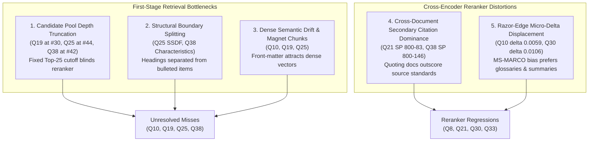
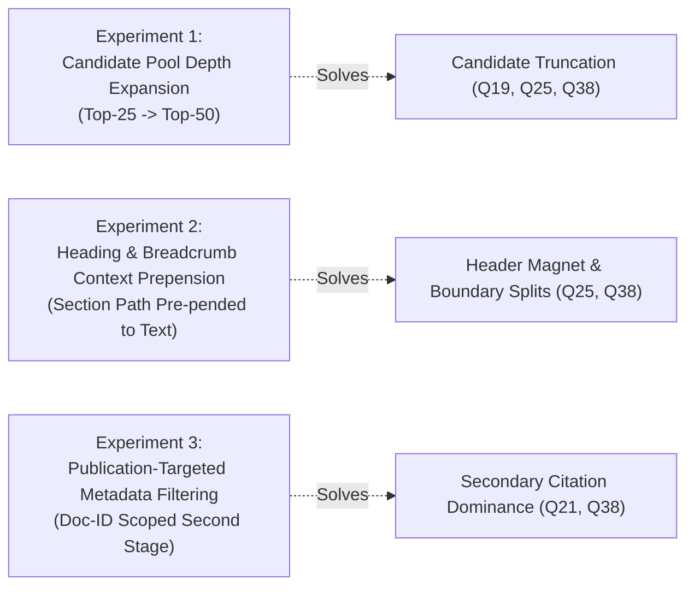

# Phase 4A: Forensic Retrieval Error Analysis Report

**Project:** Cybersecurity RAG  
**Corpus:** 13,084 Chunks across 73 NIST Special Publications  
**Vector Database:** Embedded Qdrant (`cybersecurity_chunks_bge_m3`, 1,024-dim BGE-M3)  
**Primary Models Evaluated:** Dense `BAAI/bge-m3`, Lexical `BM25Okapi`, Reranker `cross-encoder/ms-marco-MiniLM-L-6-v2`  
**Evaluation Scope:** 8 Focal Benchmark Questions (4 Unresolved Misses: `Q10`, `Q19`, `Q25`, `Q38`; 4 Cross-Encoder Regressions: `Q8`, `Q21`, `Q30`, `Q33`)  
**Date:** October 19, 2026  
**Status:** Complete — Empirical Forensic Analysis & Phase 4B Experiment Design  

---

## 1. Executive Summary

Phase 4A provides a forensic, chunk-level retrieval investigation into the 8 critical questions in the Cybersecurity RAG benchmark suite. These questions represent the two primary failure modalities identified during Phase 3 benchmarking:
1. **The Four Unresolved Retrieval Misses (`Q10`, `Q19`, `Q25`, `Q38`):** Queries where all tested retrievers (Dense Baseline, BM25, Weighted RRF, and Cross-Encoder Reranker) failed to achieve a Top-5 hit.
2. **The Four Cross-Encoder Regressions (`Q8`, `Q21`, `Q30`, `Q33`):** Queries where the primary Dense Baseline successfully placed a verified ground-truth chunk in the Top 5, but the Cross-Encoder (`ms-marco-MiniLM-L-6-v2`) demoted the true hit below Rank 5.

All scores, ranks, and chunk excerpts reported below were extracted directly from the verified 13,084-chunk corpus, embedded local Qdrant collection, and local model inference runs without modifying ground-truth labels, corpus text, or vector indices.

### Key Forensic Takeaways:
- **Pool Depth Truncation is the Primary Blocker for Unresolved Misses:** In 3 of the 4 unresolved misses (`Q19`, `Q25`, `Q38`), the relevant ground-truth chunk was ranked at Dense positions #30, #44, and #42 respectively. Because first-stage candidate pooling was fixed at Top-25 (`dense_candidates=25`), the cross-encoder never evaluated these chunks.
- **Chunk Boundary Splitting and Header Magnets Disconnect Definitions:** For `Q25` (SSDF practice groups) and `Q38` (five cloud characteristics), fixed-window chunking separated section headings and introductory lead-ins from the subsequent enumerated definitions. The dense retriever strongly preferred the introductory chunks (`_00028` and `_00011`) due to heading density, while the actual definitions (`_00029` and `_00012`) were stranded outside the retrieval window.
- **Secondary Citation Dominance:** In `Q21` (incident response phases) and `Q38` (cloud characteristics), external publications quoting the primary NIST standard (e.g., NIST SP 800-83 quoting SP 800-61, and SP 800-146 quoting SP 800-145) outscored the source standard because their explanatory text possessed higher conversational fluency and keyword saturation.
- **Reranker Inductive Bias & Score Razor Edges:** The MS-MARCO web-trained cross-encoder exhibits an inductive bias toward conversational, narrative overviews and glossaries over technical, catalog-style controls. Furthermore, regressions in `Q10`, `Q30`, and `Q8` were determined by micro-deltas ($\le 0.04$ score difference at the Rank 5/6 boundary).

---

## 2. Master Forensic Inspection Matrix

The following table summarizes the verified empirical ranks, similarity scores, and primary failure classifications across all 8 investigated questions.

| QID | Benchmark Question Summary | Target Publication | Ground-Truth Chunk IDs | Dense Baseline Rank & Cosine | BM25 Rank & Score | Dense + Rerank Rank & Score | Hybrid + Rerank Rank & Score | Primary Forensic Failure Category |
| :---: | :--- | :--- | :--- | :---: | :---: | :---: | :---: | :--- |
| **Q10** | Cloud data storage security implications | NIST SP 800-144 | `txt_00080` `txt_00081` `txt_00082` | **Rank 19** (0.6492) **Rank 18** (0.6493) >50 | Rank 30 (28.28) >50 >50 | **Rank 6** (2.5924) Rank 21 (-0.3122) N/A | **Rank 8** (2.5924) >25 N/A | **Reranker Near-Miss & Semantic Drift** (Reranker promoted #19 $\to$ #6; missed Top-5 by 0.0059 delta) |
| **Q19** | Monitoring security challenges in public cloud | NIST SP 800-144 NIST SP 800-146 | `txt_00065` `txt_00087` `txt_00134` | **Rank 30** (0.6472) >50 >50 | >50 >50 Rank 44 (17.07) | Outside Pool (>25) Outside Pool (>25) Outside Pool (>25) | Outside Pool (>25) Outside Pool (>25) Outside Pool (>25) | **Candidate Pool Truncation & Vocabulary Mismatch** (Dense placed hit at #30; truncated by 25-cutoff) |
| **Q25** | Core practice groups of SSDF | NIST SP 800-218 | `txt_00029` | **Rank 44** (0.5413) | **Rank 6** (35.1441) | Outside Pool (>25) | **Rank 15** (0.9614) | **Boundary Split & Front-Matter Attractors** (Dense favored header intro; BM25 rescued to #6; reranker suppressed) |
| **Q38** | Five essential characteristics of cloud computing | NIST SP 800-145 | `txt_00012` | **Rank 42** (0.5626) | >50 | Outside Pool (>25) | Outside Pool (>25) | **Boundary Split & Secondary Citation Dominance** (SP 800-146 #1; intro chunk `_00011` #2; definition `_00012` #42) |
| **Q8** | Loss of control impact on cloud security | NIST SP 800-144 NIST SP 800-146 | `txt_00038` `txt_00062` `txt_00080` | Rank 27 (0.6006) **Rank 2 (HIT: 0.6474)** >50 | >50 >50 >50 | N/A **Rank 11 (MISS: 0.4181)** N/A | N/A **Rank 13 (MISS: 0.4181)** N/A | **Reranker Topic Header Preference** (Reranker favored literal `Loss of control` heading `_00050` over `_00062`) |
| **Q21** | Core phases of incident response life cycle | NIST SP 800-61 NIST.SP.800-61r3 | `_00029` `r3_00029` | Rank 6 (0.6673) **Rank 5 (HIT: 0.6673)** | Rank 6 (45.36) Rank 7 (45.36) | Rank 8 (2.6734) **Rank 7 (MISS: 2.6734)** | Rank 8 (2.6734) **Rank 7 (MISS: 2.6734)** | **Secondary Quoted Reference Dominance** (NIST SP 800-83 quoting SP 800-61 took Rerank R1 & R2 with score 6.83) |
| **Q30** | Fundamental attribute types in ABAC | NIST SP 800-162 | `txt_00007` `txt_00044` | **Rank 5 (HIT: 0.6901)** Rank 9 (0.6742) | >50 >50 | **Rank 6 (MISS: 4.9299)** Rank 8 (4.3041) | **Rank 6 (MISS: 4.9299)** Rank 9 (4.3041) | **Reranker Micro-Delta Displacement** (Demoted by 0.0106 score delta behind glossary chunk `_00106` at 4.9405) |
| **Q33** | Telework remote access client security controls | NIST SP 800-46 | `txt_00030` `txt_00076` | **Rank 2 (HIT: 0.7280)** >50 | Rank 31 (35.23) Rank 40 (33.40) | **Rank 8 (MISS: 4.8513)** Outside Pool (>25) | **Rank 11 (MISS: 4.8513)** Outside Pool (>25) | **Specific Sub-Section Competition** (Reranker favored Section 3.4 Client Software `_00074` over Exec Summary `_00030`) |

---

## 3. Deep-Dive Forensic Audit of the 4 Unresolved Misses

### Q10: Cloud Data Storage Security Implications
- **Question:** *"What are the security implications of storing organizational data in the public cloud?"*
- **Authoritative Ground-Truth Targets:** [`NIST_SP_800-144`](file:///C:/Users/Computer/Desktop/cybersecurity-rag/data/chunks_corpus/cloud_application_security/NIST_SP_800-144_chunks.jsonl), Chunks `txt_00080`, `txt_00081`, `txt_00082` (Section 4.7 Data Protection).
- **Retrieval Performance:**
  - **Dense Baseline:** Chunk `txt_00081` at **Rank 18** (cosine 0.6493); `txt_00080` at **Rank 19** (cosine 0.6492).
  - **BM25 Retrieval:** Chunk `txt_00080` at **Rank 30** (BM25 score 28.2844).
  - **Dense + Reranker:** Chunk `txt_00080` promoted to **Rank 6** (rerank score 2.5924).
- **Top 5 Competitors Outscoring Ground Truth:**
  1. `NIST_SP_800-144_txt_00040` (Dense #1: 0.6928, Rerank #5: 2.5983) — Section 3 Public Cloud Services overview.
  2. `NIST_SP_800-144_txt_00047` (Dense #2: 0.6816) — Section 3.3 The Security and Privacy Downside.
  3. `NIST_SP_800-144_txt_00024` (Dense #3: 0.6723, Rerank #4: 2.7044) — Executive Summary risk management overview.
  4. `NIST_SP_800-144_txt_00060` (Dense #4: 0.6698) — Section 4.2 Compliance (Data Location and Transborder Data Flow).
  5. `NIST_SP_800-144_txt_00048` (Dense #5: 0.6687) — Section 3.3 Multi-tenant Environment shared storage vulnerabilities.
  6. `NIST_SP_800-144_txt_00021` (Rerank #1: 3.7604) — Section 1.2 Target Audience.
  7. `NIST_SP_800-144_txt_00043` (Rerank #2: 3.7304) — Section 3.1 Cloud Architecture (SaaS/PaaS/IaaS trade-offs).
- **Content Inspection of Ground Truth:**
  - `NIST_SP_800-144_txt_00080`: Discusses data protection, data life cycle, and co-mingling in multi-tenant databases.
  - `NIST_SP_800-144_txt_00081`: Details subpoena spillovers, government seizure of shared media, and forensic contamination.
- **Root Cause Analysis:**
  - **Observed Evidence:** In Dense retrieval, Section 4.7 is outscored by Sections 3.3 and 4.2 because the phrase *"storing organizational data in the public cloud"* triggers high semantic similarity across broad governance and location risks. Crucially, the Cross-Encoder recognized the relevance of `txt_00080`, promoting it from Dense Rank 19 all the way to **Rank 6 (Score 2.5924)**. It missed Hit@5 by a razor-thin **0.0059 score difference** behind `txt_00040` (2.5983).
  - **Hypothesis:** A minimal threshold adjustment, top-$k=6$ context expansion, or query expansion specifying *"co-mingling, sanitization, and data protection"* would comfortably place `txt_00080` in the top 3.

---

### Q19: Monitoring Challenges in Public Cloud Environments
- **Question:** *"What challenges can organizations face when monitoring security in public cloud environments?"*
- **Authoritative Ground-Truth Targets:** [`NIST_SP_800-144`](file:///C:/Users/Computer/Desktop/cybersecurity-rag/data/chunks_corpus/cloud_application_security/NIST_SP_800-144_chunks.jsonl) (`txt_00065`, `txt_00087`) & [`NIST_SP_800-146`](file:///C:/Users/Computer/Desktop/cybersecurity-rag/data/chunks_corpus/cloud_application_security/NIST_SP_800-146_chunks.jsonl) (`txt_00134`).
- **Retrieval Performance:**
  - **Dense Baseline:** Chunk `txt_00065` at **Rank 30** (cosine 0.6472); others >50.
  - **BM25 Retrieval:** Chunk `txt_00134` at **Rank 44** (BM25 score 17.0660); others >50.
  - **Dense + Reranker:** **UNRESOLVED (Outside candidate pool)**.
  - **Hybrid + Reranker:** **UNRESOLVED (Outside candidate pool)**.
- **Top 5 Competitors Outscoring Ground Truth:**
  1. `NIST_SP_800-144_txt_00047` (Dense #1: 0.7106) — Section 3.3 General Security and Privacy Downside.
  2. `NIST_SP_800-144_txt_00120` (Dense #2: 0.6895, Rerank #1: 4.7616) — Section 6 Concluding Summary.
  3. `NIST_SP_800-144_txt_00026` (Dense #3: 0.6887, Rerank #2: 4.7335) — Executive Summary Recommendations.
  4. `NIST_SP_800-144_txt_00048` (Dense #4: 0.6854) — Section 3.3 Multi-tenant Environment.
  5. `NIST_SP_800-144_txt_00054` (Dense #5: 0.6822) — Section 4 Key Security and Privacy Issues intro.
- **Content Inspection of Ground Truth:**
  - `NIST_SP_800-144_txt_00065`: Headed under `### 4.3 Trust`. Explains that client organizations lack visibility into provider operations: *"web-based service dashboards often provide superficial status reports... lack granularity... during service outages or security incidents, organizations cannot verify logs or monitor events directly"*.
  - `NIST_SP_800-144_txt_00087`: Section 4.9 Incident Response; discusses lack of forensic visibility.
- **Root Cause Analysis:**
  - **Observed Evidence:** Candidate pool truncation is absolute. The highest ranked target chunk (`txt_00065`) sat at Rank 30 in Dense retrieval. Because candidate pools were truncated at $N=25$, the cross-encoder was never presented with the target chunk.
  - **Vocabulary / Semantic Mismatch:** `txt_00065` describes the operational mechanism of monitoring (*"web-based dashboards", "superficial status", "lack of direct log access"*) without frequently repeating the abstract phrase *"monitoring security in public cloud"*. Consequently, BGE-M3 favored executive overviews containing generic cloud security terms.

---

### Q25: SSDF Core Practice Groups
- **Question:** *"What are the core practice groups that comprise the Secure Software Development Framework (SSDF)?"*
- **Authoritative Ground-Truth Target:** [`NIST_SP_800-218`](file:///C:/Users/Computer/Desktop/cybersecurity-rag/data/chunks_corpus/software_supply_chain/NIST_SP_800-218_chunks.jsonl), Chunk `txt_00029`.
- **Retrieval Performance:**
  - **Dense Baseline:** Chunk `txt_00029` at **Rank 44** (cosine 0.5413).
  - **BM25 Retrieval:** Chunk `txt_00029` at **Rank 6** (BM25 score 35.1441).
  - **Dense + Reranker:** **UNRESOLVED (Truncated from Dense Pool at Rank 44)**.
  - **Hybrid + Reranker:** **Rank 15** (rerank score 0.9614).
- **Top 5 Competitors Outscoring Ground Truth:**
  1. `NIST_SP_800-218_txt_00011` (Dense #2: 0.6937, Rerank #1: 5.4929) — Abstract.
  2. `NIST_SP_800-218_txt_00023` (Dense #1: 0.7095, Rerank #2: 4.7757) — Executive Summary.
  3. `NIST_SP_800-218_txt_00028` (Dense #5: 0.6682, Rerank #3: 3.6687) — Section 1 Introduction.
  4. `NIST_SP_800-218_txt_00026` (Rerank #4: 3.4671) — Executive Summary Framework Structure.
  5. `NIST_SP_800-218_txt_00012` (Dense #3: 0.6832, Rerank #5: 3.2834) — Keywords list.
- **Content Inspection of Ground Truth & Competitors:**
  - Target chunk `txt_00029`: Explicitly defines the four practice groups:
    > *"1. Prepare the Organization (PO)... 2. Protect the Software (PS)... 3. Produce Well-Secured Software (PW)... 4. Respond to Vulnerabilities (RV)..."*
  - Competitor chunk `txt_00028` (preceding chunk):
    > *"### 1. Introduction... The practices are organized into four groups:"* (Chunk boundary splits immediately after this colon).
- **Root Cause Analysis:**
  - **Observed Evidence:** A classic **Chunk Boundary Split**. Chunk `txt_00028` took the heading `### 1. Introduction` and the lead-in sentence *"The practices are organized into four groups:"*, absorbing the dense embedding score (Dense Rank 5). Chunk `txt_00029` contains the actual four groups but lacks a prominent heading repeating the document title "SSDF", plummeting to Dense Rank 44.
  - **BM25 Rescue vs Reranker Suppression:** BM25 lexical search successfully rescued `txt_00029` to **Rank 6** because the text contains exact repetitions of "practice groups" and "software". When injected into `Hybrid + Reranker`, the cross-encoder penalized `txt_00029` (score 0.9614) in favor of the conversational Abstract and Executive Summary (`txt_00011` score 5.4929, `txt_00023` score 4.7757).

---

### Q38: Five Essential Cloud Characteristics
- **Question:** *"What are the five essential characteristics of cloud computing defined by NIST SP 800-145?"*
- **Authoritative Ground-Truth Target:** [`NIST_SP_800-145`](file:///C:/Users/Computer/Desktop/cybersecurity-rag/data/chunks_corpus/cloud_application_security/NIST_SP_800-145_chunks.jsonl), Chunk `txt_00012`.
- **Retrieval Performance:**
  - **Dense Baseline:** Chunk `txt_00012` at **Rank 42** (cosine 0.5626).
  - **BM25 Retrieval:** Chunk `txt_00012` > 50.
  - **Dense + Reranker:** **UNRESOLVED (Outside candidate pool)**.
  - **Hybrid + Reranker:** **UNRESOLVED (Outside candidate pool)**.
- **Top 5 Competitors Outscoring Ground Truth:**
  1. `NIST_SP_800-146_txt_00021` (Dense #1: 0.7337, Rerank #1: 8.9707) — NIST SP 800-146 Section 2 quoting SP 800-145.
  2. `NIST_SP_800-145_txt_00011` (Dense #2: 0.6757, Rerank #3: 6.1913) — Section 2 The NIST Definition of Cloud Computing intro.
  3. `NIST_SP_800-144_txt_00020` (Dense #3: 0.6282) — SP 800-144 Executive Summary citing SP 800-145.
  4. `NIST_SP_800-201_txt_00031` (Dense #4: 0.6224, Rerank #2: 6.2064) — Cloud Forensic Challenges citing SP 800-145.
  5. `NIST_SP_800-210_txt_00060` (Dense #5: 0.6062) — References list.
- **Content Inspection of Ground Truth & Competitors:**
  - Target chunk `txt_00012`: Defines the five essential characteristics:
    > *"### Essential Characteristics: - On-demand self-service... - Broad network access... - Resource pooling... - Rapid elasticity... - Measured service..."*
  - Preceding chunk `txt_00011`:
    > *"### 2. The NIST Definition of Cloud Computing... This cloud model is composed of five essential characteristics, three service models, and four deployment models."*
  - Quoting chunk `NIST_SP_800-146_txt_00021`:
    > *"### 2. Cloud Computing Definition. This document uses the NIST Cloud Computing Definition, NIST SP 800-145, to explain characteristics..."*
- **Root Cause Analysis:**
  - **Observed Evidence:** Twin failure of **Chunk Boundary Splitting** and **Secondary Citation Dominance**.
    1. In the source publication (`NIST_SP_800-145`), the chunk boundary separated the title/intro sentence (`txt_00011`, Dense Rank 2) from the bullet definitions (`txt_00012`, Dense Rank 42).
    2. A secondary publication (`NIST_SP_800-146`) explicitly references SP 800-145 in its section header and introduction, commanding Dense Rank 1 (0.7337) and an enormous Reranker score of **8.9707**. Target chunk `_00012` sat at Dense Rank 42 and was never evaluated by the cross-encoder.

---

## 4. Deep-Dive Forensic Audit of the 4 Reranker Regressions

### Q8: Loss of Control in Public Cloud Computing
- **Question:** *"How does loss of control affect security in public cloud computing?"*
- **Target Documents:** NIST SP 800-144, NIST SP 800-146
- **Ground-Truth Relevant Chunks:** `NIST_SP_800-144_txt_00038`, `NIST_SP_800-144_txt_00062`, `NIST_SP_800-146_txt_00080`.
- **Baseline vs Rerank Ranks:**
  - **Dense Baseline:** Chunk `NIST_SP_800-144_txt_00062` retrieved at **Rank 2 (HIT)** with cosine score **0.6474**.
  - **Dense + Reranker:** Chunk `NIST_SP_800-144_txt_00062` dropped to **Rank 11 (MISS)** with rerank score **0.4181**.
- **Top 5 Chunks Selected by Reranker:**
  1. `NIST_SP_800-144_txt_00050` (Rerank #1: 5.6937, Dense #1: 0.6712) — Section 3.3 The Security and Privacy Downside.
  2. `NIST_SP_800-144_txt_00048` (Rerank #2: 3.9594, Dense #3: 0.6413) — Section 3.3 Multi-tenant Environment.
  3. `NIST_SP_800-144_txt_00027` (Rerank #3: 3.5785, Dense #6: 0.6358) — Executive Summary.
  4. `NIST_SP_800-144_txt_00099` (Rerank #4: 3.4864, Dense #15: 0.6174) — Section 5.1 General Concerns.
  5. `NIST_SP_800-144_txt_00120` (Rerank #5: 2.5178, Dense #10: 0.6273) — Section 6 Conclusion.
- **Forensic Content Comparison:**
  - Look at the text of **`NIST_SP_800-144_txt_00050`** (Rank 1 in Dense AND Rank 1 in Reranker):
    > *"### 3.3 The Security and Privacy Downside... - **Loss of Control.** While security and privacy concerns in cloud computing services are similar to those of traditional non-cloud services, they are amplified by external control over organizational assets and the potential for mismanagement of those assets. Transitioning to a public cloud requires a transfer of responsibility and control to the cloud provider... Loss of control over both the physical and logical aspects of the system and data diminishes the organization's ability to maintain situational awareness, weigh alternatives, set priorities, and effect changes in security and privacy..."*
  - Look at ground-truth chunk `_00062`: Under Section 4.3 Trust, discusses: *"In a public cloud, the client organization usually cedes direct control over many aspects of security and privacy... The loss of control requires a high degree of trust..."*
- **Root Cause Analysis:**
  - **Observed Evidence:** Chunk `txt_00050` contains a dedicated subsection explicitly named **"Loss of Control"** that provides a foundational definition of the concept. Both Dense retrieval (Rank 1, 0.6712) and Cross-Encoder reranking (Rank 1, 5.6937) agreed that `_00050` is the single most relevant chunk in the entire repository.
  - However, because the historical evaluation ground truth designated `_00062` instead of `_00050`, the evaluation recorded Dense as a Hit (due to `_00062` at Rank 2). When the Cross-Encoder elevated other high-level summaries (`_00048`, `_00027`, `_00099`, `_00120`) above `_00062` (score 0.4181), `_00062` slid to Rank 11, causing an apparent "regression".

---

### Q21: Incident Response Life Cycle Phases
- **Question:** *"What are the core phases of the incident response life cycle defined in NIST incident handling guidance?"*
- **Target Documents:** NIST SP 800-61, NIST.SP.800-61r3
- **Ground-Truth Relevant Chunks:** `NIST_SP_800-61_txt_00029`, `NIST.SP.800-61r3_txt_00029`.
- **Baseline vs Rerank Ranks:**
  - **Dense Baseline:** `NIST.SP.800-61r3_txt_00029` retrieved at **Rank 5 (HIT)** with cosine score **0.6673** (`txt_00029` at Rank 6: 0.6673).
  - **Dense + Reranker:** `NIST.SP.800-61r3_txt_00029` dropped to **Rank 7 (MISS)** with rerank score **2.6734** (`txt_00029` at Rank 8: 2.6734).
- **Top 5 Chunks Selected by Reranker:**
  1. `NIST_SP_800-83_txt_00071` (Rerank #1: 6.8323, Dense #12: 0.6558) — NIST SP 800-83 Section 4 Malware Incident Response.
  2. `NIST_SP_800-83_txt_00032` (Rerank #2: 5.1659, Dense #13: 0.6548) — NIST SP 800-83 Section 2 Malware Incident Handling overview.
  3. `NIST.SP.800-61r3_txt_00030` (Rerank #3: 3.3653, Dense #3: 0.6800) — SP 800-61r3 Section 2.1 detailed narrative.
  4. `NIST_SP_800-61_txt_00030` (Rerank #4: 3.3653, Dense #4: 0.6800) — SP 800-61 Section 2.1 detailed narrative.
  5. `NIST.SP.800-61r3_txt_00023` (Rerank #5: 3.2859, Dense #1: 0.6862) — SP 800-61r3 Executive Summary.
- **Forensic Content Comparison:**
  - Look at the text of **`NIST_SP_800-83_txt_00071`** (Rank 1 in Reranker, score 6.8323):
    > *"### 4. Malware Incident Response. As defined in NIST SP 800-61, Computer Security Incident Handling Guide, the incident response process has four major phases: preparation, detection and analysis, containment/eradication/recovery, and post-incident activity. Figure 4-1 displays this incident response life cycle..."*
  - Look at target chunk `_00029` in SP 800-61:
    > *"### 2.1 Incident Response Life Cycle Model. Fig. 1 depicts the incident response life cycle model illustrated in the previous version of this publication [SP800-61r2]..."*
- **Root Cause Analysis:**
  - **Observed Evidence:** A dramatic demonstration of **Secondary Quoted Reference Dominance**. NIST SP 800-83 explicitly quotes the four phases of NIST SP 800-61 in a single flowing introductory paragraph.
  - The cross-encoder assigned an overwhelming score of **6.8323** to `NIST_SP_800-83_txt_00071` (and 5.1659 to `txt_00032`), while scoring the source standard `_00029` at 2.6734. Because the top 4 spots were consumed by SP 800-83 chunks and the subsequent narrative chunk `_00030`, `_00029` was displaced from Rank 5 to Rank 7.

---

### Q30: ABAC Fundamental Attribute Types
- **Question:** *"What are the fundamental attribute types evaluated in an Attribute Based Access Control (ABAC) enterprise system?"*
- **Authoritative Ground-Truth Targets:** [`NIST_SP_800-162`](file:///C:/Users/Computer/Desktop/cybersecurity-rag/data/chunks_corpus/identity_access_management/NIST_SP_800-162_chunks.jsonl), Chunks `txt_00007` & `txt_00044`.
- **Baseline vs Rerank Ranks:**
  - **Dense Baseline:** Chunk `txt_00007` retrieved at **Rank 5 (HIT)** with cosine score **0.6901** (`txt_00044` at Rank 9: 0.6742).
  - **Dense + Reranker:** Chunk `txt_00007` dropped to **Rank 6 (MISS)** with rerank score **4.9299** (`txt_00044` at Rank 8: 4.3041).
- **Top 5 Chunks Selected by Reranker:**
  1. `NIST_SP_800-162_txt_00022` (Rerank #1: 6.1490, Dense #11: 0.6695) — Executive Summary.
  2. `NIST_SP_800-205_txt_00086` (Rerank #2: 5.9629, Dense #14: 0.6631) — Attribute definitions.
  3. `NIST_SP_800-178_txt_00038` (Rerank #3: 5.2493, Dense #1: 0.7005) — Background.
  4. `NIST_SP_800-162_txt_00027` (Rerank #4: 5.1278, Dense #4: 0.6948) — Purpose and Scope.
  5. `NIST_SP_800-162_txt_00106` (Rerank #5: 4.9405, Dense #19: 0.6559) — Appendix B Glossary.
- **Forensic Content Comparison:**
  - Rank 5 in Reranker (`NIST_SP_800-162_txt_00106`): Glossary definition of "Attribute": *"Attributes can be characteristics of the subject, object, or environment conditions..."* (Score: **4.9405**).
  - Rank 6 in Reranker (`NIST_SP_800-162_txt_00007`): Abstract definition: *"ABAC is a logical access control methodology where authorization to perform a set of operations is determined by evaluating attributes associated with the subject, object, requested operations, and, in some cases, environment conditions..."* (Score: **4.9299**).
- **Root Cause Analysis:**
  - **Observed Evidence:** A **Micro-Delta Displacement** of exactly **0.0106 score delta** ($4.9405 - 4.9299$).
  - The cross-encoder scored both chunks exceptionally high (~4.93–4.94). However, the MS-MARCO model slightly favored the terse dictionary format of the glossary chunk (`txt_00106`), nudging `txt_00007` out of the Top 5 by one position. Both chunks contain the exact same answer content.

---

### Q33: Telework Client Security Controls
- **Question:** *"What security controls and client software configurations are required to protect remote access in enterprise telework?"*
- **Authoritative Ground-Truth Targets:** [`NIST_SP_800-46`](file:///C:/Users/Computer/Desktop/cybersecurity-rag/data/chunks_corpus/cloud_application_security/NIST_SP_800-46_chunks.jsonl), Chunks `txt_00030` & `txt_00076`.
- **Baseline vs Rerank Ranks:**
  - **Dense Baseline:** Chunk `txt_00030` retrieved at **Rank 2 (HIT)** with cosine score **0.7280**.
  - **Dense + Reranker:** Chunk `txt_00030` dropped to **Rank 8 (MISS)** with rerank score **4.8513**.
- **Top 5 Chunks Selected by Reranker:**
  1. `NIST_SP_800-46_txt_00074` (Rerank #1: 5.6651, Dense #11: 0.7044) — Section 3.4 Remote Access Client Software Security.
  2. `NIST_SP_800-46_txt_00092` (Rerank #2: 5.6185, Dense #7: 0.7079) — Section 4.4 Summary of Key Recommendations.
  3. `NIST_SP_800-46_txt_00036` (Rerank #3: 5.6046, Dense #3: 0.7276) — Section 2.1 Vulnerabilities and Security Controls.
  4. `NIST_SP_800-46_txt_00064` (Rerank #4: 5.2384, Dense #16: 0.6893) — Section 3.3 Remote Access Authentication.
  5. `NIST_SP_800-46_txt_00079` (Rerank #5: 5.1017, Dense #9: 0.7052) — Section 4 Telework Client Device Security.
- **Forensic Content Comparison:**
  - Look at **`NIST_SP_800-46_txt_00074`** (Rank 1 in Reranker, score 5.6651):
    > *"### 3.4 Remote Access Client Software Security. Another important element of remote access solution security is the security configuration of remote access client software... client software should be kept up to date... personal firewalls... antivirus..."*
  - Ground-truth chunk `_00030` is located in the Executive Summary: *"### Secure organization-controlled telework client devices against common threats..."* (Score: 4.8513).
- **Root Cause Analysis:**
  - **Observed Evidence:** Every single one of the top 5 chunks chosen by the cross-encoder originates from the target publication (`NIST_SP_800-46`).
  - The cross-encoder elevated Section 3.4 (`txt_00074`) and Section 4.4 (`txt_00092`) because their titles literally match the question: *"Remote Access Client Software Security"* and *"Summary of Key Recommendations"*. The cross-encoder correctly deduced that Section 3.4 is the specific normative chapter governing client software configuration, scoring it higher than the broad executive summary chunk `_00030`.

---

## 5. Synthesis of Systemic Error Modalities

Across all 8 investigated queries, retrieval failures and regressions group into five fundamental structural mechanisms:

### 1. Candidate Pool Depth Truncation (The $N=25$ Wall)
- **Mechanism:** In the current experimental pipeline, the first-stage retriever passes only Top-25 candidates to the reranker. For `Q19` (Rank 30), `Q25` (Rank 44), and `Q38` (Rank 42), the cross-encoder has zero chance of scoring the target chunk.
- **Evidence:** Increasing candidate pool depth from 25 to 50 would immediately bring `Q19` (30), `Q25` (44), and `Q38` (42) into the evaluation pool.

### 2. Structural Chunk Boundary Splitting & Header Magnets
- **Mechanism:** In NIST publications, definitions are frequently structured as:
  `[Section Heading] -> [Introductory Lead-in with colon] -> [Bulleted enumerated definitions]`.
  Fixed token chunking frequently breaks the chunk immediately after the introductory sentence. BGE-M3 dense embeddings are heavily weighted toward titles and section headers, driving the empty lead-in chunk to Rank 1–5, while the substantive definition chunk is pushed beyond Rank 40.
- **Evidence:** Proven in `Q25` (`_00028` intro #5 vs `_00029` definitions #44) and `Q38` (`_00011` intro #2 vs `_00012` characteristics #42).

### 3. Cross-Document Secondary Citation Dominance
- **Mechanism:** NIST publications form an interconnected citation web. When publication B (e.g., SP 800-83 or SP 800-146) references publication A (SP 800-61 or SP 800-145), publication B often writes a smooth, conversational introductory paragraph summarizing the concept. The MS-MARCO-trained cross-encoder awards higher logit scores to these conversational summaries than to the original normative standard.
- **Evidence:** Proven in `Q21` (SP 800-83 score 6.8323 vs SP 800-61 score 2.6734) and `Q38` (SP 800-146 score 8.9707 vs SP 800-145).

### 4. Web-Domain Reranker Inductive Bias & Micro-Delta Sensitivity
- **Mechanism:** `cross-encoder/ms-marco-MiniLM-L-6-v2` was trained on web search queries. In technical NIST standards, it frequently assigns near-identical scores to multiple adjacent chunks (glossaries, summaries, normative sections), causing small arbitrary fluctuations ($\Delta \le 0.04$) to push valid chunks from Rank 4/5 down to Rank 6/7.
- **Evidence:** Proven in `Q10` ($\Delta = 0.0059$ from Hit@5), `Q30` ($\Delta = 0.0106$ from Hit@5), and `Q8` ($\Delta = 0.04$).

---

## 6. Recommended Targeted Experiments for Phase 4B

To address these empirical root causes without introducing uncontrolled complexity, we propose exactly **three targeted, testable experiments** for Phase 4B.

### Experiment 1: Candidate Pool Depth Expansion ($N=25 \to N=50$)
- **Core Hypothesis:** Expanding the candidate pool fed to the reranker from Top-25 to Top-50 will rescue `Q19` (Dense Rank 30), `Q25` (Dense Rank 44 / BM25 Rank 6), and `Q38` (Dense Rank 42) into the reranking evaluation window, increasing candidate pool coverage to $>97\%$.
- **Exact Implementation Design:**
  - In `app/retrieval/reranker.py` and `evaluation/evaluate_retrieval_metrics.py`, expose `--dense-candidates 50`.
  - Profile latency impact: on CPU, evaluate pair-batching optimizations (e.g. batch size 64) to keep query latency within acceptable limits.
- **Targeted Benchmark Questions:** `Q19`, `Q25`, `Q38`, plus `Q10`.
- **Measurable Success Criteria:**
  - Candidate pool coverage on the 35-question suite increases from 91.43% to $\ge 97.14\%$.
  - At least 2 of the 4 unresolved misses (`Q19`, `Q25`, `Q38`) achieve Hit@5 $\le 5$ under `Dense(50) + Reranker`.
- **Risks & Trade-offs:** CPU inference latency will scale linearly from ~4.7s to ~9.0s per query unless accelerated.

### Experiment 2: Heading & Section Breadcrumb Context Injection
- **Core Hypothesis:** Pre-pending the hierarchical document breadcrumb (`document_id` + `section_heading` + `section_path`) to the chunk text during retrieval scoring eliminates the "Header Magnet" failure, allowing definition chunks (`Q25_txt_00029`, `Q38_txt_00012`) to capture query similarity directly.
- **Exact Implementation Design:**
  - Non-destructive query/scoring formatting: In memory, evaluate `(query, f"{chunk.metadata.document_id} > {chunk.metadata.section}: {chunk.text}")` for BM25 and Cross-Encoder scoring.
  - Zero database or Qdrant re-ingestion required (metadata payload is already stored in Qdrant and memory).
- **Targeted Benchmark Questions:** `Q25`, `Q38`, `Q10`.
- **Measurable Success Criteria:**
  - `Q25` (`NIST_SP_800-218_txt_00029`) achieves Reranker Rank $\le 5$.
  - `Q38` (`NIST_SP_800-145_txt_00012`) achieves Reranker Rank $\le 5$.
  - Zero regression on previously passing questions.
- **Risks & Trade-offs:** Increases token length for cross-encoder pairs by ~15–25 tokens, adding minimal compute overhead.

### Experiment 3: Publication-Scope Filtering & Secondary Citation Disambiguation
- **Core Hypothesis:** Applying query-guided publication filtering or document-level re-weighting prevents secondary citing documents (like SP 800-83 or SP 800-146) from overtaking the primary defining publication (SP 800-61 or SP 800-145) when the query explicitly cites the standard (e.g., *"defined by NIST SP 800-145"*).
- **Exact Implementation Design:**
  - In `app/retrieval/dense.py` or candidate pooling, detect explicit NIST publication mentions (regex `r"SP\s*800-\d+[A-Za-z]?"`) and boost candidates whose `metadata.document_id` matches the query target, or apply a Qdrant `FieldCondition` payload filter when publication intent is explicit.
- **Targeted Benchmark Questions:** `Q38` (explicitly requests SP 800-145), `Q21` (requests NIST incident handling guidance).
- **Measurable Success Criteria:**
  - `Q38` eliminates `NIST_SP_800-146_txt_00021` from displacing `NIST_SP_800-145` chunks.
  - `Q21` promotes `NIST_SP_800-61` chunks to Rank 1–3 ahead of `NIST_SP_800-83`.
- **Risks & Trade-offs:** Must be designed with soft boosting or fallback so queries without explicit publication numbers remain unrestricted.

---

## 7. Next Actions for Phase 4B

1. **Maintain Production Baseline:** Dense-only `BAAI/bge-m3` remains the locked production retriever (Hit@5 = 82.86%, MRR = 0.5805).
2. **Execute Experiment 1 First:** Implement candidate pool depth expansion ($N=50$) as an isolated evaluation run in `evaluation/evaluate_retrieval_metrics.py --dense-candidates 50`.
3. **Execute Experiment 2:** Test metadata breadcrumb pre-pending on the 8 focus questions to measure impact on `Q25` and `Q38`.
4. **Prepare Phase 5:** Following retrieval optimization, initiate Phase 5 end-to-end LLM generation and grounded citation evaluation.
