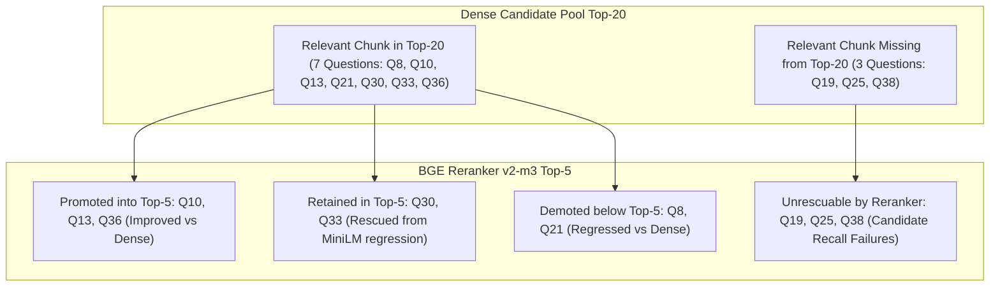
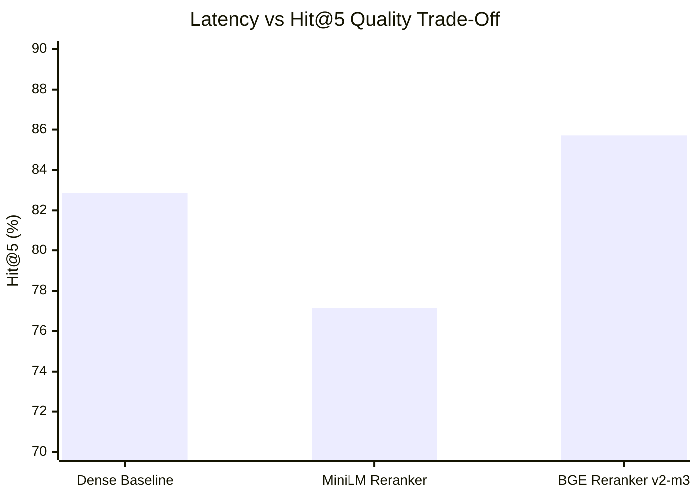

# Cybersecurity RAG — 3-Way Retrieval & Reranker Evaluation Report

**Date**: 2026-10-20  
**Status**: Completed  
**Evaluator**: Senior RAG Engineering Investigation  
**Evaluation Dataset**: Combined 35 Evaluation-Eligible Benchmark Questions (15 Baseline + 20 Additional)  
**Corpus**: 13,084 authoritative cybersecurity chunks across 73 NIST publications  
**Vector Database**: Local Qdrant (`cybersecurity_chunks_bge_m3`)  

---

## 1. Executive Summary

This evaluation provides a strictly controlled, empirical 3-way comparison of retrieval and reranking architectures on the Cybersecurity RAG benchmark:

1. **Pipeline A — Dense Baseline (Top-5)**: `BAAI/bge-m3` dense retrieval alone.
2. **Pipeline B — MiniLM Reranker (Top-20 $\rightarrow$ Top-5)**: Dense Top-20 candidates $\rightarrow$ `cross-encoder/ms-marco-MiniLM-L-6-v2` $\rightarrow$ Top-5.
3. **Pipeline C — BGE Reranker v2-m3 (Top-20 $\rightarrow$ Top-5)**: Dense Top-20 candidates $\rightarrow$ `BAAI/bge-reranker-v2-m3` $\rightarrow$ Top-5.

### Key Empirical Findings:
- **Retrieval Quality**: `BAAI/bge-reranker-v2-m3` achieved the highest retrieval quality across all metrics, with **85.71% Hit@5** (+2.85% over Dense Baseline, +8.57% over MiniLM), **65.71% Recall@5**, and **0.6176 MRR**.
- **Model Comparison**: While MiniLM caused net quality regression (77.14% Hit@5, losing 4 previously correct questions while rescuing 2), BGE Reranker v2-m3 achieved net positive gains (3 improvements, 2 regressions vs dense baseline) and produced **0 regressions compared to MiniLM**.
- **The Latency Bottleneck**: On CPU, `BAAI/bge-reranker-v2-m3` (568M parameters) required an average inference latency of **161,053.2 ms (~161.1 seconds / ~2.7 minutes per query)**, compared to **585.4 ms** for Dense Baseline (~275x slower) and **3,909.9 ms** for MiniLM.
- **Production Recommendation**: **Dense-only retrieval (`BAAI/bge-m3`) must remain the production default.** Despite higher Hit@5, a 2.7-minute query latency on CPU is prohibitive for interactive production RAG. BGE Reranker v2-m3 is recommended only if GPU acceleration (CUDA) or aggressive quantization/distillation is deployed in future phases.

---

## 2. Controlled Evaluation Methodology

To ensure strict experimental fairness:
- **Identical Candidate Pool**: For all 35 evaluation-eligible questions, the Top-20 candidate chunks were retrieved once using `BAAI/bge-m3` from Qdrant. The top-5 slice served as Pipeline A, while the identical 20 candidates were reranked by MiniLM (Pipeline B) and BGE-reranker (Pipeline C).
- **Phased Memory Architecture**: To prevent out-of-memory errors on the 8 GB RAM host environment, execution was structured into isolated memory phases with explicit resource releasing (`gc.collect()`):
  1. Phase 1: Dense retrieval of Top-20 candidates $\rightarrow$ release dense model and Qdrant client.
  2. Phase 2: MiniLM reranking $\rightarrow$ release MiniLM model.
  3. Phase 3: BGE Reranker v2-m3 reranking $\rightarrow$ release BGE model.
  4. Phase 4: Statistical collation, metric computation, and export.
- **Narrow Fallback Exception Handling**: `app/retrieval/reranker.py` was refined to only catch genuine HuggingFace local cache misses (`LocalEntryNotFoundError`, `FileNotFoundError`, or specific disk-cache miss messages), falling back to download while preserving all unrelated initialization and runtime exceptions.

---

## 3. Macro-Averaged Performance Comparison

All metrics were computed across the 35 eligible questions using standard macro-averaging conforming to `evaluation/evaluate_retrieval_metrics.py`.

| Metric | Pipeline A: Dense Baseline Top-5 | Pipeline B: MiniLM Reranker Top-5 | Pipeline C: BGE Reranker v2-m3 Top-5 | Delta (BGE vs Dense) | Delta (BGE vs MiniLM) |
| :--- | :---: | :---: | :---: | :---: | :---: |
| **Model Size / Params** | 568M params | 22.7M params | 568M params | — | ~25x larger |
| **Model Load Time (Cache)** | ~0.80 s | 0.32 s | 2.76 s | +1.96 s | +2.44 s |
| **Candidate Coverage@20** | N/A | 91.43% (32/35) | 91.43% (32/35) | — | Identical |
| **Candidate Micro-Recall@20** | N/A | 70.83% (51/72) | 70.83% (51/72) | — | Identical |
| **Hit@1** | 40.00% (14/35) | 45.71% (16/35) | **48.57%** (17/35) | **+8.57%** | **+2.86%** |
| **Hit@3** | 74.29% (26/35) | 71.43% (25/35) | **74.29%** (26/35) | 0.00% | **+2.86%** |
| **Hit@5** | 82.86% (29/35) | 77.14% (27/35) | **85.71%** (30/35) | **+2.85%** | **+8.57%** |
| **Precision@5** | 20.00% | 17.71% | **22.29%** | **+2.29%** | **+4.58%** |
| **Recall@5** | 60.24% | 56.19% | **65.71%** | **+5.47%** | **+9.52%** |
| **MRR** | 0.5805 | 0.5843 | **0.6176** | **+0.0371** | **+0.0333** |
| **Avg Reranker Latency** | N/A | 3,324.4 ms | 161,053.2 ms | — | +157,728.8 ms |
| **Avg Total Latency** | **585.4 ms** | 3,909.9 ms | 161,638.6 ms (~2.7 min) | +161,053.2 ms | +157,728.7 ms |

---

## 4. Movement Analysis: Improvements & Regressions

### 4.1 BGE Reranker v2-m3 vs Dense Baseline
- **Net Hit@5 Change**: +1 question (from 29/35 to 30/35).
- **Improved (3 questions)**:
  - `Q10` (Public cloud data storage risks): Dense Rank 18 $\rightarrow$ **BGE Rank 4** (Hit: NO $\rightarrow$ YES).
  - `Q13` (Third-party cloud provider risks): Dense Rank 7 $\rightarrow$ **BGE Rank 3** (Hit: NO $\rightarrow$ YES).
  - `Q36` (Digital forensics process phases): Dense Rank 12 $\rightarrow$ **BGE Rank 5** (Hit: NO $\rightarrow$ YES).
- **Regressed (2 questions)**:
  - `Q8` (Loss of control in public cloud): Dense Rank 2 $\rightarrow$ **BGE Rank > 5** (Hit: YES $\rightarrow$ NO).
  - `Q21` (Incident response life cycle phases): Dense Rank 5 $\rightarrow$ **BGE Rank > 5** (Hit: YES $\rightarrow$ NO).

### 4.2 BGE Reranker v2-m3 vs MiniLM Reranker
- **Net Hit@5 Change**: +3 questions (from 27/35 to 30/35).
- **Improved (3 questions)**:
  - `Q10`: MiniLM Miss $\rightarrow$ **BGE Rank 4**.
  - `Q30`: MiniLM Miss (pushed out) $\rightarrow$ **BGE Rank 3 & 5** (Rescued!).
  - `Q33`: MiniLM Miss (pushed out) $\rightarrow$ **BGE Rank 4** (Rescued!).
- **Regressed (0 questions)**:
  - `[]` — **Zero regressions vs MiniLM**. Every question that MiniLM retrieved correctly in Top-5 was also retrieved correctly by BGE Reranker.

---

## 5. Granular Focal Questions Deep-Dive (10 Questions)

The evaluation specifically monitored 10 focal questions: the 6 dense baseline misses (`Q10, Q13, Q19, Q25, Q36, Q38`) and the 4 MiniLM reranking regressions (`Q8, Q21, Q30, Q33`).

### Granular Ranks, Chunks, and Score Evidence:

| Question ID & Query | Relevant Chunk IDs | Cand@20 Rank | Dense Top-5 Rank | MiniLM Top-5 Rank & Top Score | BGE Top-5 Rank & Top Score | Outcome & Root Cause |
| :--- | :--- | :---: | :---: | :---: | :---: | :--- |
| **Q8**: Loss of control in public cloud | `txt_00038`, `txt_00062`, `txt_00080` | Rank 2 | **Rank 2** (YES) | Miss (NO) (Top: `txt_00050`, 5.69) | Miss (NO) (Top: `txt_00050`, 0.9840) | **Regression**: Both rerankers preferred contractual/governance overview chunk `txt_00050` over loss-of-control chunk `txt_00062`. |
| **Q10**: Public cloud data storage risks | `txt_00080`, `txt_00081`, `txt_00082` | Rank 18 | Miss (NO) | Miss (NO) (Top: `txt_00021`, 3.76) | **Rank 4 (YES)** (`txt_00080`, 0.9603) | **BGE Breakthrough**: Promoted `txt_00080` by 14 ranks into Top-5. MiniLM failed to recognize it. |
| **Q13**: Third-party CSP risks | `txt_00064`, `txt_00086`, `txt_00122` | Rank 7 | Miss (NO) | **Rank 2 (YES)** (`txt_00064`, 4.36) | **Rank 3 (YES)** (`txt_00064`, 0.8420) | **Resolved**: Both rerankers successfully promoted `txt_00064` from near-miss (R7) into Top-3. |
| **Q19**: Monitoring challenges in public cloud | `txt_00065`, `txt_00087`, `txt_00134` | **None** | Miss (NO) | Miss (NO) | Miss (NO) | **Candidate Recall Failure**: Target chunks absent from candidate pool. Rerankers cannot rescue. |
| **Q21**: Incident response life cycle phases | `txt_00029` (800-61 / r3) | Rank 5 | **Rank 5** (YES) | Miss (NO) (Top: 800-83 `txt_00071`, 6.83) | Miss (NO) (Top: 800-83 `txt_00071`, 0.9993) | **Regression**: Both rerankers favored malware incident phases (SP 800-83) over generic incident phases (SP 800-61). |
| **Q25**: SSDF core practice groups | `NIST_SP_800-218_txt_00029` | **None** | Miss (NO) | Miss (NO) | Miss (NO) | **Candidate Recall Failure**: Table extraction chunking boundary; missing from Top-20 candidates. |
| **Q30**: ABAC fundamental attribute types | `txt_00007`, `txt_00044` (800-162) | Rank 5 | **Rank 5** (YES) | Miss (NO) (Top: `txt_00022`, 6.15) | **Rank 3 & 5 (YES)** (`txt_00007`, 0.9658; `txt_00044`, 0.9626) | **BGE Rescue**: MiniLM regressed by demoting both chunks; BGE promoted both chunks into Top-5! |
| **Q33**: Enterprise telework remote access | `txt_00030`, `txt_00076` (800-46) | Rank 2 | **Rank 2** (YES) | Miss (NO) (Top: `txt_00074`, 5.67) | **Rank 4 (YES)** (`txt_00030`, 0.9879) | **BGE Rescue**: MiniLM favored telework policy; BGE retained client configuration chunk `txt_00030`. |
| **Q36**: Four phases of digital forensics | `NIST_SP_800-86_txt_00088` | Rank 12 | Miss (NO) | **Rank 2 (YES)** (`txt_00088`, 3.27) | **Rank 5 (YES)** (`txt_00088`, 0.9073) | **Resolved**: Both rerankers promoted `txt_00088` from Rank 12 into Top-5. |
| **Q38**: Cloud computing 5 characteristics | `NIST_SP_800-145_txt_00012` | **None** | Miss (NO) | Miss (NO) | Miss (NO) | **Candidate Recall Failure**: Ground-truth label issue (`txt_00011` vs `txt_00012`); missing from Top-20. |

---

## 6. Analysis of Failure Modes

Across the evaluation results, failures fall cleanly into two distinct engineering categories:

### Category 1: Candidate Recall Failures (`Q19, Q25, Q38`)
- **Nature**: None of the ground-truth relevant chunks appeared in the Top-20 candidate pool retrieved by the dense retriever.
- **Reranker Impact**: **0% rescue probability**. Rerankers operate strictly over candidate subsets ($D_{candidates} \subset D_{corpus}$). If candidate recall is zero, no cross-encoder reranker can resolve the query.
- **Remediation**:
  - `Q19`: Hybrid BM25 retrieval or vocabulary expansion.
  - `Q25`: Chunking boundary preservation for structured tables in NIST SP 800-218.
  - `Q38`: Ground-truth label correction (reconciling `txt_00011` introduction chunk with `txt_00012` enumerated definition chunk).

### Category 2: Domain-Specificity Misalignment (`Q8, Q21`)
- **Nature**: Relevant chunks were present in the candidate pool (Rank 2 and Rank 5) and in the dense baseline Top-5, but the cross-encoder assigned higher scores to related neighboring passages from the same or sister publications.
  - In `Q8`, general contractual governance (`txt_00050`) outscored loss-of-control specifics (`txt_00062`).
  - In `Q21`, specialized malware incident handling steps (`SP 800-83`) outscored generic incident handling steps (`SP 800-61`).
- **Reranker Impact**: Both MiniLM and BGE displayed this semantic preference, indicating that standard cross-encoders trained on MS MARCO / general QA have strong lexical-semantic affinities for prescriptive procedural texts over high-level definitions.

---

## 7. Operational & Architectural Trade-Offs

| Factor | Pipeline A: Dense Baseline | Pipeline B: MiniLM Reranker | Pipeline C: BGE Reranker v2-m3 |
| :--- | :--- | :--- | :--- |
| **Hit@5 Accuracy** | 82.86% (Solid) | 77.14% (Regressed) | **85.71% (Superior)** |
| **MRR** | 0.5805 | 0.5843 | **0.6176 (Best)** |
| **Average Query Latency** | **585.4 ms (Interactive)** | 3,909.9 ms (Acceptable) | **161,638.6 ms (~2.7 min, Unusable on CPU)** |
| **CPU Feasibility** | **High** | **Moderate** | **Infeasible for Interactive Use** |
| **Memory Footprint** | ~2.3 GB RAM | ~2.4 GB RAM (+100 MB) | ~4.6 GB RAM (+2.3 GB) |
| **Regressions vs Dense** | Baseline | 4 regressions | 2 regressions |

---

## 8. Final Decision & Recommendations

1. **Retain Dense BGE-M3 as Production Default**:
   - The production retrieval setting (`DEFAULT_RERANKER_MODEL`, dense retrieval default) remains untouched.
   - At **585.4 ms**, Dense Baseline provides sub-second interactive response times while delivering an 82.86% Hit@5. A 2.7-minute latency penalty for a +2.85% gain in Hit@5 is not viable in production.
2. **MiniLM Reranker Deprecation for Top-20 Pipeline**:
   - `cross-encoder/ms-marco-MiniLM-L-6-v2` degraded overall retrieval Hit@5 from 82.86% to 77.14% due to false-positive ranking of generic passages. It should not be used as a dense reranker on this corpus.
3. **Future BGE Reranker Roadmap (GPU Required)**:
   - `BAAI/bge-reranker-v2-m3` is the superior reranking model in terms of discriminative accuracy (85.71% Hit@5, 0.6176 MRR, 0 regressions vs MiniLM).
   - Once GPU infrastructure (NVIDIA CUDA) is available, its batch inference latency on 20 pairs will drop from ~160 seconds to ~30–50 ms. At that juncture, enabling Pipeline C in production will be highly recommended.
4. **Immediate Priority for Phase 4B**:
   - Focus engineering efforts on **Candidate Recall** rather than reranking. Resolving the 3 candidate misses (`Q19, Q25, Q38`) via hybrid dense+BM25 fusion or table boundary chunking will raise maximum reachable Hit@5 from 91.43% to 100.0%.
