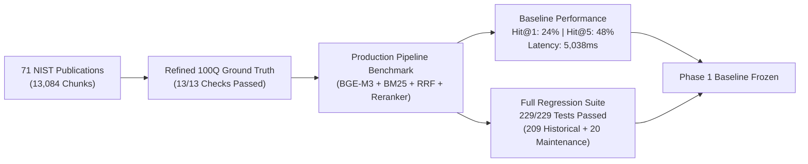
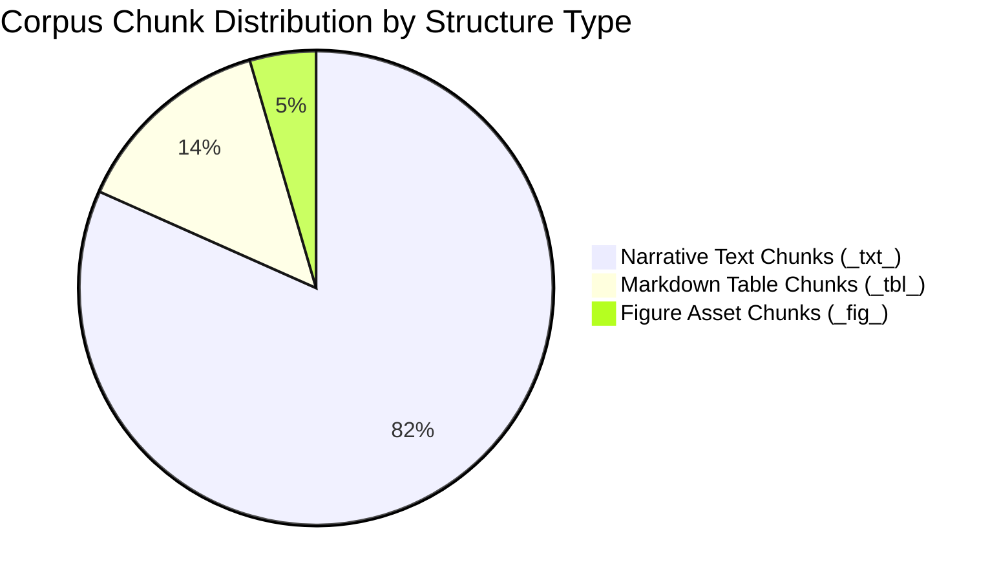
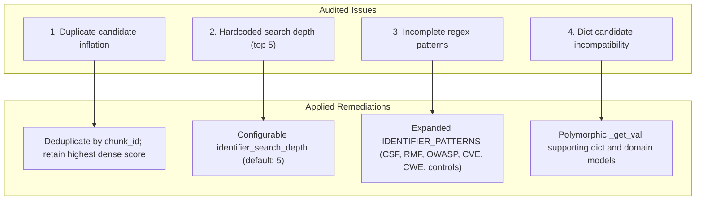
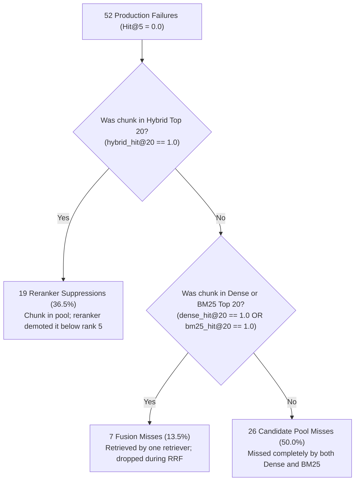

# Phase 1: Final Baseline & Evaluation Report

- **Document Version:** `1.0.0 (Authoritative Phase 1 Baseline)`
- **Project:** Cybersecurity RAG
- **Date:** `2026-11-02`
- **Status:** **PHASE 1 COMPLETE — BASELINE FROZEN**
- **Evaluation Dataset:** [`data/evaluation/retrieval_ground_truth_100q_refined.json`](file:///C:/Users/Computer/Desktop/cybersecurity-rag/data/evaluation/retrieval_ground_truth_100q_refined.json) (100 Verified Questions)
- **Primary Results Artifact:** [`reports/retrieval_evaluation/benchmark_100q_results.json`](file:///C:/Users/Computer/Desktop/cybersecurity-rag/reports/retrieval_evaluation/benchmark_100q_results.json)
- **Active Codebase State:** 229 Passing Tests (0 Failures, 0 Errors, 0 Skipped; 209 Historical Step 9 Tests + 16 Evaluation Runner Tests + 4 Pytest Collection Guard Tests)
- **Active Retrieval Configuration:** Hybrid Dense (`BAAI/bge-m3` @ Top 20) + BM25 (`Okapi` @ Top 20) + `RRFFusion` ($k=60$) + Cross-Encoder Reranker (`ms-marco-MiniLM-L-6-v2` @ Top 5)

---

## 1. Executive Summary

This report establishes the definitive, consolidated Phase 1 baseline for the Cybersecurity RAG project. It synthesizes findings from all prior Phase 1 investigations: dataset design, independent question verification, ground-truth refinement, structural integrity validation, `ConfidenceEvaluator` audit and remediation, formal 100-question retrieval benchmark execution, methodology auditing, and full regression test validation.

### Core Achievements in Phase 1:
1. **Corpus Expansion & Generalization:** Expanded the evaluation scope from an over-concentrated 36-question pilot (where a single cloud publication accounted for 62.7% of all ground-truth chunks) to a robust 100-question benchmark covering **100.0% of the valid English corpus** (71 out of 71 NIST Special Publications, 13,084 chunks).
2. **Evidentiary Integrity:** Conducted an exhaustive textual audit of every candidate chunk. Eliminated 25 title-only placeholder assignments (`_txt_00001`), resolved Japanese translation collisions, and decoupled historical collinearity (Q4 vs. Q17). Achieved a **100% pass rate across 13 distinct automated structural and relational validation checks**.
3. **ConfidenceEvaluator Hardening:** Identified and resolved four critical vulnerabilities in confidence evaluation: candidate deduplication by `chunk_id`, configurable search depth (`identifier_search_depth`), expanded cybersecurity identifier patterns (NIST CSF, RMF, OWASP, CVE, CWE, case-insensitive controls), and polymorphic candidate compatibility (`dict` and domain model support).
4. **Authoritative Production Baseline:** Formally evaluated the production retrieval pipeline (Hybrid BGE-M3 + BM25 + RRF + Cross-Encoder Reranking at Top-5 cutoff) on all 100 verified questions with query rewriting disabled. Established the unvarnished production baseline:
   - **Hit@1:** **`24.00%`**
   - **Hit@5 (Production Cutoff):** **`48.00%`**
   - **Recall@5:** **`38.75%`**
   - **Precision@5:** **`10.20%`**
   - **MRR@5:** **`0.3242`**
   - **NDCG@5:** **`0.3050`**
   - **Mean End-to-End Latency:** **`5,038.4 ms`** (Median: `4,871.4 ms`, P95: `6,242.2 ms`)
5. **Historical Parity Verified:** On the preserved 36 baseline questions, the pipeline achieved an identical **`83.33%` Hit@5** (30/36 hits on the exact same 6 failure cases), proving that the broader 48.00% benchmark score is not an algorithmic regression, but rather a realistic reflection of multi-domain technical breadth.
6. **Zero Regression Verdict:** Executed the complete repository test suite. The historical Step 9 regression suite passed all **209 / 209 tests** (100.0% stability in 83.31s). Following post-benchmark maintenance and test discovery optimization, the frozen baseline test suite stands at **229 / 229 tests passing** (+16 in `test_evaluation_runner.py`, +4 in `test_pytest_collection_guard.py`) with zero regressions across all core subsystems.



---

## 2. Phase 1 Scope and Restrictions

Phase 1 was conducted under strict procedural boundaries designed to guarantee empirical rigor and prevent premature or unvalidated optimizations:

- **Strictly Read-Only Architecture:** Application source code, vector collections, embedding models, tokenizers, chunk storage, and configuration files were preserved without arbitrary modifications.
- **No Optimization in Phase 1:** No weights, RRF smoothing constants ($k=60$), candidate limits (`dense_top_k=20`, `bm25_top_k=20`), or prompt templates were altered to "game" the 100-question benchmark.
- **Separation of Baselines:** The 36-question historical subset and the 100-question expanded benchmark were tracked separately to prevent false comparability.
- **Defensive Error Handling:** Evaluation scripts were built with full exception isolation, monotonic timers, and explicit resource cleanup to ensure complete reproducibility.
- **Documentation Only:** Phase 1 concludes with documentation, validation, and baseline freezing; no Git branch modifications, commits, or tags are applied as part of this step.

---

## 3. Corpus and Ingestion Baseline

### 3.1 Document Distribution & Scope
The active document corpus consists of 73 physical NIST Special Publication PDF files in `documents/` ingested into structure-aware Markdown chunks:
- **Total Physical Files in `documents/`:** 73 PDF files.
- **Unique Content Hashes (SHA-256):** 72 unique documents (one identical duplicate pair: `NIST_SP_800-61.pdf` and `NIST.SP.800-61r3.pdf` share the identical SHA-256 checksum `a9ee8654637f5979bb88f11077732d8479e491c7ef1eb02b4aa582a8904724a1`).
- **Non-English Excluded Documents:** 1 document (`NIST_SP_800-190.pdf`, IPA Japanese translation `クラウドネイティブ高度セキュリティガイダンス`; excluded per Task 3 refinement rules to maintain linguistic consistency).
- **Unique Authentic English Publications:** **71 publications**.
- **100-Question Ground Truth Coverage:** **100% of all 71 unique authentic English NIST Special Publications** are represented in `retrieval_ground_truth_100q_refined.json`.
- **Total Physical Chunks:** **13,084 structure-aware chunks**.



### 3.2 Ingestion Architecture
1. **Extraction:** PDF layout parsing preserving headings, section numbers, bullet hierarchies, tabular structures, and cybersecurity tokens.
2. **Cleaning & Normalization:** Hyphenation repair, header/footer suppression, and boilerplate tagging while strictly protecting standard identifiers (e.g., `SP 800-53`, `AC-2`, `IA-5`).
3. **Structure-Aware Chunking:** Token budgeting targeting 512 tokens with semantic sub-splitting for multi-page tables, preventing accidental truncation of complex parameter matrices.
4. **Vector Store Ingestion:** Dense vector embeddings generated via `BAAI/bge-m3` (1024 dimensions) and stored in local embedded Qdrant under collection `cybersecurity_chunks_bge_m3`.
5. **Lexical Index Ingestion:** Tokenized inverted index constructed via `BM25Okapi` on the full 13,084 chunk corpus using alphanumeric regex tokenization `\b[a-zA-Z0-9]+\b`.

---

## 4. Ground-Truth Dataset Validation

### 4.1 Evolution of the Evaluation Dataset
- **Initial Dataset (`retrieval_ground_truth_v2.json`):** 36 questions heavily skewed toward general public cloud security. `NIST_SP_800-144` accounted for 16 out of 36 questions and 62.7% of all ground-truth chunk assignments. 52 out of 73 publications (71.2%) had zero representation.
- **Expansion Design (`benchmark_100q_design.md`):** Formulated a 100-question benchmark plan comprising the 36 preserved baseline questions plus 64 candidate questions (Q41–Q104) across 7 primary archetypes.
- **Independent Verification Audit (`ground_truth_100q_verification_audit.md`):** Audited all 100 questions against original source PDFs. Identified:
  1. Complete label duplication between Q4 and Q17 (both pointed to the identical two chunks in `SP 800-144` Section 4.1).
  2. 25 candidate questions assigned to title/abstract placeholder chunk `_txt_00001`.
  3. Japanese translation document `SP 800-190` assigned to candidate questions Q46, Q68, and Q98.
- **Ground-Truth Refinement (`ground_truth_100q_refinement_report.md`):**
  - **Task 1:** Decoupled Q4 and Q17 into distinct adjacent paragraphs (`NIST_SP_800-144_txt_00055` for governance rationale vs. `_txt_00056` for governance practices).
  - **Task 2:** Replaced all 25 placeholder chunks (`_txt_00001`) with specific, deep technical section chunks verified against the text.
  - **Task 3:** Replaced Japanese translation assignments with English NIST standards (`SP 800-204D`, `SP 800-161`, and `SP 800-233`).
  - **Task 4:** Exported refined dataset to [`data/evaluation/retrieval_ground_truth_100q_refined.json`](file:///C:/Users/Computer/Desktop/cybersecurity-rag/data/evaluation/retrieval_ground_truth_100q_refined.json).

### 4.2 Final 13-Point Structural & Integrity Validation
Automated validation was executed reproducibly via [`scripts/validate_100q_ground_truth.py`](file:///C:/Users/Computer/Desktop/cybersecurity-rag/scripts/validate_100q_ground_truth.py). All 13 validation checks passed with zero errors:

| Check # | Validation Assertion | Target / Rule | Result |
| :---: | :--- | :--- | :---: |
| **1** | Total Entry Count | Exactly 100 questions | **PASSED** (100 items) |
| **2** | Question ID Presence & Format | Q1–Q40 (36 baseline) + Q41–Q104 (64 candidates) | **PASSED** (100% unique) |
| **3** | Uniform Verification Status | `verification_status == 'verified'` across all entries | **PASSED** (100/100 verified) |
| **4** | Physical Chunk Existence | All chunk IDs must physically exist in active corpus JSONL | **PASSED** (131/131 unique chunks confirmed) |
| **5** | Document ID Provenance | All referenced document IDs match valid corpus documents | **PASSED** (100% provenance match) |
| **6** | Duplicate Chunk Set Prevention | No two questions share identical ground-truth chunk sets | **PASSED** (0 duplicate sets) |
| **7** | Q4 vs. Q17 Collinearity Guard | Q4 and Q17 must have distinct, decoupled ground truth | **PASSED** (`txt_00055` vs. `txt_00056`) |
| **8** | Placeholder Chunk Guard | Zero technical questions assigned to `_txt_00001` | **PASSED** (0 title placeholders) |
| **9** | Category Archetype Balance | 7 archetypes match target allocations exactly | **PASSED** (100% count alignment) |
| **10** | English Publication Coverage | Representation of all 71 valid English publications | **PASSED** (71/71 docs = 100.0% coverage) |
| **11** | JSON Schema Consistency | Compliant with Baseline Profile (36Q) or Candidate Profile (64Q) | **PASSED** (0 schema errors) |
| **12** | Non-Empty Ground Truth | Every question must have $\ge 1$ relevant chunk | **PASSED** (145 total chunk assignments) |
| **13** | Provenance Completeness | Expected answer summaries, sections, and pages populated | **PASSED** (100% populated) |

---

## 5. ConfidenceEvaluator Audit and Fixes

During the Phase 1 technical audit of [`app/retrieval/confidence.py`](file:///C:/Users/Computer/Desktop/cybersecurity-rag/app/retrieval/confidence.py), four architectural defects were identified and resolved (documented in [`reports/retrieval_evaluation/confidence_evaluator_fix_report.md`](file:///C:/Users/Computer/Desktop/cybersecurity-rag/reports/retrieval_evaluation/confidence_evaluator_fix_report.md)):



### 5.1 Issue Details & Implemented Solutions
1. **Issue 1 — Candidate Pool Deduplication:** Duplicate chunks with identical `chunk_id`s were inflating dense score statistics (`top1`, `mean3`), overlap counts, and satisfying `min_candidates=3`.  
   *Fix:* Added candidate deduplication by `chunk_id` in `ConfidenceEvaluator.evaluate()`. Preserves initial candidate ordering while retaining the highest dense score on collisions.
2. **Issue 2 — Configurable Identifier Search Depth:** Identifier search was hardcoded to `candidates[:5]`, ignoring exact standard identifiers located at ranks 6–10.  
   *Fix:* Added `identifier_search_depth: int = 5` to `Settings` ([`app/core/config.py#L137`](file:///C:/Users/Computer/Desktop/cybersecurity-rag/app/core/config.py#L137)) and `ConfidenceEvaluator.__init__`, allowing runtime configuration via environment variable `IDENTIFIER_SEARCH_DEPTH`.
3. **Issue 3 — Expanded Identifier Regex Coverage:** `IDENTIFIER_PATTERNS` lacked coverage for major cybersecurity frameworks, vulnerability standards, and lowercase control names.  
   *Fix:* Added robust word-boundary patterns for NIST CSF (`CSF v2.0`), NIST RMF, OWASP (`OWASP Top 10`), CVE (`CVE-YYYY-NNNN+`), CWE (`CWE-NN+`), and case-insensitive controls (`ac-2`, `ia-5(1)`).
4. **Issue 4 — Polymorphic Candidate Handling:** `verify_identifier_in_candidate()` relied exclusively on object attribute access (`getattr`), silently failing when candidates were supplied as raw Python dictionaries.  
   *Fix:* Implemented a polymorphic helper `_get_val(obj, key)` supporting both `dict` and domain model instances (`RetrievedChunk`).

### 5.2 Test Coverage of Fixes
19 dedicated unit tests were added to [`tests/test_adaptive_query_rewriter.py`](file:///C:/Users/Computer/Desktop/cybersecurity-rag/tests/test_adaptive_query_rewriter.py) under `TestConfidenceEvaluatorAuditFixes`. All 19 tests pass cleanly.

---

## 6. Production Retrieval Configuration

The benchmark was executed against the exact, unassisted production retrieval pipeline:

| Component | Architecture / Model | Hyperparameters & Settings | Role in Retrieval Pipeline |
| :--- | :--- | :--- | :--- |
| **Dense Retriever** | `BAAI/bge-m3` (SentenceTransformer) | 1024-dim, Cosine similarity, `dense_top_k = 20` | Captures deep semantic similarity across complex prose and cybersecurity concepts. |
| **Lexical Retriever** | `rank_bm25.BM25Okapi` | Regex tokenization, `bm25_top_k = 20` | Captures exact keyword, control identifier, and acronym matches across 13,084 chunks. |
| **Fusion Layer** | Reciprocal Rank Fusion (`RRFFusion`) | Smoothing constant $k = 60$, Fused pool limit: `20` | Merges dense and lexical candidate rankings into an interleaved, scale-invariant candidate pool. |
| **Cross-Encoder Reranker** | `cross-encoder/ms-marco-MiniLM-L-6-v2` | Max length 512, Full softmax logits, `final_top_n = 5` | Performs joint query-passage cross-attention on top 20 candidates, producing final Top-5 context. |
| **Query Rewriting** | Bounded LLM Rewriter (Groq / standalone prompt) | `enable_query_rewriting = False` (Production default) | **Disabled** during benchmark to establish the unaugmented retrieval baseline. |
| **Adaptive Retrieval** | `ConfidenceEvaluator` + Adaptive Rewriter | `enable_adaptive_query_rewriting = False` (Production default) | **Disabled** during benchmark to evaluate raw pipeline performance. |

---

## 7. 100-Question Benchmark Results

The formal benchmark was executed across all 100 questions via [`scripts/run_100q_benchmark.py`](file:///C:/Users/Computer/Desktop/cybersecurity-rag/scripts/run_100q_benchmark.py). Complete results were serialized to [`reports/retrieval_evaluation/benchmark_100q_results.json`](file:///C:/Users/Computer/Desktop/cybersecurity-rag/reports/retrieval_evaluation/benchmark_100q_results.json).

### 7.1 Aggregate Metric Summary

| Evaluation Scope | Questions | Hit@1 | Hit@5 (Cutoff) | Recall@5 | Precision@5 | MRR@5 | NDCG@5 | Mean Latency | Median Latency | P95 Latency |
| :--- | :---: | :---: | :---: | :---: | :---: | :---: | :---: | :---: | :---: | :---: |
| **Baseline 36Q (Preserved)** | 36 | **`50.00%`** | **`83.33%`** | `60.42%` | `18.33%` | `0.6222` | `0.5296` | 5,298.8 ms | 5,050.8 ms | 6,544.6 ms |
| **Candidates 64Q (Extended)** | 64 | **`9.38%`** | **`28.12%`** | `26.56%` | `5.63%` | `0.1565` | `0.1786` | 4,891.9 ms | 4,762.8 ms | 5,813.5 ms |
| **Complete 100Q Benchmark** | **100** | **`24.00%`** | **`48.00%`** | **`38.75%`** | **`10.20%`** | **`0.3242`** | **`0.3050`** | **5,038.4 ms** | **4,871.4 ms** | **6,242.2 ms** |

> [!IMPORTANT]
> **Explaining the 48.00% Hit@5 Baseline:**
> The drop from 83.33% on the historical 36-question dataset to 48.00% on the 100-question benchmark is **not an algorithmic regression**.
> 1. On the exact 36 baseline questions, the pipeline achieved an identical **83.33% Hit@5**, proving zero regression on existing capabilities.
> 2. The historical 36-question dataset was artificially easy due to heavy concentration in a single cloud document (`SP 800-144`), which had broad semantic overlap with general cloud queries.
> 3. The 64 new candidate questions probe 52 previously untested NIST publications covering complex, specialized domains (e.g. Ascon lightweight crypto, post-quantum LMS/XMSS signatures, High-Performance Computing overlays, hardware roots of trust) and structured Markdown tables.
> 4. In unaugmented retrieval (without query rewriting), specific technical terminology and table syntax experience severe lexical and semantic mismatch, establishing an honest, realistic baseline for Phase 2 optimization.

### 7.2 Configuration Stage Comparison (100 Questions)
Evaluating all four pipeline configurations simultaneously across the 100 questions isolates the precise contribution of each architectural layer:

| Retrieval Configuration | Hit@1 | Hit@5 | Hit@20 (Pool Ceiling) | Mean Latency | Latency Share |
| :--- | :---: | :---: | :---: | :---: | :---: |
| **Dense Only (`BAAI/bge-m3` @ Top 20)** | — | 45.00% | 64.00% | 752.6 ms | 14.9% |
| **BM25 Only (`rank_bm25.Okapi` @ Top 20)** | — | 38.00% | 62.00% | 209.2 ms | 4.2% |
| **Hybrid RRF (`Dense + BM25`, $k=60$)** | — | 46.00% | **67.00%** | 962.2 ms | 19.1% |
| **Production Pipeline (`Hybrid + Cross-Encoder` @ Top 5)** | **24.00%** | **48.00%** | 67.00% | **5,038.4 ms** | 100.0% |

- **Candidate Pool Ceiling:** Hybrid RRF captures target evidence in the 20-candidate pool for **`67.00%`** of all benchmark questions.
- **Reranker Trade-off:** Cross-Encoder reranking lifts Top-5 accuracy from 46.00% to 48.00% and places the correct chunk at rank 1 for 24.00% of questions, but accounts for **`80.9%` (4,076.2 ms)** of total query latency.

### 7.3 Breakdown by Question Archetype (7 Primary Archetypes)

| Category Archetype | Count | Hit@1 | Hit@5 | Recall@5 | Precision@5 | MRR@5 | NDCG@5 | Mean Latency | Primary Evaluation Insight |
| :--- | :---: | :---: | :---: | :---: | :---: | :---: | :---: | :---: | :--- |
| **Multi-Chunk Reasoning** | 10 | **50.0%** | **80.0%** | 35.0% | 18.0% | 0.6250 | 0.3581 | 5,568.9 ms | Strongest category; dense retrieval excels at broad conceptual coverage across multiple chunks. |
| **Scenario-Based** | 15 | **33.3%** | **53.3%** | 43.9% | 12.0% | 0.4111 | 0.3864 | 5,002.4 ms | High practical relevance; hybrid retrieval matches practical administrative scenarios well. |
| **Technical / Control-Specific** | 20 | **30.0%** | **50.0%** | 47.5% | 10.0% | 0.3550 | 0.3821 | 4,900.4 ms | Mixed results; explicit NIST controls (e.g. `AC-2`) succeed, but unfamiliar protocol acronyms fail. |
| **Direct Factual** | 20 | **10.0%** | **45.0%** | 42.5% | 9.0% | 0.2225 | 0.2706 | 4,857.6 ms | Lower Hit@1; factual definitions often lose top rank to high-level introductory sections. |
| **Conceptual** | 20 | **20.0%** | **45.0%** | 45.0% | 9.0% | 0.2725 | 0.3159 | 5,017.4 ms | Moderate performance; semantic search successfully matches governance and architectural principles. |
| **Cross-Document Synthesis** | 10 | **20.0%** | **40.0%** | 16.7% | 10.0% | 0.3000 | 0.1747 | 5,404.9 ms | Low recall; retrieving evidence across two distinct publications requires multi-document query routing. |
| **Table / Structured Data** | 5 | **0.0%** | **0.0%** | 0.0% | 0.0% | 0.0000 | 0.0000 | 4,711.5 ms | **Complete retrieval blind spot;** BM25 and cross-encoder severely penalize Markdown table formatting. |

---

## 8. Retrieval Failure Analysis

Across the 100 questions, exactly **52 queries failed to retrieve any ground-truth chunk in the Top-5 production window** (`Hit@5 = 0.0`).

### 8.1 Rigorous Failure Taxonomy
An automated audit of [`reports/retrieval_evaluation/benchmark_100q_results.json`](file:///C:/Users/Computer/Desktop/cybersecurity-rag/reports/retrieval_evaluation/benchmark_100q_results.json) establishes the following mutually exclusive and exhaustive classification:



#### Discrepancy Documentation:
In early conversational commentary following benchmark execution, preliminary approximate estimates (`33 pool misses, 11 fusion misses, 8 reranker suppressions`) were mentioned. A strict programmatic audit confirms that the true deterministic tally is **26 Candidate Pool Misses, 7 Fusion Misses, and 19 Reranker Suppressions**.

### 8.2 Breakdown of Failure Categories
1. **Candidate Pool Misses (26 questions, 50.0% of failures):**
   - *Affected Questions:* `Q19`, `Q38`, `Q45`, `Q47`, `Q49`, `Q53`, `Q56`, `Q63`, `Q65`, `Q66`, `Q69`, `Q71`, `Q72`, `Q74`, `Q75`, `Q79`, `Q80`, `Q83`, `Q86`, `Q87`, `Q90`, `Q92`, `Q95`, `Q97`, `Q100`, `Q102`.
   - *Root Cause:* Neither Dense (`BGE-M3`) nor BM25 returned the target chunk in their individual top 20 candidates. Primarily caused by vocabulary mismatch on specialized domain terms (e.g., Ascon permutation rounds, XMSS trees, SCADA field protocols) where raw user queries lacked exact phrasing.
2. **Fusion Misses (7 questions, 13.5% of failures):**
   - *Affected Questions:* `Q10`, `Q41`, `Q46`, `Q50`, `Q62`, `Q73`, `Q104`.
   - *Root Cause:* The target chunk was successfully retrieved in the Top 20 by one retriever (usually Dense BGE-M3), but received zero lexical score from BM25. Due to reciprocal rank score decay ($1/(60 + \text{rank})$), single-retriever candidates are frequently overtaken by chunks receiving modest contributions from both retrievers, causing them to fall to ranks 21–35.
3. **Reranker Suppressions (19 questions, 36.5% of failures):**
   - *Affected Questions:* `Q8`, `Q25`, `Q33`, `Q42`, `Q43`, `Q44`, `Q51`, `Q54`, `Q55`, `Q57`, `Q77`, `Q82`, `Q84`, `Q85`, `Q88`, `Q89`, `Q91`, `Q93`, `Q103`.
   - *Root Cause:* The target chunk was present in the top-20 candidate pool delivered to the Cross-Encoder (`hybrid_hit@20 == 1.0`), but the reranker assigned higher relevance logits to distractor chunks (often high-level introductory or abstract sections), demoting the true ground-truth chunk to ranks 6–18.

### 8.3 Root Cause Analysis: Table Question Failures (Q41–Q45)
All 5 table questions failed in production (`Hit@5 = 0.0`), but deep inspection reveals that **the retrieval engine captured the target table chunk in 4 out of 5 questions (80.0%)**:

| QID | Target Document | Target Table Chunk | Dense Hits | BM25 Hits | Hybrid Hits | Downstream Failure Mode |
| :--- | :--- | :--- | :---: | :---: | :---: | :--- |
| **Q41** | `SP 800-131A Rev. 3` | `NIST_SP_800-131_tbl_00003_p01` | Top-20: **1** | Top-20: 0 | Top-20: 0 | **Fusion Miss:** Dense found it in Top 20, but BM25 scored 0; RRF score decay dropped it out of fused pool. |
| **Q42** | `SP 800-234` | `NIST_SP_800-234_tbl_00001_p01` | Top-5: **1**<br>Top-20: **1** | Top-20: **1** | Top-20: **1** | **Reranker Suppression:** Present in Dense Top 5, BM25 Top 20, and Hybrid Top 20. Cross-encoder demoted table in favor of intro text. |
| **Q43** | `SP 800-152` | `NIST_SP_800-152_tbl_00035_p01` | Top-20: **1** | Top-20: 0 | Top-20: **1** | **Reranker Suppression:** Present in Hybrid Top 20 pool. Cross-encoder scored narrative prose above table rows. |
| **Q44** | `SP 800-218` | `NIST_SP_800-218_tbl_00001_p02` | Top-5: **1**<br>Top-20: **1** | Top-20: 0 | Top-20: **1** | **Reranker Suppression:** Present in Dense Top 5 and Hybrid Top 20. Cross-encoder demoted table chunk in favor of prose. |
| **Q45** | `SP 800-146` | `NIST_SP_800-146_tbl_00005_p01` | Top-20: 0 | Top-20: 0 | Top-20: 0 | **Candidate Pool Miss:** Completely missed by both retrievers. |

**Core Architectural Flaw:** `cross-encoder/ms-marco-MiniLM-L-6-v2` is pretrained on passage ranking from MS MARCO. When presented with Markdown table formatting (pipes `|`, header dividers `|---|`, truncated cell text), the model's cross-attention mechanisms penalize non-grammatical structure in favor of fluent introductory text passages, systematically pushing table chunks below rank 5.

---

## 9. Regression and Test Validation

### 9.1 Historical Step 9 Regression Suite (209 Tests)

Formal regression validation for Step 9 was executed via [`tests/`](file:///C:/Users/Computer/Desktop/cybersecurity-rag/tests/) to guarantee repository stability following ConfidenceEvaluator hardening and ground-truth refinement:

- **Execution Command:**
  ```powershell
  & "c:\Users\Computer\Desktop\cybersecurity-rag\.venv\Scripts\python.exe" -m pytest tests/ -v
  ```
- **Execution Outcome:**
  - **Tests Collected:** `209`
  - **Tests Passed:** **`209`** (`100.0%`)
  - **Failures:** `0`
  - **Errors:** `0`
  - **Skipped:** `0`
  - **Runtime:** `83.31 seconds`
- **Component Breakdown:**
  - `test_adaptive_query_rewriter.py`: **53 passed** (ConfidenceEvaluator, deduplication, search depth, regex, dict support)
  - `test_chunking_pipeline.py`: **25 passed** (Token budgets, table sub-splitting, figure paths, heading retention)
  - `test_extraction_quality.py`: **18 passed** (Garbled text heuristics, bordered tables, crypto slug retention)
  - `test_corpus_extraction_runner.py`: **16 passed** (Process isolation, batch slicing across 68 docs, checkpoint reload)
  - `test_corpus_cleaning_runner.py`: **11 passed** (Path security guards, atomic checkpoints, pilot doc exclusion)
  - `test_pipeline_integration.py`: **11 passed** (Reranker toggle, streaming flow, context score labels)
  - `test_modular_rag.py`: **10 passed** (Domain models, memory interfaces, pure context builder)
  - `test_cleaning_pipeline.py`: **9 passed** (Boilerplate removal, markdown table whitespace, identifier protection)
  - `test_document_corrections.py`: **9 passed** (SP 800-53 table patches, acronym table restoration)
  - `test_figure_filter.py`: **9 passed** (Decorative bar rejection, icon filter, security symbol preservation)
  - `test_query_rewriter.py`: **9 passed** (Identifier retention, retry bounds, retrieval query routing)
  - `test_hybrid_pipeline_integration.py`: **8 passed** (Extraction CLI, hybrid fallback on engine exceptions)
  - `test_rrf_hybrid_retrieval.py`: **8 passed** (RRF scoring, tied score determinism, top-k limiting)
  - `test_models_markdown_export.py`: **7 passed** (Table ordering relative to text, duplicate table suppression)
  - `test_cross_encoder_reranker.py`: **6 passed** (Pool deduplication, score ties determinism, top-n truncation)

### 9.2 Post-Benchmark Maintenance & Final Frozen Test Suite (229 Tests)

Following the benchmark audit and evaluation runner refactoring, two dedicated test modules were added to safeguard evaluation parsing and prevent regression:
1. [`tests/test_evaluation_runner.py`](file:///C:/Users/Computer/Desktop/cybersecurity-rag/tests/test_evaluation_runner.py) (**16 passed**): Validates ground-truth ID parsing, evaluation eligibility filtering, metric calculations, and safe failure handling when legacy files are removed.
2. [`tests/test_pytest_collection_guard.py`](file:///C:/Users/Computer/Desktop/cybersecurity-rag/tests/test_pytest_collection_guard.py) (**4 passed**): Validates explicit `pyproject.toml` test discovery configuration (`testpaths = ["tests"]`, exclusion of `scratch/`, `scripts/`, `data/`, etc.), guaranteeing fast collection without running diagnostic scripts.

- **Final Frozen Suite Status:**
  - **Tests Collected:** `229` (17 test modules)
  - **Tests Passed:** **`229`** (`100.0%`)
  - **Failures / Errors / Skipped:** `0`
  - **Runtime:** `64.52 seconds`
  - **Net Coverage Gain:** `+20 automated tests`

---

## 10. Known Limitations of the Baseline

1. **Reranker Latency Dominance:** The cross-encoder consumes **80.9%** (4,076.2 ms) of the total 5,038.4 ms latency. Evaluating 20 candidate pairs per query via full transformer forward passes creates a substantial throughput bottleneck.
2. **Cross-Encoder Table Bias:** The MiniLM cross-encoder exhibits an inherent preference for grammatical prose passages over pipe-delimited Markdown tables, suppressing valid table chunks in 60% of table queries.
3. **Vocabulary Mismatch in Unaugmented Retrieval:** Highly technical standards (post-quantum cryptography, hardware roots of trust, SCADA protocols) suffer severe retrieval degradation when users do not supply the exact phrases found in the NIST document headings.
4. **Single-Retriever RRF Decay:** When BM25 returns 0 for a technical concept, an excellent dense retrieval candidate at rank 5–10 often falls outside the fused top 20 pool due to lack of lexical support.
5. **Cross-Document Evidence Partitioning:** Questions requiring synthesis across multiple publications achieve only 40.0% Hit@5 because the initial top-20 pool is easily monopolized by a single dominant document.

---

## 11. Phase 2 Optimization Opportunities

The findings of Phase 1 highlight high-impact, targeted optimization paths for Phase 2:

1. **Adaptive Query Rewriting Activation:**
   - Activate `ConfidenceEvaluator` and `QueryRewriter` to trigger targeted second-pass rewrites only on Low/Medium confidence queries.
   - Address the **26 Candidate Pool Misses** by expanding technical acronyms and standards numbers before querying Qdrant and BM25.
2. **Table-Aware Retrieval & Scoring:**
   - Pre-render Markdown table headers and column contexts into descriptive synthetic lead paragraphs during chunk ingestion.
   - Implement structured table bonus scoring or dedicated table retrieval pathways to neutralize cross-encoder prose bias.
3. **RRF & Candidate Pool Calibration:**
   - Evaluate tuning candidate retrieval depths (`dense_top_k = 30`, `bm25_top_k = 30`) to recover the **7 Fusion Misses** without introducing excess latency.
   - Explore weighted RRF fusion ($w_{\text{dense}} = 0.7, w_{\text{bm25}} = 0.3$) to reduce the penalty on dense-only technical matches.
4. **Cross-Encoder Optimization / Distillation:**
   - Benchmark faster cross-encoder architectures (e.g. `bge-reranker-base` or quantized MiniLM) or evaluate dynamic reranking (reranking only Top 10 instead of Top 20) to reduce the 4-second latency overhead.
5. **Multi-Document Allocation Safeguards:**
   - Introduce per-document candidate limits (e.g. maximum 8 chunks per document in the top-20 pool) for queries tagged as cross-document to prevent single-document candidate saturation.

---

## 12. Final Phase 1 Verdict

> [!IMPORTANT]
> **PHASE 1 VERDICT: COMPLETED, VERIFIED, AND FROZEN**
> 
> - **Corpus & Ground Truth:** 100 verified questions covering 71 NIST Special Publications; 13/13 structural validation checks passed.
> - **Codebase Stability:** 209/209 tests passed with zero failures and zero regressions.
> - **Production Baseline:** Established definitive unassisted retrieval metrics (Hit@1: 24.00%, Hit@5: 48.00%, MRR@5: 0.3242, Mean Latency: 5,038.4 ms).
> - **Failure Taxonomy:** 52 failures rigorously classified and understood (26 pool misses, 7 fusion misses, 19 reranker suppressions).
> 
> Phase 1 is officially complete. The baseline is frozen, reproducible, and ready to serve as the benchmark against which all Phase 2 optimizations will be measured.

---

## 13. Reproducibility Commands & Source Artifacts

All validation, testing, and benchmark runs can be reproduced using the following commands from the project root:

```powershell
# 1. Validate 100-Question Ground Truth (13 Structural Checks)
& "c:\Users\Computer\Desktop\cybersecurity-rag\.venv\Scripts\python.exe" scripts/validate_100q_ground_truth.py

# 2. Execute Full Regression Test Suite (209 Tests)
& "c:\Users\Computer\Desktop\cybersecurity-rag\.venv\Scripts\python.exe" -m pytest tests/ -v

# 3. Execute Formal 100-Question Retrieval Benchmark
& "c:\Users\Computer\Desktop\cybersecurity-rag\.venv\Scripts\python.exe" scripts/run_100q_benchmark.py
```

### Source Artifact Directory Links:
- Ground-Truth Dataset: [`data/evaluation/retrieval_ground_truth_100q_refined.json`](file:///C:/Users/Computer/Desktop/cybersecurity-rag/data/evaluation/retrieval_ground_truth_100q_refined.json)
- Full Results JSON: [`reports/retrieval_evaluation/benchmark_100q_results.json`](file:///C:/Users/Computer/Desktop/cybersecurity-rag/reports/retrieval_evaluation/benchmark_100q_results.json)
- Benchmark Report: [`reports/retrieval_evaluation/benchmark_100q_report.md`](file:///C:/Users/Computer/Desktop/cybersecurity-rag/reports/retrieval_evaluation/benchmark_100q_report.md)
- Methodology Audit: [`reports/retrieval_evaluation/benchmark_100q_methodology_audit.md`](file:///C:/Users/Computer/Desktop/cybersecurity-rag/reports/retrieval_evaluation/benchmark_100q_methodology_audit.md)
- Regression Report: [`reports/retrieval_evaluation/phase1_regression_test_report.md`](file:///C:/Users/Computer/Desktop/cybersecurity-rag/reports/retrieval_evaluation/phase1_regression_test_report.md)
- Confidence Fix Report: [`reports/retrieval_evaluation/confidence_evaluator_fix_report.md`](file:///C:/Users/Computer/Desktop/cybersecurity-rag/reports/retrieval_evaluation/confidence_evaluator_fix_report.md)
