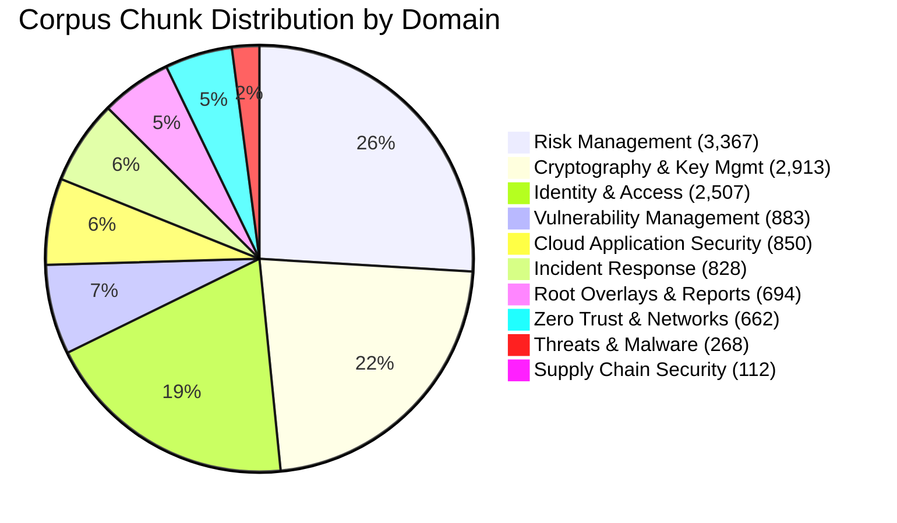
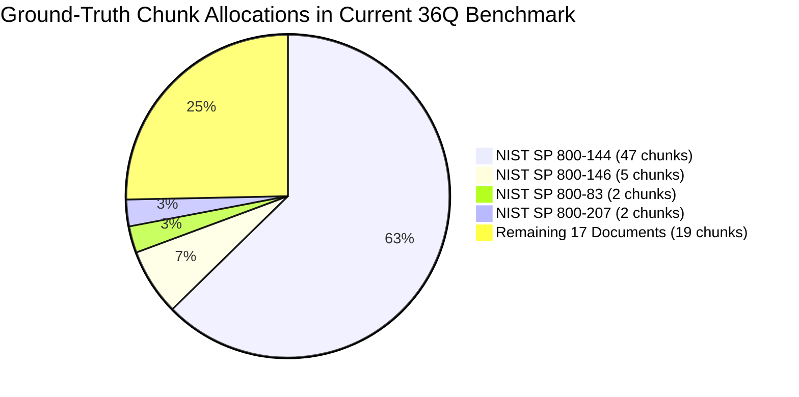
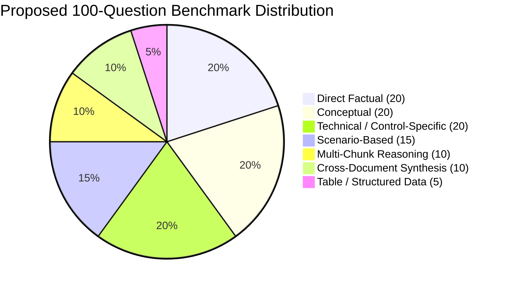
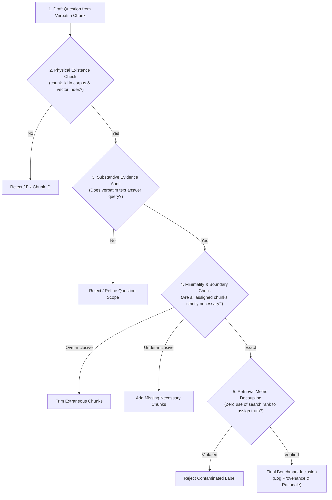

# 100-Question Retrieval Benchmark Design

**Project:** Cybersecurity RAG  
**Corpus Scope:** 73 NIST Special Publications (4,649 pages, 13,084 chunks)  
**Existing Benchmark:** [`data/evaluation/retrieval_ground_truth_v2.json`](file:///C:/Users/Computer/Desktop/cybersecurity-rag/data/evaluation/retrieval_ground_truth_v2.json) (36 questions)  
**Verification Reference:** [`reports/retrieval_evaluation/ground_truth_36q_verification_audit.md`](file:///C:/Users/Computer/Desktop/cybersecurity-rag/reports/retrieval_evaluation/ground_truth_36q_verification_audit.md)  
**Deliverable Path:** `reports/retrieval_evaluation/benchmark_100q_design.md`  
**Date:** 2026-11-01  
**Status:** DESIGN COMPLETED (READ-ONLY ANALYSIS)  

---

## Executive Summary

This design document establishes the blueprint for expanding the Cybersecurity RAG retrieval evaluation benchmark from 36 questions to **100 distinct, evaluation-eligible questions**.

The benchmark expansion addresses fundamental structural imbalances identified in the current evaluation suite:
1. **Severe Document Skew:** The current 36-question benchmark covers only **21 of the 73 NIST publications** (28.8%), leaving **52 documents (71.2%) completely unrepresented**. A single publication ([`NIST SP 800-144`](file:///C:/Users/Computer/Desktop/cybersecurity-rag/data/chunks_corpus/cloud_application_security/NIST_SP_800-144_chunks.jsonl)) accounts for 44.4% of all questions and 62.7% of all ground-truth chunk assignments.
2. **Domain Neglect:** While `cryptography_security` comprises 17 documents (23.3% of the corpus) and 2,913 chunks (22.3%), it contains only a single question (Q31). Similarly, `identity_access` contains 14 documents and 2,507 chunks, but has only 2 evaluation questions.
3. **Structured Data Omission:** 100% of the 75 ground-truth chunks in the existing benchmark are plain text (`text`). Zero table (`table`) or figure (`figure`) chunks are evaluated, despite the corpus containing 1,809 table chunks (13.8%) and 591 figure chunks (4.5%).
4. **Metric Collinearity:** Questions Q4 and Q17 share identical ground-truth chunks ([`NIST_SP_800-144_txt_00055`](file:///C:/Users/Computer/Desktop/cybersecurity-rag/data/chunks_corpus/cloud_application_security/NIST_SP_800-144_chunks.jsonl#L55) and `00056`), artificially coupling their retrieval scores.

The proposed 100-question benchmark preserves all 36 existing questions intact and introduces 64 newly designed question specifications across **7 question archetypes**, achieving **100% document coverage across all 72 unique NIST Special Publications**.

---

## 1. Corpus Coverage Analysis

### 1.1 Physical Corpus Characteristics
The active corpus represents the comprehensive ingestion of authoritative NIST Special Publications covering cybersecurity, risk management, identity verification, cryptographic algorithms, zero trust, and software assurance:

- **Total Documents Ingested:** 73 files (4,649 scanned pages, 1,626,713 words, 2,493 embedded figures/images).
- **Unique Publications:** 72 unique SHA-256 document hashes (with 1 identical duplicate group: `NIST_SP_800-61.pdf` and `NIST.SP.800-61r3.pdf`, SHA-256 `e5593d6...`, both 48 pages).
- **Total Structure-Aware Chunks:** **13,084 chunks** (10,684 text chunks, 1,809 table chunks, 591 figure chunks).
- **Token Statistics:**
  - Minimum Tokens: 5
  - Median Tokens: 256.0
  - Mean Tokens: 263.10
  - Maximum Tokens: 500 (strictly constrained by structure-aware boundary chunking)
  - Oversized Chunks ($> 500$ tokens): 0 (100% compliance)

### 1.2 Domain Distribution
The corpus is organized into 10 primary cybersecurity domains across the pilot and corpus storage directories ([`data/chunks_pilot/`](file:///C:/Users/Computer/Desktop/cybersecurity-rag/data/chunks_pilot) and [`data/chunks_corpus/`](file:///C:/Users/Computer/Desktop/cybersecurity-rag/data/chunks_corpus)):

| Cybersecurity Domain | Documents | Pages | Total Chunks | Text Chunks | Table Chunks | Figure Chunks | Chunk Share |
| :--- | :---: | :---: | :---: | :---: | :---: | :---: | :---: |
| **`risk_management`** | 7 | 1,150 | 3,367 | 2,870 | 450 | 47 | 25.73% |
| **`cryptography_security`** | 17 | 1,095 | 2,913 | 2,278 | 543 | 92 | 22.26% |
| **`identity_access`** | 14 | 806 | 2,507 | 2,016 | 384 | 107 | 19.16% |
| **`vulnerability_management`** | 6 | 291 | 883 | 672 | 121 | 90 | 6.75% |
| **`cloud_application_security`** | 6 | 325 | 850 | 694 | 112 | 44 | 6.50% |
| **`incident_response`** | 5 | 359 | 828 | 747 | 46 | 35 | 6.33% |
| **`root`** (Core Overlays & Standards) | 6 | 202 | 694 | 465 | 88 | 141 | 5.30% |
| **`zero_trust_network_security`** | 7 | 270 | 662 | 606 | 32 | 24 | 5.06% |
| **`threats_malware`** | 4 | 110 | 268 | 249 | 12 | 7 | 2.05% |
| **`supply_chain_security`** | 1 | 41 | 112 | 87 | 21 | 4 | 0.86% |
| **Total Corpus** | **73** | **4,649** | **13,084** | **10,684** | **1,809** | **591** | **100.0%** |

### 1.3 Analysis of Strong vs. Weak Topic Coverage

#### Topics with Strong Source Coverage
- **Security & Privacy Control Catalogs:** [`NIST SP 800-53`](file:///C:/Users/Computer/Desktop/cybersecurity-rag/data/chunks_pilot/risk_management/NIST_SP_800-53_chunks.jsonl) is the single largest document with 1,306 chunks (492 pages), providing comprehensive coverage of all 20 control families (AC, AU, AT, CM, CP, IA, IR, MP, PE, PL, PS, RA, SA, SC, SI, SR, etc.).
- **Cyber Supply Chain Risk Management (C-SCRM):** [`NIST SP 800-161`](file:///C:/Users/Computer/Desktop/cybersecurity-rag/data/chunks_corpus/risk_management/NIST_SP_800-161_chunks.jsonl) contains 1,050 chunks (325 pages) spanning enterprise, process, and operational tiers.
- **Digital Identity, PIV, and Biometrics:** SP 800-63, 800-73, 800-76, and 800-79 together provide 1,384 chunks covering enrollment, authenticator assurance (AAL1-3), identity assurance (IAL1-3), federation (FAL1-3), card interfaces, and biometric specifications.
- **Cryptographic Key Management & Transitions:** SP 800-56, 800-57, 800-130, 800-131, 800-133, and 800-152 comprise over 1,500 chunks detailing key generation, lifecycle, key wrapping, derivation, and algorithm transitions.
- **Digital Forensics & Incident Response:** SP 800-61, 800-83, 800-86, and 800-101 provide over 900 chunks detailing forensic artifact preservation, file systems, memory analysis, and containment.

#### Topics with Weak or Insufficient Source Coverage
- **Non-Invasive Hardware Cryptographic Attack Mitigation:** [`NIST SP 800-140`](file:///C:/Users/Computer/Desktop/cybersecurity-rag/data/chunks_corpus/threats_malware/NIST_SP_800-140_chunks.jsonl) contains only 21 chunks (8 pages) covering CMVP test metrics.
- **Cloud Computing Definitions:** [`NIST SP 800-145`](file:///C:/Users/Computer/Desktop/cybersecurity-rag/data/chunks_corpus/cloud_application_security/NIST_SP_800-145_chunks.jsonl) contains only 16 chunks (7 pages).
- **Vulnerability Naming Schemes:** [`NIST SP 800-51`](file:///C:/Users/Computer/Desktop/cybersecurity-rag/data/chunks_corpus/vulnerability_management/NIST_SP_800-51_chunks.jsonl) has only 30 chunks (13 pages).
- **Emerging Overlays (AI Data Centers & HPC):** SP 800-223, 800-234, and 800-239 are concise specialized reports/overlays (~30–75 chunks each).

---

## 2. Existing Benchmark Analysis (`retrieval_ground_truth_v2.json`)

### 2.1 Overview of Current 36 Questions
The existing benchmark contains 36 questions (originating from an initial 40-question pilot, with retired invalid items Q2, Q6, Q15, and Q18 excluded).

- **Total Questions:** 36
- **Total Ground-Truth Chunk Assignments:** 75 chunk instances
- **Unique Ground-Truth Chunk IDs:** 63 unique chunks
- **Ground-Truth Chunk Types:** **100% `text`** (75 text, 0 table, 0 figure)
- **Document Coverage:** **21 out of 73 documents represented (28.8%)**
- **Unrepresented Documents:** **52 out of 73 documents (71.2%)**

### 2.2 Question Ground-Truth Chunk Distribution
- **1-Chunk Questions:** 16 questions (44.4%)
- **2-Chunk Questions:** 5 questions (13.9%)
- **3-Chunk Questions:** 11 questions (30.6%)
- **4-Chunk Questions:** 4 questions (11.1%)

### 2.3 Severe Document and Domain Skew
The existing dataset is heavily concentrated in cloud security:

| Document ID | Domain | Questions Referencing | Assigned Chunks | Share of Benchmark Chunks |
| :--- | :--- | :---: | :---: | :---: |
| **`NIST_SP_800-144`** | `cloud_application_security` | **16** | **47** | **62.7%** |
| **`NIST_SP_800-146`** | `cloud_application_security` | 5 | 5 | 6.7% |
| **`NIST_SP_800-83`** | `incident_response` | 2 | 2 | 2.7% |
| **`NIST_SP_800-207`** | `cloud_application_security` | 2 | 2 | 2.7% |
| **17 other documents** | *Various* | 1 each | 19 | 25.3% |
| **52 unrepresented documents** | *Various* | **0** | **0** | **0.0%** |

### 2.4 Existing Methodological Weaknesses

#### 1. Label Duplication & Metric Collinearity (Q4 vs. Q17)
- **Q4:** *"Why is governance important for public cloud security?"*  
  Assigned: `['NIST_SP_800-144_txt_00055', 'NIST_SP_800-144_txt_00056']`
- **Q17:** *"What governance practices are important when using public cloud services?"*  
  Assigned: `['NIST_SP_800-144_txt_00055', 'NIST_SP_800-144_txt_00056']`
- **Impact:** Both questions evaluate the exact same two chunks in Section 4.1. In retrieval evaluations, any improvement or regression on this section affects two evaluation items simultaneously, producing 100% metric co-linearity.

#### 2. Redundant Cloud Responsibilities Cluster
Questions Q5, Q8, Q9, Q11, and Q12 repeatedly probe cloud outsourcing and shared responsibility, sharing ground-truth chunks across multiple questions:
- Chunk `NIST_SP_800-144_txt_00038` is assigned to **Q5, Q8, Q9, and Q11**.
- Chunk `NIST_SP_800-144_txt_00026` is assigned to **Q5 and Q11**.
- Chunk `NIST_SP_800-144_txt_00060` is assigned to **Q5 and Q11**.
- Chunk `NIST_SP_800-144_txt_00062` is assigned to **Q8 and Q9**.
- Chunk `NIST_SP_800-144_txt_00022` is assigned to **Q5 and Q12**.

#### 3. Cross-Document Repetition
Out of 6 cross-document questions, 5 (Q3, Q8, Q12, Q13, Q19) combine the exact same two documents: `NIST_SP_800-144` and `NIST_SP_800-146`. Only Q40 spans distinct domains (`SP 800-207` ZTA and `SP 800-233` Service Mesh).

#### 4. Complete Absence of Structured Data Retrieval
The corpus contains **1,809 table chunks** and **591 figure chunks** containing parameter tables, control baseline matrices, algorithm transition dates, and architecture diagrams. The current benchmark tests none of them.

---

## 3. Proposed 100-Question Distribution

### 3.1 Target Distribution by Question Archetype
The 100-question benchmark comprises **36 preserved existing questions** and **64 newly designed question specifications** across 7 primary archetypes:

| Category Archetype | Target Count | Existing (v2) | Proposed New | Primary Evaluation Objective |
| :--- | :---: | :---: | :---: | :--- |
| **1. Direct Factual** | **20** | 4 | **16** | Precision of top-1 retrieval for explicit definitions, named phases, and established lists. |
| **2. Conceptual** | **20** | 6 | **14** | Semantic similarity retrieval for high-level governance, architectural philosophies, and risk trade-offs. |
| **3. Technical / Control-Specific** | **20** | 9 | **11** | Dense/BM25 hybrid retrieval for explicit controls (e.g. `AC-2`, `IA-5`), algorithm standards, and protocols. |
| **4. Scenario-Based** | **15** | 5 | **10** | Contextual retrieval simulating practical enterprise attack responses, telework deployments, and audits. |
| **5. Multi-Chunk Reasoning** | **10** | 8 | **2** | Comprehensive multi-chunk recall within a document where answering requires combining disparate sections. |
| **6. Cross-Document Synthesis** | **10** | 4 | **6** | Dual-source retrieval requiring complementary evidence from two distinct NIST publications. |
| **7. Table / Structured Data** | **5** | 0 | **5** | Retrieval of Markdown table chunks containing parameter matrices, transition timelines, and baseline allocations. |
| **Total** | **100** | **36** | **64** | **100 distinct, evaluation-eligible questions** |

### 3.2 Mapping of Existing 36 Questions to Categories

To integrate the existing 36 questions seamlessly into the 100-question benchmark without modifying their ground-truth data, each question is assigned a definitive primary category:

1. **Direct Factual (4 existing):**
   - **Q21:** Core phases of the incident response life cycle (SP 800-83 / 800-61).
   - **Q25:** Core practice groups of the Secure Software Development Framework (SP 800-218).
   - **Q36:** Four phases of the digital forensics process (SP 800-86).
   - **Q38:** Five essential characteristics of cloud computing (SP 800-145).

2. **Conceptual (6 existing):**
   - **Q4:** Why governance is important for public cloud security (SP 800-144).
   - **Q8:** How loss of control affects security in public cloud computing (SP 800-144 / 800-146).
   - **Q17:** Governance practices important when using public cloud services (SP 800-144).
   - **Q23:** Fundamental paradigm shift of Zero Trust Architecture (SP 800-207).
   - **Q34:** Strategic benefits of participating in cyber threat information sharing (SP 800-150).
   - **Q37:** Distinguishing foundational from sustaining practices in C-SCRM (SP 800-161).

3. **Technical / Control-Specific (9 existing):**
   - **Q24:** Network segmentation recommendations for virtual machine protection (SP 800-125).
   - **Q26:** Leveraging actionable metrics to prioritize enterprise patch management (SP 800-40).
   - **Q28:** Security control tailoring process modifying baselines (SP 800-53).
   - **Q29:** Core requirements and authentication factors for AAL2 (SP 800-63).
   - **Q30:** Fundamental attribute types in Attribute Based Access Control (SP 800-162).
   - **Q31:** Operational differences between Full Disk Encryption and File/Folder Encryption (SP 800-111).
   - **Q32:** Application-proxy gateways vs. packet filtering firewalls (SP 800-41).
   - **Q35:** Technical penetration testing vs. automated vulnerability scanning (SP 800-115).
   - **Q39:** Characterizing security controls to mitigate attack vectors in threat modeling (SP 800-154).

4. **Scenario-Based (5 existing):**
   - **Q3:** Client-side malware affecting public cloud security (SP 800-144 / 800-146).
   - **Q14:** Social engineering attacks affecting public cloud security (SP 800-144).
   - **Q20:** Factors in evaluating the security of a public cloud provider (SP 800-144).
   - **Q22:** Considerations and trade-offs in malware containment decisions (SP 800-83).
   - **Q33:** Controls and configurations for telework remote access (SP 800-46).

5. **Multi-Chunk Reasoning (8 existing):**
   - **Q1:** Security risks of public cloud computing (SP 800-144, 3 chunks).
   - **Q5:** Responsibility for security and privacy in public cloud (SP 800-144, 4 chunks).
   - **Q7:** Privacy risks arising from public cloud services (SP 800-144, 3 chunks).
   - **Q9:** Security issues resulting from outsourcing services to cloud (SP 800-144, 3 chunks).
   - **Q10:** Security implications of storing organizational data in cloud (SP 800-144, 3 chunks).
   - **Q11:** Responsibilities retained after moving to public cloud (SP 800-144, 4 chunks).
   - **Q16:** Lifecycle security and privacy considerations (SP 800-144, 3 chunks).
   - **Q27:** Three tiers in the multitiered risk management approach (SP 800-39, 3 chunks).

6. **Cross-Document Synthesis (4 existing):**
   - **Q12:** Shared responsibilities between cloud provider and customer (SP 800-144 & SP 800-146).
   - **Q13:** Risks of relying on third-party cloud service providers (SP 800-144 & SP 800-146).
   - **Q19:** Monitoring challenges in public cloud environments (SP 800-144 & SP 800-146).
   - **Q40:** Service mesh infrastructure security for microservices (SP 800-207 & SP 800-233).

7. **Table / Structured Data (0 existing):**
   - Target is 5 questions; all 5 will be introduced in the expansion.

---

## 4. Underrepresented Cybersecurity Topics

To ensure that the 64 new questions provide comprehensive coverage of the NIST corpus, the following 13 key topics have been identified from corpus content analysis:

### 4.1 Cryptographic Key Lifecycle and Transitions
- **Topics:** Key state transitions (active, deactivated, compromised, destroyed), key generation entropy requirements, split-knowledge / dual control, and algorithm retirement timelines.
- **Key Documents:** SP 800-57 Part 1 Rev 5, SP 800-130 (CKMS Framework), SP 800-131A Rev 2 (Transitions), SP 800-133 Rev 2 (Key Generation), SP 800-152 (FCKMS Profile).

### 4.2 Modern & Lightweight Cryptography
- **Topics:** SHA-3 derived functions (KMAC, cSHAKE, TupleHash), stateful hash-based signatures (LMS, XMSS for post-quantum resistance), and Ascon-based lightweight cryptography for constrained IoT devices.
- **Key Documents:** SP 800-185, SP 800-208, SP 800-232.

### 4.3 PIV, Biometrics, and Federation
- **Topics:** PIV card card-edge interfaces, biometric quality calibration (fingerprint minutiae, facial recognition), accreditation of card-issuing authorities, and derived PIV credentials for mobile devices.
- **Key Documents:** SP 800-73-4, SP 800-76-2, SP 800-78-4, SP 800-79-3, SP 800-116 Rev 1, SP 800-157, SP 800-217.

### 4.4 Advanced Access Control Architecture
- **Topics:** Attribute Based Access Control (ABAC) rule engines, policy verification algorithms (detecting conflicting, redundant, or unreachable rules), and comparison of XACML vs. Next Generation Access Control (NGAC).
- **Key Documents:** SP 800-178, SP 800-192, SP 800-205, SP 800-210.

### 4.5 Container & Cloud-Native Security
- **Topics:** Container image vulnerability scanning, registry trust, runtime isolation, orchestrator access control (Kubernetes RBAC), and API gateway token verification.
- **Key Documents:** SP 800-190 (Application Container Security), SP 800-228 (API Protection for Cloud-Native Systems), SP 800-233 (Service Mesh Proxies).

### 4.6 Specialized Incident Forensics
- **Topics:** Forensic acquisition from mobile devices (logical vs. physical extraction), PDA memory artifacts, and cloud forensic reference architecture (multi-tenant tenant separation and virtual disk acquisition).
- **Key Documents:** SP 800-72, SP 800-101 Rev 1, SP 800-201.

### 4.7 Control Baseline Tailoring & Overlay Engineering
- **Topics:** Detailed control families in SP 800-53 (AC, IA, SC, SI, CM), privacy control baselines, and security overlays for high-performance computing (HPC).
- **Key Documents:** SP 800-53 Rev 5, SP 800-234 (HPC Security Overlay).

### 4.8 Software Supply Chain Security & DevSecOps
- **Topics:** Software Bill of Materials (SBOM) generation, hermetic build environments, provenance verification (SLSA framework), and CI/CD pipeline integrity protection.
- **Key Documents:** SP 800-204, SP 800-218 (SSDF).

### 4.9 Differential Privacy & Privacy Risk Modeling
- **Topics:** Mathematical formalization of $\epsilon$ (epsilon) and $\delta$ (delta) privacy budgets, noise addition mechanisms (Laplace/Gaussian), and differential privacy evaluation guarantees.
- **Key Documents:** SP 800-226.

### 4.10 Enterprise Network Architecture & Zero Trust Segmentation
- **Topics:** Transitioning from castle-and-moat perimeter architectures to software-defined perimeters (SDP), microsegmentation, and zero trust network landscape engineering.
- **Key Documents:** SP 800-207, SP 800-215.

### 4.11 Wireless & Internet of Things (IoT) Security
- **Topics:** WPA3 authentication mechanisms, rogue AP detection, 802.11i robust security networks (RSN), and foundational trust principles in Networks of Things (NoT).
- **Key Documents:** SP 800-153 (Wireless LANs), SP 800-183 (Networks of Things).

### 4.12 Vulnerability Formalization & Coordinated Disclosure
- **Topics:** Vulnerability disclosure policies (VDP), CVE syntax and Common Weakness Enumeration (CWE) relationships, and the Bugs Framework (BF) fault model.
- **Key Documents:** SP 800-51 Rev 1, SP 800-216, SP 800-231 (Bugs Framework).

### 4.13 AI Data Center Security & Threat Modeling
- **Topics:** Hardware security boundary isolation for AI clusters, multi-tenant GPU memory sanitization, training pipeline poisoning, and model weight extraction defenses.
- **Key Documents:** SP 800-239 (AI Data Center Security), SP 800-223 (HPC Threats).

---

## 5. Proposed Document Coverage Plan

### 5.1 Document Allocation Strategy
The 64 proposed new questions are systematically allocated to ensure that **every single one of the 51 unique unrepresented publications is assigned at least one dedicated question**, while allocating multi-question depth to high-impact control and architecture frameworks:

| Domain | Total Docs | Existing Docs Covered | Unrepresented Docs | New Questions Assigned | Total Questions in 100Q |
| :--- | :---: | :---: | :---: | :---: | :---: |
| **`cryptography_security`** | 17 | 1 | 16 | **16** | **17** |
| **`identity_access`** | 14 | 2 | 12 | **14** | **16** |
| **`risk_management`** | 7 | 3 | 4 | **9** | **12** |
| **`cloud_application_security`** | 6 | 4 | 2 | **2** | **23** |
| **`zero_trust_network_security`** | 7 | 3 | 4 | **5** | **8** |
| **`vulnerability_management`** | 6 | 3 | 3 | **5** | **8** |
| **`incident_response`** | 5 | 2 | 3 | **4** | **7** |
| **`root`** (Overlays & AI Data Centers)| 6 | 1 | 5 | **5** | **6** |
| **`threats_malware`** | 4 | 2 | 2 | **2** | **4** |
| **`supply_chain_security`** | 1 | 0 | 1 | **2** | **2** |
| **Total** | **73** | **21** | **52 (51 unique)** | **64** | **100** |

*(Note: `NIST_SP_800-61` and `NIST.SP.800-61r3` are identical duplicates; a question covering one satisfies both).*

### 5.2 Allocation Table for the 64 Proposed Question Specifications

The following table defines the design blueprint for the 64 proposed evaluation questions (Q41–Q104), specifying the target publication, domain, primary archetype, and core cybersecurity topic:

| Proposed ID | Primary Document(s) | Domain | Category Archetype | Cybersecurity Topic Focus |
| :--- | :--- | :--- | :--- | :--- |
| **Q41** | `NIST_SP_800-131` | `cryptography_security` | **Table / Structured Data** | Cryptographic algorithm transition timelines and disallowed key lengths. |
| **Q42** | `NIST_SP_800-53` | `risk_management` | **Table / Structured Data** | Security control baseline allocation matrix (Low, Moderate, High impact). |
| **Q43** | `NIST_SP_800-152` | `cryptography_security` | **Table / Structured Data** | Key management transitions and profile security capability matrix. |
| **Q44** | `NIST_SP_800-218` | `vulnerability_management` | **Table / Structured Data** | SSDF practice tasks, implementation examples, and control mappings. |
| **Q45** | `NIST_SP_800-146` | `cloud_application_security` | **Table / Structured Data** | Comparison matrix of SaaS, PaaS, and IaaS security capabilities and actor scopes. |
| **Q46** | `NIST_SP_800-190` & `NIST_SP_800-204` | `cloud` / `supply_chain` | **Cross-Document Synthesis** | Container image signing and provenance verification in CI/CD pipelines. |
| **Q47** | `NIST_SP_800-207` & `NIST_SP_800-210` | `cloud` / `identity_access` | **Cross-Document Synthesis** | Integrating Zero Trust PDP/PEP engines with cloud access control models. |
| **Q48** | `NIST_SP_800-63` & `NIST_SP_800-116` | `identity_access` | **Cross-Document Synthesis** | AAL3 cryptographic authenticators mapped to physical PIV facility access. |
| **Q49** | `NIST_SP_800-57` & `NIST_SP_800-130` | `cryptography_security` | **Cross-Document Synthesis** | Key management lifecycle policies aligned with CKMS design frameworks. |
| **Q50** | `NIST_SP_800-216` & `NIST_SP_800-218` | `vulnerability_management` | **Cross-Document Synthesis** | Coordinated vulnerability disclosure integrated into SSDF remediation practices. |
| **Q51** | `NIST_SP_800-61` & `NIST_SP_800-101` | `incident_response` | **Cross-Document Synthesis** | Mobile forensic evidence chain-of-custody in enterprise incident containment. |
| **Q52** | `NIST_SP_800-53` | `risk_management` | **Multi-Chunk Reasoning** | End-to-end continuous monitoring and re-authorization requirements in CA-7. |
| **Q53** | `NIST_SP_800-161` | `risk_management` | **Multi-Chunk Reasoning** | Enterprise supplier risk assessment and contract clause enforcement in C-SCRM. |
| **Q54** | `NIST_SP_800-57` | `cryptography_security` | **Direct Factual** | Four operational states of cryptographic keys defined in key lifecycle guidance. |
| **Q55** | `NIST_SP_800-130` | `cryptography_security` | **Direct Factual** | Core components comprising a Cryptographic Key Management System (CKMS). |
| **Q56** | `NIST_SP_800-133` | `cryptography_security` | **Direct Factual** | Approved methods for generating asymmetric cryptographic key pairs. |
| **Q57** | `NIST_SP_800-185` | `cryptography_security` | **Direct Factual** | Primary functional purpose of KMAC and cSHAKE SHA-3 derived functions. |
| **Q58** | `NIST_SP_800-208` | `cryptography_security` | **Direct Factual** | Stateful hash-based signature algorithms (LMS, XMSS) approved for federal use. |
| **Q59** | `NIST_SP_800-232` | `cryptography_security` | **Direct Factual** | Mathematical foundations and design goals of Ascon lightweight cryptography. |
| **Q60** | `NIST_SP_800-73` | `identity_access` | **Direct Factual** | Four core PIV card-edge interface data objects (CHUID, PIV auth, fingerprint, photo). |
| **Q61** | `NIST_SP_800-76` | `identity_access` | **Direct Factual** | Biometric image quality and minutiae format requirements for PIV cards. |
| **Q62** | `NIST_SP_800-78` | `identity_access` | **Direct Factual** | Mandatory cryptographic algorithm and key size specifications for PIV credentials. |
| **Q63** | `NIST_SP_800-79` | `identity_access` | **Direct Factual** | Accreditation requirements for PIV Card Issuing (PCI) organizations. |
| **Q64** | `NIST_SP_800-157` | `identity_access` | **Direct Factual** | Prerequisites and assurance requirements for issuing Derived PIV Credentials. |
| **Q65** | `NIST_SP_800-217` | `identity_access` | **Direct Factual** | Primary architectural trust models for PIV identity federation across agencies. |
| **Q66** | `NIST_SP_800-50` | `risk_management` | **Direct Factual** | Four distinct stages of an organizational cybersecurity awareness and training program. |
| **Q67** | `NIST_SP_800-221` | `risk_management` | **Direct Factual** | Core ICT risk outcomes framework and its primary measurement dimensions. |
| **Q68** | `NIST_SP_800-190` | `cloud_application_security` | **Direct Factual** | Five primary threat categories affecting application container environments. |
| **Q69** | `NIST_SP_800-228` | `cloud_application_security` | **Direct Factual** | Core security capabilities required for protecting APIs in cloud-native architectures. |
| **Q70** | `NIST_SP_800-72` | `incident_response` | **Direct Factual** | Preservation procedures for volatile memory in handheld digital devices. |
| **Q71** | `NIST_SP_800-201` | `incident_response` | **Direct Factual** | Forensic Reference Architecture tiers for cloud multi-tenant investigations. |
| **Q72** | `NIST_SP_800-51` | `vulnerability_management` | **Direct Factual** | Common Vulnerabilities and Exposures (CVE) naming syntax and formatting rules. |
| **Q73** | `NIST_SP_800-216` | `vulnerability_management` | **Direct Factual** | Mandatory components of a federal Coordinated Vulnerability Disclosure policy. |
| **Q74** | `NIST_SP_800-140` | `threats_malware` | **Direct Factual** | Non-invasive physical attack mitigation metrics evaluated under CMVP. |
| **Q75** | `NIST_SP_800-223` | `threats_malware` | **Direct Factual** | Threat modeling methodology for High-Performance Computing clusters. |
| **Q76** | `NIST_SP_800-204` | `supply_chain_security` | **Direct Factual** | Core security gates for continuous integration and continuous deployment pipelines. |
| **Q77** | `NIST_SP_800-234` | `root` | **Direct Factual** | High-Performance Computing (HPC) security overlay control adaptations. |
| **Q78** | `NIST_SP_800-239` | `root` | **Direct Factual** | Physical and environmental security requirements for AI data center infrastructure. |
| **Q79** | `NIST_SP_800-107` | `cryptography_security` | **Conceptual** | Security properties of cryptographic hash functions (pre-image and collision resistance). |
| **Q80** | `NIST_SP_800-175` | `cryptography_security` | **Conceptual** | Strategic guidelines for selecting and adopting federal cryptographic standards. |
| **Q81** | `NIST_SP_800-178` | `identity_access` | **Conceptual** | Comparative analysis of policy expressiveness between XACML and NGAC. |
| **Q82** | `NIST_SP_800-205` | `identity_access` | **Conceptual** | Dynamic attribute evaluation in real-time access authorization systems. |
| **Q83** | `NIST_SP_800-226` | `risk_management` | **Conceptual** | Mathematical meaning and trade-offs of the epsilon ($\epsilon$) privacy budget. |
| **Q84** | `NIST_SP_800-183` | `zero_trust_network_security` | **Conceptual** | Network of Things (NoT) foundational building blocks: sensors, aggregators, actors. |
| **Q85** | `NIST_SP_800-215` | `zero_trust_network_security` | **Conceptual** | Evolution from legacy network boundaries to software-defined perimeters (SDP). |
| **Q86** | `NIST_SP_800-231` | `vulnerability_management` | **Conceptual** | The Bugs Framework (BF) fault model classifying software execution flaws. |
| **Q87** | `NIST_SP_800-236` | `root` | **Conceptual** | NIST strategic priorities and metrics for federal cryptographic research. |
| **Q88** | `NIST_SP_800-238` | `root` | **Conceptual** | Strategic evolution of post-quantum standards and privacy-enhancing technologies. |
| **Q89** | `NIST_SP_800-197` | `cryptography_security` | **Conceptual** | Public feedback and security considerations in lightweight block cipher evaluation. |
| **Q90** | `NIST_SP_800-89` | `cryptography_security` | **Technical / Control-Specific** | Obtaining cryptographic assurance for digital signature generation keys. |
| **Q91** | `NIST_SP_800-38` | `cryptography_security` | **Technical / Control-Specific** | Authenticated encryption with associated data (AEAD) in GCM mode operation. |
| **Q92** | `NIST_SP_800-56` | `cryptography_security` | **Technical / Control-Specific** | Pair-wise key establishment schemes using discrete logarithm cryptography. |
| **Q93** | `NIST_SP_800-186` | `cryptography_security` | **Technical / Control-Specific** | Recommended elliptic curve domain parameters (Weierstrass and Edwards curves). |
| **Q94** | `NIST_SP_800-132` | `identity_access` | **Technical / Control-Specific** | PBKDF2 password-based key derivation iterations and salt generation rules. |
| **Q95** | `NIST_SP_800-192` | `identity_access` | **Technical / Control-Specific** | Formal verification methods for detecting conflicting access control rules. |
| **Q96** | `NIST_SP_800-224` | `identity_access` | **Technical / Control-Specific** | HMAC key length and padding specifications for message authentication. |
| **Q97** | `NIST_SP_800-153` | `zero_trust_network_security` | **Technical / Control-Specific** | WPA3 Enterprise authentication and rogue AP detection configurations. |
| **Q98** | `NIST_SP_800-114` | `zero_trust_network_security` | **Scenario-Based** | Securing BYOD home devices accessing enterprise resources over VPN tunnels. |
| **Q99** | `NIST_SP_800-116` | `identity_access` | **Scenario-Based** | Configuring PIV dual-factor authentication at physical facility perimeters. |
| **Q100**| `NIST_SP_800-101` | `incident_response` | **Scenario-Based** | Extracting and isolating encrypted messaging app artifacts from seized mobile devices. |
| **Q101**| `NIST_SP_800-190` | `cloud_application_security` | **Scenario-Based** | Mitigating container escape vulnerabilities arising from shared host kernel calls. |
| **Q102**| `NIST_SP_800-228` | `cloud_application_security` | **Scenario-Based** | Defending enterprise microservice APIs against Broken Object Level Authorization (BOLA). |
| **Q103**| `NIST_SP_800-210` | `identity_access` | **Scenario-Based** | Enforcing ABAC policies across multi-tenant SaaS cloud applications. |
| **Q104**| `NIST_SP_800-239` | `root` | **Scenario-Based** | Isolating multi-tenant GPU memory and preventing side-channel data leakage in AI clusters. |

---

## 6. Question Generation Rules

All future question authors and pipeline engineers must adhere strictly to these empirical benchmark rules when creating evaluation questions:

### Rule 1: Verbatim Source Grounding
- Every question must be formulated from verifiable content extracted directly from active corpus chunks.
- Authors must not generate questions from external memory, hypothetical assumptions, or LLM hallucinations.
- The source chunk must contain clear, unambiguous evidence answering the question in its entirety.

### Rule 2: Realistic Inquiries & Query Phrasing
- Questions must simulate real-world practitioner inquiries (e.g. enterprise security architects, compliance auditors, SOC analysts, and CISOs).
- Avoid trivial keyword-copying that creates artificially simple BM25 matches without requiring semantic comprehension.
- Formulations should use natural phrasing and realistic technical terms (e.g. "What key sizes are permitted for PIV credentials?" rather than verbatim strings like "Table 3-1 indicates 2048-bit RSA").

### Rule 3: Disambiguation & Self-Containment
- Each question must be completely self-contained.
- Do not use ambiguous pronouns (e.g., "What does this section recommend for it?").
- When asking about a specific framework or standard, explicitly name the standard or context (e.g. "In NIST SP 800-63 Digital Identity Guidelines, what are...").

### Rule 4: Prohibition of Duplicate Ground Truth
- No two questions in the benchmark may share identical ground-truth chunk assignments.
- This rule eliminates the defect observed in Q4 vs. Q17, ensuring that every evaluation question tests a distinct slice of corpus evidence.

### Rule 5: Criteria for Multi-Chunk Reasoning Questions
- Multi-chunk questions must have genuine inter-chunk dependency.
- The question must synthesize facts across multiple sections of the same document (e.g., contrasting two distinct tiers or tracing a lifecycle across multiple phases).
- A question where one chunk fully answers the inquiry and the second chunk merely provides redundant filler is strictly invalid.

### Rule 6: Criteria for Cross-Document Synthesis Questions
- Cross-document questions must require information from two distinct publications to formulate a complete answer.
- The pairing must be authentic and complementary (e.g., pairing a foundational standard with an architectural implementation guide, such as SP 800-207 ZTA with SP 800-210 Cloud Access Control).

### Rule 7: Criteria for Table / Structured Data Questions
- Questions must specifically query structured information residing in Markdown table chunks.
- The inquiry must test retrieval of tabular attributes, parameter values, comparison matrices, or transition timelines that cannot be answered from adjacent narrative text alone.

---

## 7. Ground-Truth Verification Methodology

To prevent ground-truth contamination and ensure reproducibility, all ground-truth labels for the 100-question benchmark must follow this verification protocol:

### Protocol Steps:
1. **Physical Existence Verification:**
   Confirm that every assigned `chunk_id` physically exists in [`data/chunks_corpus/`](file:///C:/Users/Computer/Desktop/cybersecurity-rag/data/chunks_corpus) or [`data/chunks_pilot/`](file:///C:/Users/Computer/Desktop/cybersecurity-rag/data/chunks_pilot), and is actively indexed in the Qdrant `cybersecurity_chunks_bge_m3` collection.
2. **Substantive Textual Relevance Audit:**
   An independent reviewer must read the verbatim chunk text and confirm that the chunk directly and substantively answers the question.
3. **Minimality & Sufficiency Enforcement:**
   Ground-truth sets must contain only chunks that are necessary and sufficient to answer the question. Do not assign adjacent chunks merely because they are in the same section.
4. **Decoupling from Retrieval Rankings (Strict Rule):**
   **Under no circumstances may dense similarity scores, BM25 scores, RRF ranks, or Cross-Encoder scores be used to select or validate ground-truth chunks.** Ground truth must be determined solely from source document content.
5. **Provenance Logging:**
   Every ground-truth assignment must record:
   - Question ID and question text.
   - List of primary document IDs.
   - List of exact chunk IDs.
   - Verification status (`verified`).
   - Evaluation eligibility (`true`).
   - Verbatim supporting excerpt and detailed rationale.

---

## 8. Risks and Limitations

### 8.1 Retrieval Evaluation Challenges
1. **Distractor Density at Scale:**
   Expanding retrieval evaluation from 1,000 pilot chunks to 13,084 full-corpus chunks increases the probability of retrieving high-scoring semantic distractors (e.g. generic security control descriptions), requiring higher discriminative power from Cross-Encoder reranking.
2. **Multi-Chunk Retrieval Metric Penalization:**
   Metrics like `Hit@5` and `Recall@5` are naturally lower for multi-chunk and cross-document questions. For a question requiring 4 chunks, achieving 100% Recall@5 requires 4 of the top 5 retrieved slots to be ground-truth chunks. The benchmark analysis must report metrics segmented by question archetype.
3. **Table Chunk Vectorization Challenges:**
   Dense retrieval models (BGE-M3) can experience score degradation on Markdown table representations when headers are long or cell contents contain abbreviated notation. The hybrid retrieval pipeline (dense + BM25) is crucial for structured information retrieval.
4. **Domain Acronym Collisions:**
   Across 73 NIST documents, identical acronyms represent completely different concepts:
   - `CA`: Certificate Authority (SP 800-57) vs. Continuous Assessment (SP 800-53 control family CA).
   - `MAC`: Message Authentication Code (SP 800-185, 224) vs. Mandatory Access Control (SP 800-162, 178) vs. Media Access Control address (SP 800-153).
   - `CSP`: Cloud Service Provider (SP 800-144, 146) vs. Cryptographic Service Provider (SP 800-130).
   Retrieval pipelines must handle disambiguation through query context rather than superficial keyword matching.
5. **Benchmark Maintenance Overhead:**
   Maintaining a 100-question benchmark with ~200 ground-truth chunks requires rigorous automated regression testing, JSON schema validation, and periodic checks against any corpus re-indexing.

---

## 9. Conclusion and Next Steps

This benchmark design establishes a balanced, rigorous, and fully representative evaluation suite for the Cybersecurity RAG project. By expanding from 36 to 100 questions, the benchmark eliminates the historical 71.2% document omission rate, resolves label collinearity, incorporates structured table retrieval, and balances all 10 cybersecurity domains across the 13,084-chunk corpus.

### Recommended Next Steps:
1. Review and approve the 100-question benchmark design specification.
2. Extract verbatim ground-truth chunks for proposed questions Q41–Q104 following the verification protocol.
3. Generate the final 100-question ground-truth dataset (`data/evaluation/retrieval_ground_truth_100q.json`).
4. Execute baseline retrieval evaluation (dense, BM25, RRF hybrid, Cross-Encoder reranker) against the complete 100-question suite.
