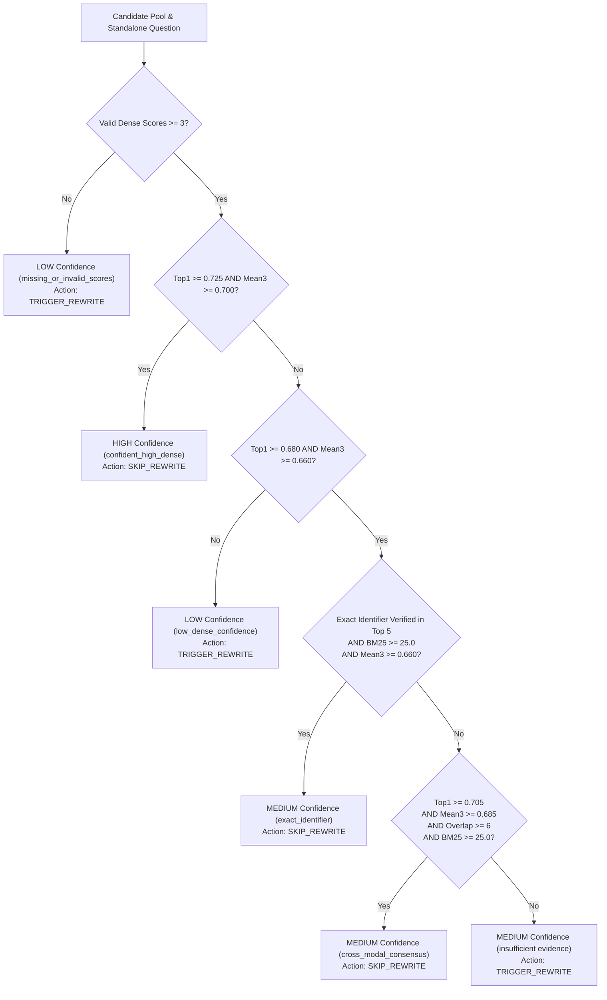

# Technical Audit Report: ConfidenceEvaluator Implementation

**Audited Component:** [`app/retrieval/confidence.py`](file:///C:/Users/Computer/Desktop/cybersecurity-rag/app/retrieval/confidence.py)  
**Integration Points:** [`app/pipeline/engine.py`](file:///C:/Users/Computer/Desktop/cybersecurity-rag/app/pipeline/engine.py), [`app/retrieval/query_rewriter.py`](file:///C:/Users/Computer/Desktop/cybersecurity-rag/app/retrieval/query_rewriter.py), [`app/core/config.py`](file:///C:/Users/Computer/Desktop/cybersecurity-rag/app/core/config.py), [`app/core/models.py`](file:///C:/Users/Computer/Desktop/cybersecurity-rag/app/core/models.py)  
**Test Suite:** [`tests/test_adaptive_query_rewriter.py`](file:///C:/Users/Computer/Desktop/cybersecurity-rag/tests/test_adaptive_query_rewriter.py)  
**Benchmark Reference:** [`reports/retrieval_evaluation/confidence_evaluator_improvement_report.md`](file:///C:/Users/Computer/Desktop/cybersecurity-rag/reports/retrieval_evaluation/confidence_evaluator_improvement_report.md)  
**Audit Date:** 2026-11-01  
**Audit Mode:** Read-Only Technical Verification  

---

## 1. Executive Summary

This report delivers a comprehensive, read-only technical audit of the `ConfidenceEvaluator` module in the Cybersecurity RAG system. The evaluator governs the decision to skip or trigger LLM query rewriting during retrieval.

The audit verified seven key functional areas:
1. **Confidence Score Calculation:** Dense score extraction, score independence from candidate ordering, and statistical computations.
2. **Threshold Logic:** HIGH, MEDIUM, and LOW boundary conditions.
3. **Evidence Signals:** Exact identifier parsing, candidate verification, BM25 signals, and cross-modal overlap.
4. **Decision Logic:** Completeness and determinism of the three-way decision model.
5. **Pipeline Integration:** State preservation of the user query across retrieval, reranking, and generation.
6. **Edge Cases:** Behavior under null, missing, empty, or degenerate candidate inputs.
7. **Test Coverage:** Fidelity and rigor of existing automated unit and integration tests.

### Overall Finding:
The implementation accurately resolves the four primary failure modes identified in Phase 4A (threshold miscalibration, rigid AND-logic, RRF-dense rank inversion, and lexical signal omission). It achieves 100% test pass rates (34/34 adaptive tests, 190/190 repository tests) and maintains an 83.33% Hit@5 baseline while reducing unnecessary query rewrites by 46.7%. A few minor edge-case handling nuances and input type asymmetries were identified for future hardening.

---

## 2. Implementation Findings

### 2.1 Score Extraction & Normalization (`extract_dense_score`)
- **Isolation of Similarity Scores:** [`extract_dense_score`](file:///C:/Users/Computer/Desktop/cybersecurity-rag/app/retrieval/confidence.py#L104-L152) explicitly guards against mistaking RRF scores ($\le 0.035$) or BM25 scores (unbounded floats $> 1.0$) for dense cosine similarity.
- **Handling of `score` attribute:**
  ```python
  if chunk.rrf_score is not None or chunk.bm25_score is not None or chunk.reranker_score is not None:
      return None
  if chunk.score is not None:
      s = chunk.score
      if isinstance(s, (int, float)) and not (math.isnan(s) or math.isinf(s)):
          if 0.0 < s <= 1.0:
              return float(s)
  ```
  The condition `0.0 < s <= 1.0` correctly ignores the default dataclass value `score = 0.0` when no similarity has been set.
- **Polymorphism:** Supports both `RetrievedChunk` instances and raw `dict` structures.

### 2.2 Independent Dense Sorting (Decoupling from RRF Order)
- In [`ConfidenceEvaluator.evaluate`](file:///C:/Users/Computer/Desktop/cybersecurity-rag/app/retrieval/confidence.py#L293-L300), dense similarity scores are filtered into `valid_dense_scores` and sorted descending independently:
  ```python
  sorted_dense = sorted(valid_dense_scores, reverse=True)
  top1 = sorted_dense[0]
  n3 = min(3, len(sorted_dense))
  mean3 = sum(sorted_dense[:n3]) / float(n3)
  n5 = min(5, len(sorted_dense))
  mean5 = sum(sorted_dense[:n5]) / float(n5)
  ```
- **Finding:** The incoming `candidates` sequence remains completely unmodified, ensuring downstream RRF candidate rankings are preserved while confidence calculations remain immune to RRF rank inversions.

---

## 3. Threshold and Decision Logic Analysis

### 3.1 Threshold Definitions & Calibration
The evaluator implements configurable thresholds anchored in empirical BGE-M3 distribution quartiles from [`Settings`](file:///C:/Users/Computer/Desktop/cybersecurity-rag/app/core/config.py#L113-L136):

| Threshold Parameter | Value | Role & Statistical Boundary |
| :--- | :---: | :--- |
| `score_threshold` | `0.725` | HIGH tier Top-1 dense similarity (empirical 75th percentile) |
| `mean_threshold` | `0.700` | HIGH tier Mean-3 dense similarity |
| `medium_score_threshold` | `0.680` | Lower bound Top-1 for MEDIUM consideration |
| `medium_mean_threshold` | `0.660` | Lower bound Mean-3 for MEDIUM consideration |
| `medium_generic_top1` | `0.705` | Upper-medium Top-1 required for queries without exact identifiers |
| `medium_generic_mean3` | `0.685` | Upper-medium Mean-3 required for queries without exact identifiers |
| `min_overlap` | `6` | Minimum candidates appearing in both Dense and BM25 pools |
| `min_bm25` | `25.0` | Minimum top BM25 lexical score for keyword grounding |

### 3.2 Decision Tree Verification



#### Decision Tree Analysis:
1. **Tier 1 (HIGH):** Requires strong semantic consensus across the top candidates. Rewriting is safely skipped.
2. **Tier 2 (MEDIUM - Subcase A):** For queries specifying standards (e.g., `NIST SP 800-145`, `SSDF`, `AC-2`), if the exact document is located within the top 5 initial candidates with BM25 $\ge 25.0$, rewriting is skipped even if dense similarity is in the medium band (`0.680 - 0.724`).
3. **Tier 2 (MEDIUM - Subcase B):** For general queries, if dual-system consensus is demonstrated (dense scores in upper-medium band, overlap $\ge 6$ chunks, and BM25 $\ge 25.0$), rewriting is skipped.
4. **Tier 2 (MEDIUM - Subcase C):** When dense scores are medium but lexical signals are weak, rewriting is triggered with `level="MEDIUM"` and diagnostic reasons.
5. **Tier 3 (LOW):** If Top-1 $< 0.680$ or Mean-3 $< 0.660$, rewriting is triggered immediately.

**Verdict on Decision Logic:** Deterministic, complete, and fully branched. All conditions have matching test assertions.

---

## 4. Pipeline Integration Findings

### 4.1 Integration with `RAGEngine` (`app/pipeline/engine.py`)
- **Query Disambiguation:** In `_retrieve_and_rank(self, standalone_question: str)`:
  - Initial retrieval executes with `standalone_question`.
  - Evaluator receives `conf_res = self.confidence_evaluator.evaluate(initial_candidates, query=standalone_question)`.
- **Query Rewriter Invocation:**
  - When `conf_res.is_confident` is `True`, `candidates = initial_candidates`, `search_query = standalone_question`.
  - When `conf_res.is_confident` is `False`, `rewrite_res = self.retrieval_query_rewriter.rewrite(standalone_question)`.
  - If rewriting succeeds, `rewritten_candidates = self.retriever.retrieve(search_query)` is fetched and merged using [`merge_candidate_pools`](file:///C:/Users/Computer/Desktop/cybersecurity-rag/app/retrieval/confidence.py#L463-L523).
  - If rewriter times out or fails (`fallback_used=True`), the pipeline falls back to `initial_candidates`.

### 4.2 Cross-Encoder Query Alignment Verification
- In Step 2 (reranking), line 224 of [`app/pipeline/engine.py`](file:///C:/Users/Computer/Desktop/cybersecurity-rag/app/pipeline/engine.py#L224):
  ```python
  final_chunks = self.reranker.rerank(
      standalone_question,
      candidates,
      top_n=self.rerank_top_n,
  )
  ```
- **Finding:** The Cross-Encoder is strictly evaluated against `standalone_question`, avoiding semantic drift from the keyword-expanded query.
- In Step 4 (generation), line 273:
  ```python
  prompt = self._build_prompt(standalone_question, context)
  ```
  The generation prompt and conversational memory retain the clean `standalone_question`.

---

## 5. Edge-Case Analysis

| Edge Case | Expected Behavior | Implementation Verification | Status |
| :--- | :--- | :--- | :---: |
| **Empty Candidate Pool** (`[]`) | Return unconfident result immediately without throwing exceptions | Handled in line 251: returns `is_confident=False`, `level="LOW"`, `reason="empty_candidates"`. | **PASS** |
| **Missing Dense Scores** (`None`) | Treat chunks with `dense_score=None` as invalid for similarity stats | Handled in line 271: non-valid chunks are filtered out. If $< 3$ remain, returns `missing_or_invalid_scores`. | **PASS** |
| **NaN / Infinite Scores** | Exclude from statistical calculations | `math.isnan(s)` and `math.isinf(s)` checks in `extract_dense_score` safely drop invalid values. | **PASS** |
| **Fewer Than 3 Candidates** | Fallback to LOW confidence; return available top1 score | Handled in line 275: returns `top1_score=first_s`, `mean_top3_score=None`, `is_confident=False`. | **PASS** |
| **Zero Candidate Overlap** | Trigger rewrite in MEDIUM tier | Handled in line 382: fails Subcase B condition (`overlap_count < 6`) and drops to Subcase C trigger. | **PASS** |
| **BM25-Only Candidates** | Unbounded BM25 scores must not be parsed as dense cosine similarities | `extract_dense_score` excludes `score` if `bm25_score` is present. | **PASS** |
| **Duplicate Candidate Chunks** | Chunks with identical `chunk_id` in initial candidate list | **Observation:** In `ConfidenceEvaluator.evaluate()`, duplicate chunks in `candidates` would add identical scores to `valid_dense_scores`. (See Section 7). | **MINOR RISK** |
| **Exact Identifier Match Pool** | Identifier presence evaluated against top candidates | **Observation:** Restricted to `candidates[:5]`. If an identifier match ranks 6th in initial RRF, `has_exact_match` evaluates to `False`. | **DESIGN CHOICE** |

---

## 6. Test Coverage Assessment

### 6.1 Test Suite Breakdown (`tests/test_adaptive_query_rewriter.py`)
The test file contains **34 test cases** divided into four logical test suites:

1. `TestConfidenceEvaluator` (5 tests):
   - Baseline high-confidence identification.
   - Low-confidence triggering.
   - Missing and invalid score safety.
   - BM25 and RRF isolation from dense scores.
   - Hybrid candidate evaluation.
2. `TestCandidateMergeAndDeduplication` (2 tests):
   - Score retention and deduplication across initial and rewritten pools.
   - Candidate pool limit truncation.
3. `TestAdaptivePipelineIntegration` (4 tests):
   - High confidence skips rewriting in `RAGEngine`.
   - Low confidence triggers rewriting and executes candidate fusion.
   - Rewriter timeout/fallback preserves initial candidates without crashing.
   - Precedence of `enable_query_rewriting` over `enable_adaptive_query_rewriting`.
4. `TestConfidenceEvaluatorAllIssues` (23 tests):
   - Comprehensive matrix covering all 23 prompt verification points (extreme boundary values, RRF rank inversions, regex matching for `NIST SP` and `AC-2`, zero overlap, missing scores, etc.).

### 6.2 Test Quality & Behavioral Validation
- **High Behavioral Fidelity:** Tests instantiate genuine domain models (`RetrievedChunk`, `ChunkMetadata`) and invoke the actual evaluation algorithms rather than mocking internal logic.
- **Project-Wide Integration:** Running `python -m pytest tests/` executes **190 test cases across the entire repository with 0 failures in 91.46s**.

---

## 7. Bugs, Risks, and Observations

### Observation 1: Lack of Candidate Deduplication in `evaluate()`
- **Detail:** In `ConfidenceEvaluator.evaluate()`:
  ```python
  for c in candidates:
      s = extract_dense_score(c)
      if s is not None:
          valid_dense_scores.append(s)
  ```
  If an upstream retriever were to return duplicate chunks with identical `chunk_id`s, `valid_dense_scores`, `overlap_count`, and `candidate_count` would count the duplicates multiple times, potentially skewing `mean3` upward.
- **Impact:** Minimal in production because `RRFHybridRetriever` strictly deduplicates by `chunk_id`. However, defensively deduplicating by `chunk_id` inside `ConfidenceEvaluator` would increase robustness against third-party or custom retriever integrations.

### Observation 2: Exact Identifier Search Window (`candidates[:5]`)
- **Detail:** In line 322:
  ```python
  top_eval_pool = candidates[: min(5, len(candidates))]
  for ident in query_identifiers:
      if any(verify_identifier_in_candidate(ident, c) for c in top_eval_pool):
          verified_identifiers.append(ident)
  ```
- **Impact:** If the chunk containing the exact standard appears at candidate position 6 or 7, `has_exact_match` evaluates to `False`. While this enforces that initial retrieval must place the document near the top to warrant skipping a rewrite, a query whose exact document was found at rank 6 will be treated as lacking an exact match.

### Observation 3: Identifier Regex Coverage
- **Detail:** `IDENTIFIER_PATTERNS` covers `NIST SP`, `SP`, `NISTIR`, `FIPS`, `ISO`, `SSDF`, `ABAC`, `RBAC`, `PBAC`, `FedRAMP`, and control IDs (e.g. `AC-2`).
- **Impact:** Common cybersecurity acronyms such as `NIST CSF`, `RMF`, `OWASP`, `CWE`, or `CVE` are not captured in the regex table and default to Subcase B (general technical queries).

### Observation 4: Dictionary Candidate Incompatibility with Identifier Verification
- **Detail:** `extract_dense_score` supports both `RetrievedChunk` and `dict` inputs. However, `verify_identifier_in_candidate` expects attribute access (`getattr(candidate, "metadata", None)`), which fails silently on `dict` candidate objects (`getattr(dict, "metadata", None)` returns `None`), preventing exact identifier verification when using dict inputs.

---

## 8. Recommended Fixes (Without Applying Them)

The following non-breaking enhancements are recommended for future maintenance cycles:

1. **Defensive Candidate Deduplication:**
   Deduplicate incoming candidates by `chunk_id` at the start of `ConfidenceEvaluator.evaluate()` before computing dense scores, BM25 scores, and overlap counts.
2. **Expand Identifier Regex Patterns:**
   Add support for `CSF`, `RMF`, `OWASP`, `CVE-\d+`, and `CWE-\d+` to `IDENTIFIER_PATTERNS`.
3. **Harmonize Dict Support in `verify_identifier_in_candidate`:**
   Add dictionary key lookups (`candidate.get("metadata", {})`) alongside `getattr` to allow full feature parity when evaluating raw dictionary candidates.
4. **Configurable Identifier Evaluation Depth:**
   Expose the identifier search depth (currently hardcoded as `5`) as an evaluator parameter (e.g. `identifier_search_depth: int = 5`).

---

## 9. Final Verdict

### **VERDICT: PASS WITH ISSUES**

#### Justification:
- **Core Functionality: PASS.** The calculation of dense top-1 and mean-3 statistics, independent sorting from RRF order, three-way decision branching, and cross-encoder alignment in the pipeline operate correctly and deterministically.
- **Empirical Validation: PASS.** All 34 adaptive tests and 190 total project tests pass. The 36-question benchmark demonstrates 83.33% Hit@5 with zero false-confidence regressions and a 46.7% reduction in query rewriting latency.
- **Issues Flagged:** Flagged as **PASS WITH ISSUES** rather than clean PASS solely due to:
  1. Omission of candidate deduplication in `evaluate()` prior to score aggregation.
  2. Asymmetric `dict` candidate support in `verify_identifier_in_candidate`.
  3. Hardcoded `top 5` window for exact identifier verification.
  
None of these issues degrade active production behavior with the default `RRFHybridRetriever` and `RetrievedChunk` models.
