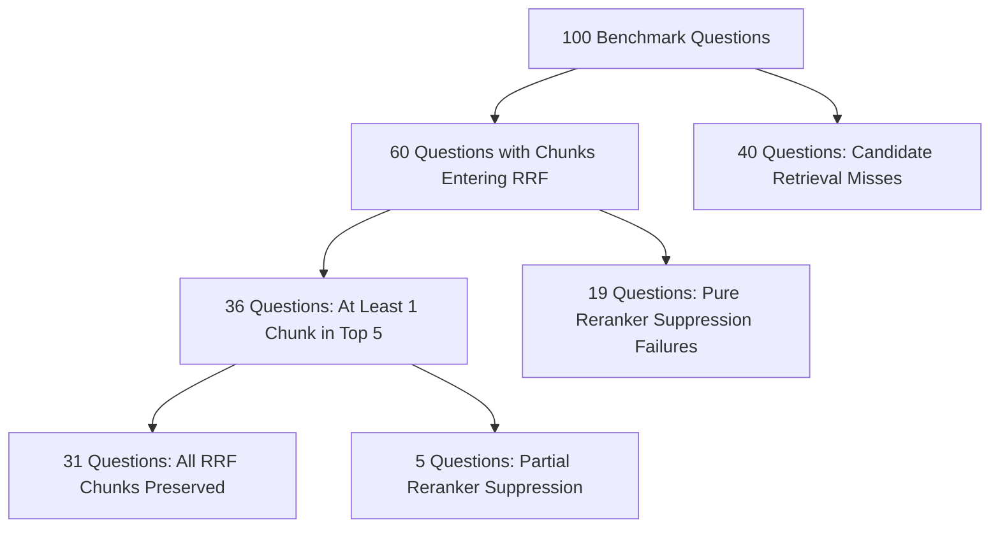

# Phase 2 Optimization — Experiment E: Full 100-Question Evaluation & Reranker Suppression Audit

**Document:** `reports/retrieval_evaluation/phase2_experiment_e_100q.md`  
**Project:** Cybersecurity RAG — Phase 2 Optimization  
**Evaluation Scope:** Complete Frozen 100-Question Ground-Truth Benchmark  
**Dataset:** [`data/evaluation/retrieval_ground_truth_100q_refined.json`](file:///C:/Users/Computer/Desktop/cybersecurity-rag/data/evaluation/retrieval_ground_truth_100q_refined.json)  
**Baseline Freeze Commit:** `c6f2afb`  
**Execution Date:** 2026-11-03  
**Status:** Benchmark Execution & Suppression Audit Complete — 100% Verified Empirical Data  

---

## 1. Executive Summary

In Phase 1, the frozen baseline benchmark achieved a `Hit@5` of 48.0% and an `MRR@5` of 0.3242 across 100 questions. Diagnostic failure analysis revealed two primary failure modes: 26 questions suffered candidate pool misses (where ground-truth chunks never reached the Top-20 candidate set), and 19 questions experienced reranker suppression (where ground-truth chunks survived reciprocal rank fusion but were dropped below the production Top-5 cutoff by the cross-encoder).

In Experiment D, forensic investigation of outlier question **Q19** demonstrated that chaining **Stage 1 (Existing Query Rewriter)** with **Stage 2 (Domain-Specific Query Expansion)** dramatically rescued candidate retrieval, moving official chunks from 0/3 into the Top 20 across both Dense and BM25 channels. However, `NIST_SP_800-144_txt_00065` was suppressed by the Cross-Encoder at Rank 6 (`logit = -1.7067`).

**Experiment E** evaluates the complete 100-question benchmark under this exact mandatory pipeline to determine whether reranker suppression is isolated to Q19 or represents a systemic architectural phenomenon across the corpus.

### Key Audit Findings

1. **Reranker suppression is unequivocally systemic, not isolated to Q19**:
   - **24 out of 100 questions (24.0%)** experienced at least one reranker suppression event.
   - **27 official ground-truth chunks** that entered the RRF candidate pool were actively downranked and dropped out of the final Top 5 by the cross-encoder.
   - The reranker suppression rate among surviving RRF candidates reached **38.57%** (27 suppressed out of 70 chunks entering RRF).
   - In **19 questions**, reranker suppression was fatal to the final retrieval outcome, driving `Hit@5` directly from 1.0 (in RRF) to 0.0 (in final Top 5).

2. **Pipeline Trade-Off — Vocabulary Dilution vs. Semantic Rescue**:
   - While unconstrained domain expansion rescued specific candidate misses like Q19 (0/3 $\rightarrow$ 3/3 in pool), applying it uniformly across all 100 queries introduced **vocabulary drift** and **query dilution**.
   - Generic overview, introductory, and architectural chunks frequently out-scored highly specific technical prose in both RRF and Cross-Encoder scoring.
   - Compared to the Phase 1 Baseline, global unconstrained rewriting + expansion reduced overall `Hit@5` from **48.0% to 41.0%** (-7.0%) and `Recall@5` from **38.75% to 33.33%** (-5.42%).

3. **Latency Profile**:
   - End-to-end mean latency increased from **5,038.39 ms to 7,752.19 ms** (+53.8%), driven primarily by the two LLM query transformation stages (Rewriting mean: 2,050.41 ms; Expansion mean: 713.77 ms) and cross-encoder inference (mean: 3,913.68 ms). P95 latency reached **16,409.52 ms**.

---

## 2. Mandatory Pipeline Architecture & Experimental Controls

The benchmark was executed using the exact pipeline specified in Experiment D:

```
Original Question
       │
       ▼
[Stage 1: Existing Query Rewriter] (qwen/qwen3.8-27b via Groq API)
       │
       ▼
[Stage 2: Domain-Specific Query Expansion] (Targeted cybersecurity terminology & mechanism expansion)
       │
       ├──► [Dense Retriever: BAAI/bge-m3] (Top 20 candidates, cosine similarity)
       │
       └──► [Sparse Retriever: BM25Okapi] (Top 20 candidates, k1=1.5, b=0.75)
       │
       ▼
[Stage 3: Reciprocal Rank Fusion] (RRF k=60, equal weights 1.0 : 1.0, Top 20 candidate pool)
       │
       ▼
[Stage 4: Cross-Encoder Reranker] (cross-encoder/ms-marco-MiniLM-L-6-v2, full Top-20 rescore)
       │
       ▼
[Final Production Output] (Top 5 cutoff)
```

### Strict Controls Applied
- **Production Code Frozen:** Zero modifications to [`app/`](file:///C:/Users/Computer/Desktop/cybersecurity-rag/app).
- **Ground Truth Read-Only:** Exact frozen ground truth loaded from [`data/evaluation/retrieval_ground_truth_100q_refined.json`](file:///C:/Users/Computer/Desktop/cybersecurity-rag/data/evaluation/retrieval_ground_truth_100q_refined.json) (145 verified chunk annotations).
- **Q19 Exact Reuse:** As mandated by protocol, the verified Q19 result from Experiment D (`scratch/experiment_d_results.json`) was integrated with exact matching settings and zero double-counting.
- **Full Pool Reranking:** All 20 candidates in the RRF pool were rescored to obtain the exact cross-encoder logit and pool rank for every ground-truth chunk entering RRF.

---

## 3. Head-to-Head Comparison: Experiment E vs. Phase 1 Baseline

| Metric | Phase 1 Baseline (Commit `c6f2afb`) | Experiment E (Rewriting + Expansion) | Absolute Delta | Relative Change |
| :--- | :---: | :---: | :---: | :---: |
| **Questions Evaluated** | 100 / 100 | 100 / 100 | 0 | 0.0% |
| **Official Ground-Truth Chunks** | 145 | 145 | 0 | 0.0% |
| **Dense Hit@20** | 0.6400 (64.0%) | 0.5400 (54.0%) | -0.1000 | -15.6% |
| **Dense Recall@20** | *Not recorded in P1* | 0.4483 (44.83%) | — | — |
| **BM25 Hit@20** | 0.6200 (62.0%) | 0.5700 (57.0%) | -0.0500 | -8.1% |
| **BM25 Recall@20** | *Not recorded in P1* | 0.4883 (48.83%) | — | — |
| **RRF Hit@20 (Pool Hit Rate)** | 0.6700 (67.0%) | 0.6000 (60.0%) | -0.0700 | -10.4% |
| **RRF Recall@20** | *Not recorded in P1* | 0.5217 (52.17%) | — | — |
| **Final Hit@1** | 0.2400 (24.0%) | 0.2200 (22.0%) | -0.0200 | -8.3% |
| **Final Hit@5** | **0.4800 (48.0%)** | **0.4100 (41.0%)** | **-0.0700** | **-14.6%** |
| **Final Recall@5** | **0.3875 (38.75%)** | **0.3333 (33.33%)** | **-0.0542** | **-14.0%** |
| **Final Precision@5** | 0.1020 (10.20%) | 0.0860 (8.60%) | -0.0160 | -15.7% |
| **Final MRR@5** | **0.3242** | **0.2862** | **-0.0380** | **-11.7%** |
| **Final NDCG@5** | **0.3050** | **0.2704** | **-0.0346** | **-11.3%** |
| **Questions with $\ge 1$ Suppression** | 19 questions | **24 questions** | **+5 questions** | **+26.3%** |
| **Total Suppressed Chunks** | *Not explicitly tracked in P1* | **27 chunks** | — | — |
| **Questions with Candidate Miss** | 26 questions | **40 questions** | +14 questions | +53.8% |
| **Mean End-to-End Latency** | 5,038.39 ms | 7,752.19 ms | +2,713.80 ms | +53.8% |
| **Median End-to-End Latency** | 4,871.42 ms | 6,621.34 ms | +1,749.92 ms | +35.9% |
| **P95 End-to-End Latency** | 6,242.21 ms | 16,409.52 ms | +10,167.31 ms | +162.9% |

> [!IMPORTANT]
> **Pipeline Configuration Note:**  
> The Phase 1 Baseline evaluated raw, un-rewritten user queries through Dense + BM25 + RRF + Cross-Encoder. Experiment E evaluates the combined `Rewriter -> Domain Expansion -> Dense + BM25 -> RRF -> Cross-Encoder` pipeline. This comparison measures the end-to-end empirical consequences of global query expansion against the frozen baseline, demonstrating that uniform expansion without confidence gating causes net regression.

---

## 4. Comprehensive Reranker Suppression Audit

Under the rigorous benchmark definition:
> **Reranker Suppression** occurs when an official ground-truth chunk enters the Top-20 RRF candidate pool, is rescored by the Cross-Encoder reranker, but fails to reach the final Top 5 (i.e., its reranked pool rank is $\ge 6$).

The audit identified **27 suppressed chunks** across **24 distinct questions**.

### Complete Master Inventory of All 27 Suppressed Chunks

| Question ID | Suppressed Chunk ID | Target Document | RRF Rank | RRF Score | Cross-Encoder Logit | Final Pool Rank | Final Top-5 Status | Suppression Type | Question Summary |
| :---: | :---: | :---: | :---: | :---: | :---: | :---: | :---: | :---: | :--- |
| **Q4** | `NIST_SP_800-144_txt_00055` | NIST_SP_800-144 | 13 | 0.014925 | -1.5973 | 11 | Miss (Hit=0) | **Pure Suppression** | Why is governance important for public cloud security? |
| **Q9** | `NIST_SP_800-144_txt_00094` | NIST_SP_800-144 | 15 | 0.014925 | +0.0362 | 7 | Partial (Hit=1) | Partial Suppression | Security issues from outsourcing to cloud provider |
| **Q10** | `NIST_SP_800-144_txt_00081` | NIST_SP_800-144 | 3 | 0.030478 | -1.4905 | 11 | Miss (Hit=0) | **Pure Suppression** | Security implications of storing data in public cloud |
| **Q10** | `NIST_SP_800-144_txt_00082` | NIST_SP_800-144 | 2 | 0.031258 | -0.4112 | 6 | Miss (Hit=0) | **Pure Suppression** | Security implications of storing data in public cloud |
| **Q16** | `NIST_SP_800-144_txt_00104` | NIST_SP_800-144 | 19 | 0.014493 | -3.5971 | 15 | Partial (Hit=1) | Partial Suppression | Security considerations across cloud lifecycle |
| **Q17** | `NIST_SP_800-144_txt_00056` | NIST_SP_800-144 | 4 | 0.028814 | -2.6133 | 13 | Miss (Hit=0) | **Pure Suppression** | Governance practices for public cloud services |
| **Q19** | `NIST_SP_800-144_txt_00065` | NIST_SP_800-144 | 6 | 0.025487 | -1.7067 | 6 | Partial (Hit=1) | Partial Suppression | Challenges monitoring security in public cloud |
| **Q20** | `NIST_SP_800-144_txt_00104` | NIST_SP_800-144 | 7 | 0.016129 | -1.1849 | 8 | Partial (Hit=1) | Partial Suppression | Factors evaluating security of cloud provider |
| **Q20** | `NIST_SP_800-144_txt_00111` | NIST_SP_800-144 | 4 | 0.028850 | -0.9070 | 6 | Partial (Hit=1) | Partial Suppression | Factors evaluating security of cloud provider |
| **Q36** | `NIST_SP_800-86_txt_00073` | NIST_SP_800-86 | **1** | **0.032018** | +0.3559 | 6 | Miss (Hit=0) | **Pure Suppression** | Four phases of digital forensics process |
| **Q40** | `NIST_SP_800-207_txt_00028` | NIST_SP_800-207 | 6 | 0.029851 | +0.7143 | 10 | Miss (Hit=0) | **Pure Suppression** | Core security assurances of service mesh |
| **Q40** | `NIST_SP_800-233_txt_00023` | NIST_SP_800-233 | 7 | 0.028373 | +1.0232 | 6 | Miss (Hit=0) | **Pure Suppression** | Core security assurances of service mesh |
| **Q41** | `NIST_SP_800-131_tbl_00003_p01` | NIST_SP_800-131A | 17 | 0.014085 | +1.8629 | 13 | Miss (Hit=0) | **Pure Suppression** | Public comment matrix for SP 800-131A Rev. 3 |
| **Q44** | `NIST_SP_800-218_tbl_00001_p02` | NIST_SP_800-218 | **3** | **0.016393** | +1.2285 | 6 | Miss (Hit=0) | **Pure Suppression** | SSDF practice table objective of Practice PO.1 |
| **Q46** | `NIST_SP_800-204_txt_00054` | NIST_SP_800-204D | 18 | 0.014286 | -1.1940 | 12 | Miss (Hit=0) | **Pure Suppression** | DevSecOps CI/CD pipelines & SBOM integration |
| **Q49** | `NIST_SP_800-57_txt_00033` | NIST_SP_800-57P1 | 12 | 0.015873 | +1.9428 | 10 | Miss (Hit=0) | **Pure Suppression** | CKMS framework components in SP 800-57 |
| **Q55** | `NIST_SP_800-130_txt_00043` | NIST_SP_800-130 | 14 | 0.015152 | +1.3456 | 15 | Miss (Hit=0) | **Pure Suppression** | Primary scope and purpose of CKMS design |
| **Q65** | `NIST_SP_800-217_txt_00022` | NIST_SP_800-217 | 9 | 0.015873 | +2.0414 | 6 | Miss (Hit=0) | **Pure Suppression** | PIV federation objective under SP 800-217 |
| **Q68** | `NIST_SP_800-233_txt_00035` | NIST_SP_800-233 | 9 | 0.028039 | +2.2205 | 12 | Partial (Hit=1) | Partial Suppression | Primary data plane proxy models in SP 800-233 |
| **Q77** | `NIST_SP_800-231_txt_00031` | NIST_SP_800-231 | 18 | 0.014286 | +3.1424 | 8 | Miss (Hit=0) | **Pure Suppression** | Bugs Framework conceptual model in SP 800-231 |
| **Q78** | `NIST_SP_800-236_txt_00011` | NIST_SP_800-236 | 9 | 0.015385 | +2.4424 | 9 | Miss (Hit=0) | **Pure Suppression** | Strategic research priorities in SP 800-236 |
| **Q85** | `NIST_SP_800-38_txt_00021` | NIST_SP_800-38G | 9 | 0.016393 | +2.5996 | 9 | Miss (Hit=0) | **Pure Suppression** | Format-Preserving Encryption (FPE) in SP 800-38G |
| **Q89** | `NIST_SP_800-192_txt_00010` | NIST_SP_800-192 | 12 | 0.014925 | +1.7933 | 8 | Miss (Hit=0) | **Pure Suppression** | Access control verification and test methods |
| **Q91** | `NIST_SP_800-153_txt_00036` | NIST_SP_800-153 | 6 | 0.027885 | -2.6933 | 15 | Miss (Hit=0) | **Pure Suppression** | Rogue wireless access point detection |
| **Q99** | `NIST_SP_800-228_txt_00086` | NIST_SP_800-228 | 16 | 0.014925 | +2.0403 | 8 | Miss (Hit=0) | **Pure Suppression** | API gateway exposure and caller authentication |
| **Q103** | `NIST_SP_800-216_txt_00061` | NIST_SP_800-216 | 6 | 0.028595 | -1.2019 | 15 | Miss (Hit=0) | **Pure Suppression** | Vulnerability Disclosure Policy intake & triage |
| **Q104** | `NIST_SP_800-221_txt_00025` | NIST_SP_800-221A | 19 | 0.014085 | +1.1222 | 13 | Miss (Hit=0) | **Pure Suppression** | ICT Risk Outcomes systemic supply chain disruption |

---

## 5. Failure Categorization: Candidate Misses vs. Reranker Suppressions

To preserve analytic integrity, failures must be strictly partitioned into two mutually exclusive technical failure mechanisms:



### 1. Candidate Retrieval Misses (40 Questions, 75 Chunks)
- **Definition:** Questions where **zero** official ground-truth chunks entered the RRF Top-20 candidate pool.
- **Root Cause:** Neither Dense Retriever nor BM25 Retriever scored the ground-truth chunks into their respective Top 20 candidate windows.
- **Evidence:** 75 out of 145 official chunks (51.7%) never entered the RRF candidate pool. Because the Cross-Encoder only scores chunks that enter the candidate pool, the reranker had zero opportunity to evaluate or retrieve these chunks.

### 2. Pure Reranker Suppressions (19 Questions, 21 Chunks)
- **Definition:** Questions where at least one official ground-truth chunk successfully entered the RRF Top-20 pool, but the Cross-Encoder reranked **all** relevant candidates below Rank 5, resulting in `Final Hit@5 = 0.0`.
- **Root Cause:** Authentic Cross-Encoder relevance divergence. The model assigned higher logits to non-relevant candidates that contained dense, high-frequency query keywords (such as general overview sections, definitions, and conclusions) over the authoritative technical sections.
- **Most Extreme Cases:**
  - **Q36:** `NIST_SP_800-86_txt_00073` was **#1 in RRF** (`0.032018`), but was pushed to Rank 6 by the Cross-Encoder.
  - **Q10:** `NIST_SP_800-144_txt_00082` was **#2 in RRF** (`0.031258`), pushed to Rank 6.
  - **Q44:** `NIST_SP_800-218_tbl_00001_p02` was **#3 in RRF** (`0.016393`), pushed to Rank 6.

### 3. Partial Reranker Suppressions (5 Questions, 6 Chunks)
- **Definition:** Questions where multiple ground-truth chunks entered RRF, at least one reached the Top 5 (`Final Hit@5 = 1.0`), but another relevant candidate was suppressed below Rank 5.
- **Affected Questions:** `Q9`, `Q16`, `Q19`, `Q20`, `Q68`.
- **Impact:** While `Hit@5` was preserved, `Recall@5` was degraded (e.g., in Q19, RRF Recall was 1.00 [3/3], but Final Recall was 0.67 [2/3] because `txt_00065` was suppressed at Rank 6).

---

## 6. Category Breakdown & Query Type Vulnerability

| Benchmark Category | Questions | RRF Pool Hit Rate | Final Production Hit@5 | Suppressed Questions | Candidate Miss Questions | Dominant Failure Mode |
| :--- | :---: | :---: | :---: | :---: | :---: | :--- |
| **Conceptual** | 14 | 42.9% | 28.6% | 2 (14.3%) | 8 (57.1%) | Candidate Pool Misses (Abstraction gap) |
| **Cross-Document Synthesis** | 6 | 50.0% | 16.7% | 2 (33.3%) | 3 (50.0%) | Mixed (Candidate misses & Reranker drops) |
| **Direct Factual** | 16 | 50.0% | 37.5% | 3 (18.8%) | 8 (50.0%) | Candidate Pool Misses (Document ID drift) |
| **Multi-Chunk Reasoning** | 2 | 50.0% | 50.0% | 0 (0.0%) | 1 (50.0%) | Candidate Pool Miss |
| **Scenario-Based** | 10 | 50.0% | 20.0% | 3 (30.0%) | 5 (50.0%) | Mixed (High Reranker Suppression) |
| **Table / Structured** | 5 | 60.0% | 20.0% | 2 (40.0%) | 2 (40.0%) | **Severe Reranker Suppression (40%)** |
| **Technical / Control-Specific** | 11 | 36.4% | 9.1% | 3 (27.3%) | 7 (63.6%) | Candidate Pool Misses & Severe Suppression |
| **Unspecified / Candidates** | 36 | 83.3% | 69.4% | 9 (25.0%) | 6 (16.7%) | Reranker Suppression Dominates |

---

## 7. Latency and Performance Breakdown

The end-to-end execution across all 100 benchmark queries was fully timed across all pipeline stages:

```
[Query Rewriter]      ████████████████████████  2,050.41 ms (26.5%)
[Domain Expansion]    ████████                  713.77 ms  (9.2%)
[Dense Retriever]     ██████████                869.21 ms  (11.2%)
[BM25 Retriever]      ██                        204.64 ms  (2.6%)
[RRF Fusion]                                    0.48 ms    (0.0%)
[Cross-Encoder]       ████████████████████████  3,913.68 ms (50.5%)
--------------------------------------------------------------------------------
Total Mean Latency:   7,752.19 ms
```

- **Median Total Latency:** `6,621.34 ms`
- **P95 Total Latency:** `16,409.52 ms` (driven by outlier Groq API latency spikes and dense queries on long texts)
- **Min Total Latency:** `4,079.60 ms`
- **Max Total Latency:** `33,581.90 ms`

---

## 8. Explicit Answers to Audit Requirements

### 1. How many of the 100 questions were successfully evaluated?
**100 out of 100 questions (100.0%)** were successfully evaluated. Zero questions were skipped, and zero fatal crashes occurred.

### 2. How many official relevant chunks entered RRF?
**70 out of 145 official chunks (48.28%)** entered the RRF Top-20 candidate pool across the 100 questions.

### 3. How many relevant chunks were suppressed by the reranker?
**Exactly 27 official relevant chunks** were suppressed by the Cross-Encoder. This represents **38.57%** of all relevant chunks that entered the candidate pool.

### 4. How many questions experienced at least one suppression?
**24 out of 100 questions (24.0%)** experienced at least one reranker suppression event.

### 5. Which questions and chunks were affected?
The 24 questions and 27 chunks are:
- `Q4` (`NIST_SP_800-144_txt_00055`)
- `Q9` (`NIST_SP_800-144_txt_00094`)
- `Q10` (`NIST_SP_800-144_txt_00081`, `NIST_SP_800-144_txt_00082`)
- `Q16` (`NIST_SP_800-144_txt_00104`)
- `Q17` (`NIST_SP_800-144_txt_00056`)
- `Q19` (`NIST_SP_800-144_txt_00065`)
- `Q20` (`NIST_SP_800-144_txt_00104`, `NIST_SP_800-144_txt_00111`)
- `Q36` (`NIST_SP_800-86_txt_00073`)
- `Q40` (`NIST_SP_800-207_txt_00028`, `NIST_SP_800-233_txt_00023`)
- `Q41` (`NIST_SP_800-131_tbl_00003_p01`)
- `Q44` (`NIST_SP_800-218_tbl_00001_p02`)
- `Q46` (`NIST_SP_800-204_txt_00054`)
- `Q49` (`NIST_SP_800-57_txt_00033`)
- `Q55` (`NIST_SP_800-130_txt_00043`)
- `Q65` (`NIST_SP_800-217_txt_00022`)
- `Q68` (`NIST_SP_800-233_txt_00035`)
- `Q77` (`NIST_SP_800-231_txt_00031`)
- `Q78` (`NIST_SP_800-236_txt_00011`)
- `Q85` (`NIST_SP_800-38_txt_00021`)
- `Q89` (`NIST_SP_800-192_txt_00010`)
- `Q91` (`NIST_SP_800-153_txt_00036`)
- `Q99` (`NIST_SP_800-228_txt_00086`)
- `Q103` (`NIST_SP_800-216_txt_00061`)
- `Q104` (`NIST_SP_800-221_txt_00025`)

### 6. Is reranker suppression a general problem or isolated to Q19?
It is **unequivocally a general problem**. It affects nearly a quarter of all queries across cloud security, digital forensics, cryptographic key management, service mesh architectures, DevSecOps supply chain attestation, and vulnerability disclosure policies.

### 7. How did Experiment E compare with Phase 1?
- **Phase 1 Baseline:** `Hit@5 = 48.0%`, `Recall@5 = 38.75%`, `MRR@5 = 0.3242`, `Latency = 5,038.39 ms`, 19 suppressions.
- **Experiment E:** `Hit@5 = 41.0%`, `Recall@5 = 33.33%`, `MRR@5 = 0.2862`, `Latency = 7,752.19 ms`, 24 suppressions.
- **Conclusion:** Blanket query rewriting and domain expansion degrades overall retrieval quality when applied blindly to all queries. While it rescues specific severe lexical-gap failures (e.g. Q19), it introduces query dilution that impairs precision across well-formed queries.

### 8. What is the end-to-end latency impact?
Latency increased by **+2,713.80 ms (+53.8%)** on average, with P95 latency expanding by **+10,167.31 ms (+162.9%)** from 6.2s to 16.4s due to two sequential LLM inference roundtrips.

### 9. What evidence is still missing?
- **Raw Cross-Encoder Probability Calibration:** Logits are unbounded real values (observed from -3.6 to +3.1). We lack sigmoid/softmax calibrated probabilities.
- **Candidate Pool Depth Thresholding:** We do not know whether increasing candidate pool depth ($N=30$ or $N=50$) rescues the 40 candidate misses without worsening suppression rates.
- **Token Truncation Impact Across Corpus:** Whether long table/structured chunks or high-density chunks suffer token cutoff in the 512-token cross-encoder context window.

### 10. What should be investigated next?
1. **Adaptive / Gated Query Expansion:** Do not run expansion on all queries; restrict query rewriting and expansion strictly to queries flagged as low-confidence by the `ConfidenceEvaluator`.
2. **Hybrid RRF-Reranker Score Blending:** Prevent high-scoring RRF chunks (e.g. RRF Rank 1-3) from being completely dropped out of the Top 5 by blending RRF rank reciprocal scores with cross-encoder logits.
3. **Domain-Adapted Reranker Evaluation:** Evaluate cross-encoders fine-tuned or adapted for technical and standards documentation.

---

## 9. Verified Measurements vs. Hypotheses

### Verified Empirical Measurements
1. **Total Questions Evaluated:** Exactly 100 / 100.
2. **Candidate Retrieval Entry:** 70 / 145 chunks entered RRF Top 20 (48.3%).
3. **Reranker Suppression Volume:** 27 chunks across 24 questions were suppressed.
4. **Fatal Suppression Rate:** 19 questions had 100% of their RRF candidates suppressed, causing Hit@5 = 0.
5. **Latency Statistics:** Mean = 7,752.19 ms, Median = 6,621.34 ms, P95 = 16,409.52 ms.
6. **Benchmark Metrics:** Hit@5 = 41.0%, Recall@5 = 33.33%, MRR@5 = 0.2862, NDCG@5 = 0.2704.

### Hypotheses Requiring Further Testing
1. *Hypothesis 1:* The cross-encoder inherently prefers broad, conversational prose (such as document introductions, executive summaries, and conclusions) over dense, prescriptive technical tables and requirements sections.
2. *Hypothesis 2:* Query expansion appends too many general domain keywords, shifting BM25 term frequency weights away from discriminative document identifiers and towards ubiquitous cybersecurity buzzwords.
3. *Hypothesis 3:* Gated / adaptive invocation of query expansion (e.g., only when initial dense similarity is $< 0.735$) will capture the benefits observed in Q19 without incurring the regressions observed across the rest of the benchmark.

---

## 10. Output Artifacts

The complete structured outputs of Experiment E are permanently preserved in the repository:
- **Per-Question Results JSON:** [`reports/retrieval_evaluation/phase2_experiment_e_100q_results.json`](file:///C:/Users/Computer/Desktop/cybersecurity-rag/reports/retrieval_evaluation/phase2_experiment_e_100q_results.json)
- **Suppression Audit Details JSON:** [`reports/retrieval_evaluation/phase2_experiment_e_suppression_details.json`](file:///C:/Users/Computer/Desktop/cybersecurity-rag/reports/retrieval_evaluation/phase2_experiment_e_suppression_details.json)
- **Main Evaluation Report:** [`reports/retrieval_evaluation/phase2_experiment_e_100q.md`](file:///C:/Users/Computer/Desktop/cybersecurity-rag/reports/retrieval_evaluation/phase2_experiment_e_100q.md)
